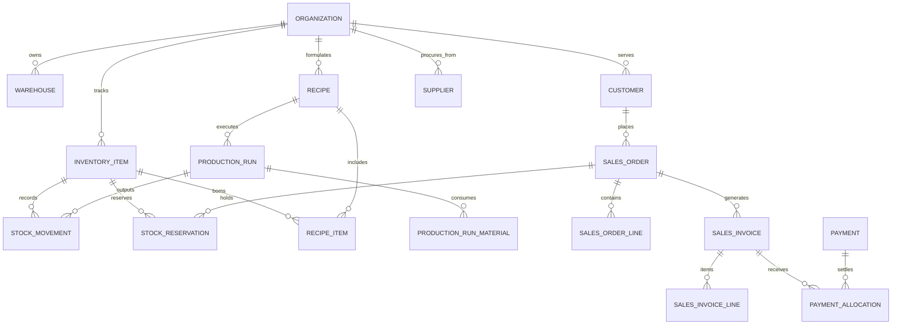

# MillLedger Architecture and Design Note

MillLedger is an enterprise resource planning and shop floor ledger system tailored for food manufacturing mills. This design note details the foundational data architecture, inventory ledgering, batch production costing, GST compliance, and concurrency guarantees that govern the platform.



## 1. Stock Ledger and Available to Promise (ATP)

Direct overwriting of inventory balances is strictly prohibited. Inventory balances are driven exclusively by immutable, traceable stock ledger entries:

```text
Physical Stock = Opening Stock + Sum(PURCHASE_RECEIPT) + Sum(PRODUCTION_OUTPUT)
                 - Sum(PRODUCTION_CONSUMPTION) - Sum(SALES_DISPATCH) + Sum(ADJUSTMENTS)

Available to Promise (ATP) = Physical Stock - Sum(Active RESERVED Stock)
```

### Transaction Isolation and Concurrency

- **Row Level Locking**: All reservation, production, and dispatch operations acquire `SELECT ... FOR UPDATE` locks on the targeted `InventoryItem` records within a PostgreSQL serializable or repeatable read transaction.
- **Atomic Two Phase Fulfilment**: When an admin approves an order, stock is immediately moved to `RESERVED` status. Physical inventory remains unchanged until dispatch. Upon dispatch, physical stock decrements while reservations are released in the same database transaction.
- **Shortage Enforcement**: Orders with demand exceeding available stock cannot transition to approved status. Distributor B's order for 120 packets against 88 available packets is rejected by the server with a 400 Insufficient Stock response and held in draft status with an explicit shortage alert.

## 2. Bill of Materials (BOM) and Production Mechanics

Production runs are executed from versioned recipes specifying standard batch sizes, expected outputs, component quantities, and tolerance thresholds.

### Yield and Variance Formulations

```text
Planned Component Qty = Recipe Planned Qty x Batch Count
Consumption Variance Qty = Actual Consumed Qty - Planned Component Qty
Consumption Variance Pct = (Consumption Variance Qty / Planned Component Qty) x 100
Yield Variance Qty = Actual Good Output - Expected Good Output
Yield Variance Pct = (Yield Variance Qty / Expected Good Output) x 100
```

### Benchmark Run Breakdown

- **Output**: 188 good packets from an expected 200 packets produces a -6% yield variance, which triggers a high priority audit alert.
- **Oil Usage**: Consuming 10.5 L against a 10.0 L baseline produces a +5% consumption variance, which reaches the configured tolerance threshold and is flagged for review.
- **Pouch Consumption**: 194 pouches consumed (188 good packets plus 6 damaged packets) are deducted from inventory while tracking the 6 damaged units separately.
- **Carton Warning**: Consuming 9 cartons surfaces a non blocking operator warning that 9 cartons pack 180 packets (at 20 packets per carton) whereas 188 good packets were manufactured.

## 3. Costing and Inventory Valuation

MillLedger uses a perpetual moving weighted average cost method:

```text
New Average Cost = (Prior Stock Value + Inbound Purchase Value) / (Prior Stock Qty + Inbound Purchase Qty)
```

- **Purchase Adjustment**: Purchasing 60 kg of flour at ₹45.00/kg with 100 kg on hand at ₹42.00/kg yields an exact weighted average cost of ₹43.125/kg:
  ```text
  ((100 x 42) + (60 x 45)) / (100 + 60) = (4200 + 2700) / 160 = 6900 / 160 = ₹43.125 / kg
  ```
- **Batch Costing**: Total production run cost aggregates consumed raw materials at their captured moving weighted average cost, packaging materials, direct labor, and utilities:
  ```text
  Flour: 40 kg x ₹43.125 = ₹1,725.00
  Oil: 10.5 L x ₹140.00 = ₹1,470.00
  Spice Mix: 1.2 kg x ₹200.00 = ₹240.00
  Pouches: 194 pcs x ₹2.50 = ₹485.00
  Cartons: 9 pcs x ₹15.00 = ₹135.00
  Direct Labor: ₹1,200.00
  Utilities: ₹600.00
  Total Production Run Cost = ₹5,855.00
  Cost Per Good Packet = ₹5,855.00 / 188 packets = ₹31.143617 ≈ ₹31.14
  ```

## 4. Sales Order to Cash and GST Calculation

Tax computation complies with statutory Indian GST rules based on customer place of supply:

- **Intra State (Tamil Nadu)**: Tax splits into CGST 2.5% and SGST 2.5%.
  Retailer A: 150 packets at ₹50.00 = ₹7,500.00 taxable. CGST ₹187.50, SGST ₹187.50, Total invoice ₹7,875.00.
- **Inter State (Karnataka)**: Tax applies as IGST 5.0%.
- **Payment Settling**: Partial payments allocate against invoices using First In First Out (FIFO) logic. Recording a ₹4,000.00 receipt leaves an exact outstanding balance of ₹3,875.00 on Retailer A's invoice.

## 5. Security, ABAC, and Offline Resilience

- **Authorization**: Express 5 middleware enforces strict Role Based (RBAC) and Attribute Based Access Controls (ABAC). Salesmen are restricted to their assigned customer territories. Floor operators can only record production runs.
- **Offline Outbox**: Sales orders captured in poor network conditions persist to Dexie IndexedDB. Each order carries a client generated UUID idempotency key. Upon network reconnection, transactions replay safely without risk of duplicate submission.
