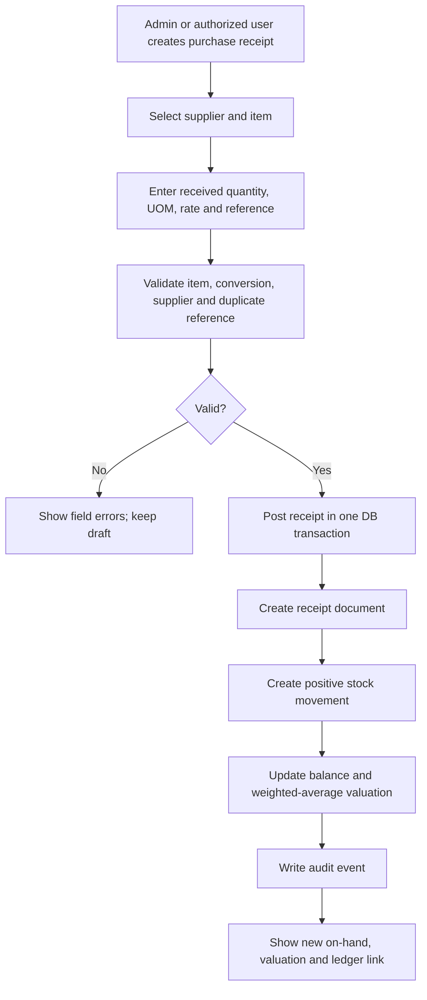
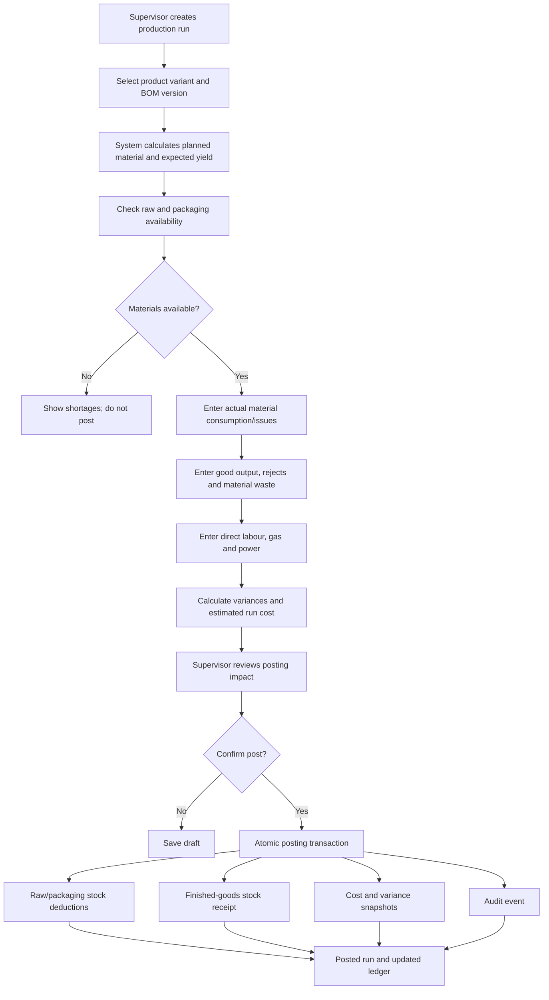
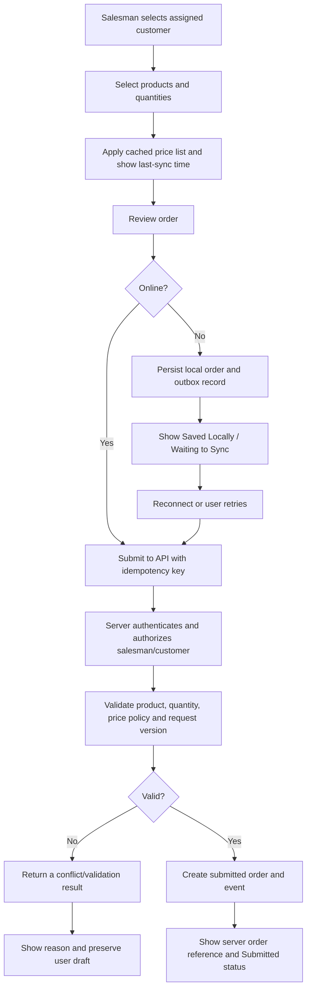
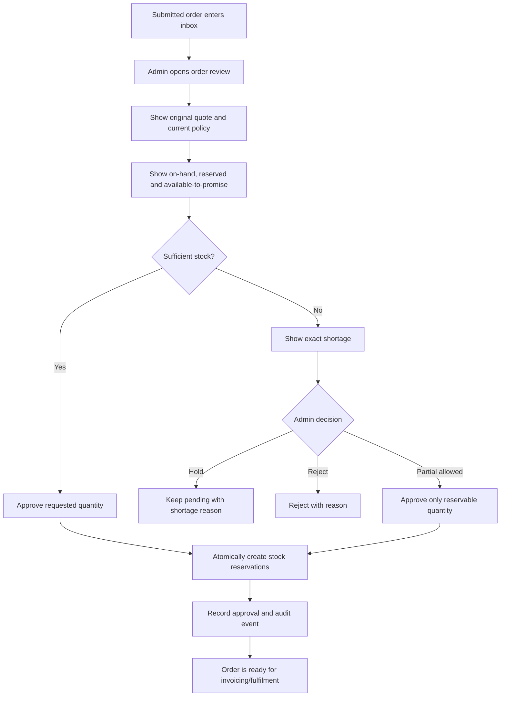
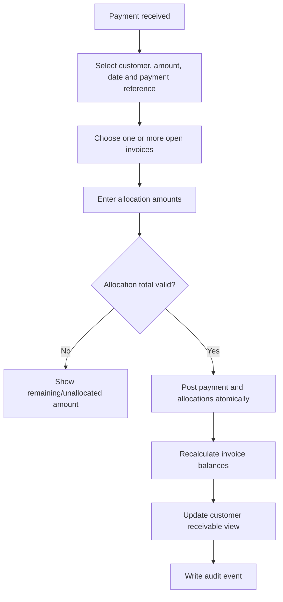
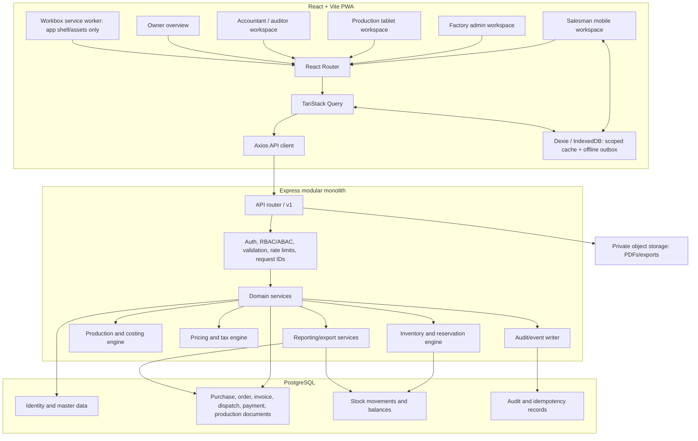

# MillLedger - Master Project Plan

## Order-to-Audit System for a Small Food Manufacturer

**Document type:** Product, UX, architecture, data-model and implementation master plan  
**Baseline:** CDI Winter Internship Problem Statement supplied by the applicant  
**Prepared:** 17 November 2026  
**Status:** Proposed implementation baseline; validate assumptions marked **OPEN** before production use  
**Primary objective:** Deliver a reliable, demonstrable, mobile-first manufacturing ERP prototype that completes the supplied benchmark end to end.

---

# 0. How to read this plan

This document deliberately distinguishes three kinds of statements:

- **[PS — Required]** Explicitly stated in the CDI problem statement. These requirements are the source of truth for the internship submission.
- **[DESIGN — Proposed]** An engineering or UX decision recommended to implement the requirement safely and coherently. It is not claimed to be explicitly required by CDI.
- **[FUTURE — Optional]** A later capability that can create product differentiation after the benchmark and core controls work.

The CDI document's section numbers are referenced throughout so every requirement remains traceable. The fixed benchmark in §5 is treated as the acceptance contract. Where the source data is incomplete or internally ambiguous, this plan preserves the supplied values and records the ambiguity rather than silently changing the scenario.

The project should be built as a **modular monolith**, not as microservices. It should have one authoritative PostgreSQL database, one backend API, one React PWA, and clear domain modules.

---

# 1. Executive product definition

## 1.1 Product statement

Build a single operational system that connects the factory's two transaction loops:

1. **Sales loop:** salesman order → admin verification → GST invoice → dispatch → finished-goods stock reduction → receivables and collections.
2. **Production loop:** material purchase → raw-material receipt → issue against a versioned Bill of Materials (BOM) → production run → actual output and wastage → finished-goods receipt → planned-versus-actual variance and cost per packet.

Both loops meet at finished-goods inventory and feed the same reports. The application must eliminate repeated manual entry and make each stock and financial figure traceable to a source transaction. This is the central purpose of the CDI assignment (Problem Statement §§1–2).

## 1.2 What success looks like

A successful prototype must let the evaluator:

- Sign in as each relevant role and see an appropriate, restricted workspace.
- Load the exact benchmark master data through a repeatable seed command.
- Record the 60 kg flour purchase.
- Post a production run using the stated actual material issues, good output, damaged pouches and carton use.
- Verify stock ledger movements, closing balances and variance flags.
- Place a 150-packet order from the salesman mobile view.
- Review, approve, invoice and dispatch it from the admin view.
- Place the second 120-packet order and see the exact shortage of 32 packets without allowing negative stock.
- Allocate the ₹4,000 payment to Retailer A's invoice.
- Calculate and explain run-level cost per good packet.
- Generate and export the reports listed by CDI.
- Explain the schema, transaction boundaries, unit conversions, valuation method, tax calculation and access policies during a live interview.

## 1.3 Product principles

1. **Correctness before feature count.** The CDI document explicitly says a smaller system that runs the benchmark correctly beats a larger system that does not (§6).
2. **Ledger before balance.** Balances are derived from or reconciled against movement records; they are not freely overwritten (§7).
3. **One source transaction, many reliable views.** A purchase, production run, dispatch or payment is entered once and reused by reports.
4. **Separate business events.** An order is not an invoice; an invoice is not a dispatch; a payment is not an order status.
5. **Mobile-first where work happens on mobile; desktop-first where dense review is needed.** Each role gets an experience designed for its work.
6. **Offline is explicit, not simulated.** An order saved locally must never be presented as server-submitted or stock-reserved.
7. **Immutable posted records.** Posted financial and stock events are corrected by reversal/credit-note workflows, not silent deletion.
8. **Accessible by design.** Target WCAG 2.2 AA, with generous touch controls for floor and field work.
9. **Explainable calculations.** A user can drill into why a number is what it is.
10. **No decorative AI.** Add automation only where it solves an evidenced operational problem.

---

# 2. Scope, priority and requirement inventory

## 2.1 Mandatory and tiered requirements from the source

| ID    | Feature / capability                                                                                                 | CDI tier or source                  | Planned milestone                                             | Criticality         | Verification evidence                                                   |
| ----- | -------------------------------------------------------------------------------------------------------------------- | ----------------------------------- | ------------------------------------------------------------- | ------------------- | ----------------------------------------------------------------------- |
| R-001 | Login and role separation for salesman, admin and production at minimum                                              | Must-have, §6                       | M1                                                            | P0                  | Automated role tests; login walkthrough                                 |
| R-002 | Support the five described roles: salesman, factory admin, production supervisor, accountant/auditor, owner          | Users and roles, §3                 | M1–M2                                                         | P0                  | Role-by-role permission matrix and UI walkthrough                       |
| R-003 | Product, customer, raw-material and BOM masters                                                                      | Must-have, §6                       | M2                                                            | P0                  | Seed data; create/edit/archive tests                                    |
| R-004 | Mobile-friendly field order entry                                                                                    | Must-have, §6; §4.1                 | M5                                                            | P0                  | Playwright mobile flow completed in under one minute for a normal order |
| R-005 | Customer selection and price-list-based product pricing                                                              | §4.1                                | M2, M5                                                        | P0                  | Price snapshot and customer assignment tests                            |
| R-006 | Admin order inbox; edit quantities/prices; approve/reject                                                            | Must-have, §6; §4.2                 | M5                                                            | P0                  | End-to-end order-state tests and audit events                           |
| R-007 | Stock availability displayed before approval                                                                         | §4.2                                | M5                                                            | P0                  | Available-to-promise test; shortage test                                |
| R-008 | GST tax invoice with supplier/customer tax details, HSN, place of supply, applicable tax components and FY numbering | §4.2                                | M6                                                            | P0                  | Golden invoice tests; PDF inspection; sequence uniqueness test          |
| R-009 | Downloadable invoice PDF; share by link/email is sufficient                                                          | §4.2                                | M6                                                            | P1                  | PDF snapshot and download/share test                                    |
| R-010 | Dispatch reduces finished-goods stock                                                                                | Must-have, §6; §4.2                 | M6                                                            | P0                  | Dispatch movement and stock reconciliation test                         |
| R-011 | Record payments against invoices and calculate customer outstanding                                                  | §4.2; Should-have §6                | M7                                                            | P0 for benchmark    | Partial payment allocation test; ₹3,875 benchmark assertion             |
| R-012 | Versioned or otherwise controlled BOM containing raw and packaging quantities and expected yield                     | §4.3                                | M2, M4                                                        | P0                  | BOM calculation and historical-version tests                            |
| R-013 | Production run captures product, batch/issue quantity, expected output, actual output and wastage/scrap              | Must-have, §6; §4.3                 | M4                                                            | P0                  | Production-run acceptance tests                                         |
| R-014 | Posting production deducts raw materials and increases finished goods automatically                                  | Must-have, §6; §4.3                 | M4                                                            | P0                  | Atomic posting test and ledger check                                    |
| R-015 | Planned-vs-actual consumption and yield variance with tolerance flag                                                 | Must-have, §6; §4.3                 | M4                                                            | P0                  | −6% yield and +5% oil regression tests                                  |
| R-016 | Unit conversion across kg, g, litres, pieces, packets and cartons                                                    | §4.3                                | M2, M4                                                        | P0                  | Conversion test matrix                                                  |
| R-017 | Separate balances for raw, packaging, WIP if modelled, and finished goods by variant/pack size                       | §4.4                                | M3                                                            | P0                  | Inventory category and product-variant tests                            |
| R-018 | Stock ledger records every movement and its source document                                                          | Must-have, §6; §4.4, §7             | M3                                                            | P0                  | Every movement has resolvable source; reconciliation job                |
| R-019 | Purchases and supplier records                                                                                       | Should-have, §6; benchmark step 1   | M3                                                            | P0 for benchmark    | 60 kg flour purchase and purchase register                              |
| R-020 | Cost of raw materials and packaging using a stated valuation method                                                  | §4.5; Should-have §6                | M7                                                            | P0 for benchmark    | Costing worksheet reproduces chosen method                              |
| R-021 | Labour, power, gas and other overhead allocation                                                                     | §4.5; benchmark step 8              | M7                                                            | P0 for benchmark    | ₹1,200 labour + ₹600 gas/power appear in run cost                       |
| R-022 | Cost per packet and margin against selling price                                                                     | §4.5; Should-have §6                | M7                                                            | P0 for benchmark    | Cost per good packet shown with method and assumptions                  |
| R-023 | Monthly sales, GST, purchase, stock, production, collection and receivable reports                                   | §4.6                                | M8                                                            | P0                  | Report-by-report test fixture and export inspection                     |
| R-024 | Export monthly reports to Excel/CSV and PDF                                                                          | §4.6                                | M8                                                            | P0                  | Valid CSV/XLSX/PDF file checks                                          |
| R-025 | GST summary in a shape that maps to GSTR-1/GSTR-3B                                                                   | §4.6; Should-have §6                | M8                                                            | P1                  | Tax summary reconciles to invoice lines; labelled as report, not filing |
| R-026 | Variance alerts beyond configured tolerance                                                                          | Should-have, §6                     | M4, M8                                                        | P1                  | Threshold boundary tests                                                |
| R-027 | Owner dashboard                                                                                                      | Should-have, §6; §3                 | M8                                                            | P1                  | Metrics reconcile to source queries and show freshness time             |
| R-028 | Offline order capture and sync                                                                                       | Strongly preferred §4.1; Stretch §6 | PWA/data foundation M1–M2; local order queue M5; full sync M9 | P1 / differentiator | Offline → reload → reconnect → exactly-once accepted order test         |
| R-029 | Batch and expiry tracking; FEFO dispatch                                                                             | Stretch, §6                         | M11+                                                          | P2                  | Lot traceability and FEFO allocation tests                              |
| R-030 | Reorder levels and low-stock alerts                                                                                  | Stretch, §6                         | M10                                                           | P2                  | Threshold and notification tests                                        |
| R-031 | Production planning from pending orders                                                                              | Stretch, §6                         | M10                                                           | P2                  | Planned material and batch recommendation reconciles to BOM             |
| R-032 | Salesman route/visit log and GPS check-in                                                                            | Stretch, §6                         | M12+                                                          | P3                  | Consent, accuracy and opt-out tests if ever built                       |
| R-033 | Tally-compatible export                                                                                              | Optional §4.6; Stretch §6           | M12+                                                          | P2                  | Export schema sample and import validation                              |
| R-034 | e-Invoice/e-Way Bill data format/mock API                                                                            | Stretch, §6                         | M12+                                                          | P2                  | Explicit sandbox/mock label; contract tests                             |
| R-035 | Tamil language interface for floor staff                                                                             | Stretch, §6                         | M10                                                           | P1                  | Tamil terminology review and bilingual usability test                   |
| R-036 | Stock and production edit audit trail with user and time; posted invoices cancelled through credit note, not deleted | Technical expectations, §7          | M1, M4, M6                                                    | P0                  | Immutable-posting and audit-history tests                               |
| R-037 | Seed data for the exact benchmark                                                                                    | Technical expectations, §7          | M0, M11                                                       | P0                  | Fresh database can be seeded and scenario rerun                         |
| R-038 | Hosted demo or single local run command; role test logins                                                            | §7–8                                | M11                                                           | P0                  | Independent evaluator setup test                                        |
| R-039 | Public repository with meaningful commit history, README, design note ≤2 pages and demo video ≤8 minutes             | Deliverables, §8                    | M11                                                           | P0                  | Submission checklist signed off                                         |

**Important scope finding:** The mandatory benchmark includes purchasing, payments, labour/power overhead entry and costing, even though the tier list places some of these under “Should have”. Therefore, those modules are part of the benchmark-complete release, not optional for this submission (source §§5–6).

## 2.2 Priority definitions

- **P0 — Release blocker:** Needed for the fixed benchmark, correctness, traceability, security or mandatory deliverables.
- **P1 — Strongly recommended:** Materially improves the required experience or meets a strongly preferred requirement.
- **P2 — Future differentiator:** Useful after the benchmark release; must not delay P0.
- **P3 — Defer / high caution:** Optional and potentially privacy-, integration- or maintenance-heavy.

## 2.3 Explicitly out of the initial release

- Live government GST filing or production e-invoice/e-way-bill integration.
- Tally two-way synchronization.
- Multi-company SaaS tenancy and subscription billing.
- Microservices, Kubernetes, event streaming or a separate mobile-native app.
- AI forecasting, computer vision or generative AI features without trustworthy operational data.
- GPS tracking by default.
- Complex accounting/general-ledger replacement. This is an order, production, inventory, billing and audit prototype; it should export data to accounting software rather than pretend to replace every accounting function.

---

# 3. Users, operating context and real-world constraints

## 3.1 Personas and primary outcomes

| Persona               | Primary device                            | Main job                                                                       | Success measure                                               | Main risks / constraints                                                                    |
| --------------------- | ----------------------------------------- | ------------------------------------------------------------------------------ | ------------------------------------------------------------- | ------------------------------------------------------------------------------------------- |
| Salesman              | Android phone, sometimes weak mobile data | Create accurate customer orders while visiting shops                           | Normal order entered in <60 seconds                           | One-hand use, sunlight, weak signal, small display, stale pricing, accidental double submit |
| Factory admin         | Desktop/laptop with keyboard and mouse    | Review demand, control pricing, approve, invoice, dispatch, record collections | Process order with minimal re-entry and clear exceptions      | Many orders, dense lists, invoice mistakes, stock conflicts, printer/PDF workflow           |
| Production supervisor | Tablet or desktop on factory floor        | Issue correct materials, record actual output and wastage                      | A run can be posted with auditable actuals and no stock drift | Gloves/dirty hands, bright light, interruptions, unit confusion, shared device, noisy floor |
| Accountant/auditor    | Desktop/laptop                            | Inspect registers, balances, tax summaries and receivables                     | Every reported number can be traced to source                 | Read-only access, large datasets, period filters, export fidelity, repeatability            |
| Owner                 | Phone, tablet or desktop                  | Monitor orders, stock, variance, cost and collections                          | Detect an issue and drill down to its cause                   | Needs a concise summary, current-as-of timestamps, meaningful alerts rather than noise      |

## 3.2 Real-life conditions the UX must account for

### Salesman conditions

- Connectivity may disappear inside shops or on the road.
- The app must retain a draft after refresh, tab close or a temporary browser crash as far as browser storage permits.
- Customer and product search should work against a small, recently synchronized local dataset.
- Price and stock data can become stale offline. The interface must show **last synchronized at** and must not promise stock availability.
- A local order must be labelled **Saved on this device / Waiting to sync**, not “Submitted”.
- The user needs an obvious retry and conflict-resolution path.
- Avoid tiny icon-only actions, hover-only behaviour and long checkout forms.

### Admin conditions

- The admin may process several orders at once. Use searchable, filterable queues, keyboard support and bulk read-only review where safe.
- Stock should be shown as physical, reserved and available-to-promise, not one ambiguous number.
- Price edits must preserve the submitted quote and capture the reason for the final change.
- Approval, invoice and dispatch should be distinct actions with clear consequences.
- A shortage must be a visible exception with explicit choices; never silently over-dispatch.

### Production-floor conditions

- The supervisor should not need to understand accounting terminology.
- Planned quantities should be prefilled from the selected BOM version, with units displayed next to every value.
- Actual values should be large numeric fields with clear decimal precision and increment controls where appropriate.
- Damaged packaging, raw-material loss, finished-product rejects and unexplained variance are different concepts; the UI should not collapse them into one “wastage” number.
- A run should show the whole posting impact before final confirmation.
- After posting, corrections require a reversal/correction workflow rather than editing history.
- Provide Tamil labels and help text as a planned high-value extension; never machine-translate critical inventory terms without review.

### Accountant/auditor conditions

- Every report needs a visible period, filter summary, generation timestamp and data-as-of time.
- Every total should drill down to invoice, purchase, payment, production run or movement records.
- Exports must use the same filters and totals as the on-screen report.
- The role is read-only. Do not show edit buttons and do not rely only on hiding them; the API must deny writes.

### Shared-device conditions

- Production tablets may be shared. Provide explicit sign-out, short inactivity lock and clear current-user identity.
- Do not expose all users' cached records after an account switch.
- Never store passwords or session secrets in IndexedDB/localStorage.
- Offline business data must be minimized and scoped to the signed-in salesman.
- On logout, explain what happens to queued offline orders; do not silently discard unsynchronized work.

---

# 4. Experience architecture: portals, navigation and every core screen

There is one React application and one design system, but five role-oriented workspace layouts. Route visibility is a convenience only; backend authorization remains authoritative.

## 4.1 Shared application shell

All roles share:

- Company/factory identity and active financial year.
- User menu and role/context indicator.
- Global connection state (online, offline, syncing, sync failed).
- Notification centre for business alerts.
- Help/support and language selection.
- Accessible focus management and consistent page titles.
- A clear “last updated” or “data as of” timestamp on data that can go stale.

The application should use role-specific navigation. Do not expose the entire ERP menu to every role.

## 4.2 Salesman mobile workspace

**Navigation:** Home, New Order, Orders, Customers, More. Use bottom navigation on narrow phone layouts and a compact side rail on larger screens.

| Screen                    | Main content and interaction                                                            | Critical states / UX rules                                                                  | Verification                                      |
| ------------------------- | --------------------------------------------------------------------------------------- | ------------------------------------------------------------------------------------------- | ------------------------------------------------- |
| Sign-in / session restore | Email/username and password or configured login method; show company/workspace          | Offline mode only after a previous authorized sync; no new offline identity creation        | Expired session, wrong account and sign-out tests |
| Home                      | Today’s orders, local unsynced count, recently used customers, quick New Order          | Offline banner must persist; pending queue visible without opening settings                 | At-a-glance status test                           |
| Customer picker           | Assigned customers, recent/favourite list, search by name/phone/code                    | Only assigned customers; last-synced data marker; no full customer database download        | ABAC and offline-cache scope tests                |
| Product picker            | Product cards/list, pack size, current cached price, quantity control                   | Clearly label stale/offline price; no fake live stock guarantee; support fast numeric entry | 320px layout, keyboard and order timing test      |
| Cart / order review       | Customer, delivery address, lines, quantity, price snapshot, tax estimate if configured | Show total estimate and quote timestamp; changes remain local until synced                  | Quantity, price and draft persistence tests       |
| Submit result             | Local reference, sync state, timestamp and next action                                  | Distinguish Saved Locally, Queued, Submitted, Rejected/Conflict                             | Offline/reload/reconnect tests                    |
| Orders list               | Own orders, filter by date/status/customer, customer-wise sales                         | Show server state separately from local state; no other salesman orders                     | Record-level authorization tests                  |
| Order detail              | Line items, submitted price, admin changes, invoice/dispatch state, timeline            | Read-only status history; clear reason for rejection or price adjustment                    | Event history test                                |
| Sync centre               | Pending, syncing, failed, conflict, last successful sync                                | Retry one/all; never duplicate an order; preserve failed payload until resolved             | Idempotency and retry test                        |
| Customer summary          | Assigned customer, address, order history and customer-wise sales                       | Do not expose sensitive financial fields unless role policy allows                          | ABAC test                                         |

**One-minute order interaction:** Home → New Order → choose recent customer → add one or more products and quantities → review → save/submit. Avoid requiring the salesman to type full addresses or tax details on every order.

## 4.3 Factory admin desktop workspace

**Navigation:** Overview, Order Inbox, Orders, Invoices, Dispatch, Customers, Products & Prices, Inventory, Purchases, Payments, Reports, Settings (only permissions granted).

| Screen                   | Main content and interaction                                                                                     | Critical states / UX rules                                                                                     | Verification                             |
| ------------------------ | ---------------------------------------------------------------------------------------------------------------- | -------------------------------------------------------------------------------------------------------------- | ---------------------------------------- |
| Admin overview           | New orders, pending review, low-stock exceptions, dispatches due, receivables alerts                             | No decorative metrics; every card links to filtered records                                                    | Totals reconcile with source data        |
| Order inbox              | Dense table with submitted time, salesman, customer, state, value and stock coverage                             | Filters, sorting, pagination, keyboard navigation; local-offline orders only appear after server acceptance    | Filter and access-control tests          |
| Order review             | Customer snapshot, requested lines, price list, available stock, reserved stock, proposed quantity/price changes | Show changes side-by-side; require reason for overrides; distinguish stale quote from current rules            | Approval policy tests                    |
| Shortage resolution      | Requested, physically available, already reserved, available-to-promise, shortage                                | Options: leave pending, reject, or approve partial quantity if policy allows; never create negative stock      | Benchmark B shortage = 32                |
| Approval confirmation    | Final lines, effective prices, reservation impact, fulfilment plan                                               | Atomic stock reservation; prevent double approval                                                              | Concurrency test                         |
| Invoice composer/preview | Supplier/customer details, HSN, place of supply, taxable value, tax split, numbering, PDF preview                | Tax rate from effective-dated config; invoice immutable after posting; no offline invoice                      | Golden invoice and serial sequence tests |
| Invoice detail           | Posted PDF, invoice lines, tax breakdown, payment allocations, credit-note history                               | No delete/edit of posted invoice; issue credit note for correction                                             | Immutability test                        |
| Dispatch workspace       | Approved/unfulfilled lines, pick quantities, stock location, dispatch note                                       | Dispatch cannot exceed reservation or physical stock; partial dispatch represented as separate dispatch record | No-over-dispatch tests                   |
| Payment receipt          | Customer, amount, date, mode/reference, allocations to invoice(s)                                                | Support partial, full and unallocated receipts; show remaining outstanding                                     | ₹4,000 allocation test                   |
| Customer ledger          | Invoices, credit notes, receipts, outstanding and ageing                                                         | Opening balance and historical transactions clearly distinguished                                              | Receivable reconciliation test           |
| Product/price masters    | Product variants, pack size, active price lists, effective date                                                  | Existing posted documents retain their snapshots after price changes                                           | Historical price snapshot test           |
| Purchase entry           | Supplier, item, received quantity, UOM, rate, reference, date                                                    | Receipt posts stock only once; purchase cost preserved                                                         | Flour purchase benchmark test            |
| Inventory views          | On-hand, reserved, available, movement ledger, source link                                                       | Show physical quantity and reservations separately                                                             | Ledger reconciliation test               |

## 4.4 Production supervisor tablet/desktop workspace

**Navigation:** Today’s Runs, New Production Run, Material Receipts, Material Issues, Run History, Inventory Lookup. Avoid exposing sales/financial configuration unless separately permitted.

| Screen                            | Main content and interaction                                                                       | Critical states / UX rules                                                                      | Verification                         |
| --------------------------------- | -------------------------------------------------------------------------------------------------- | ----------------------------------------------------------------------------------------------- | ------------------------------------ |
| Production home                   | Planned runs, drafts needing completion, posted runs, shortages and variance alerts                | Large status labels; show run date and assigned product                                         | Role access and queue tests          |
| New run                           | Select product variant and active production specification/BOM version                             | Show the exact version/effective date; do not silently switch a historical run to a newer BOM   | BOM snapshot test                    |
| Planned material sheet            | Component, standard quantity, unit, available stock, expected output                               | Units shown on every row; conversions visible; inadequate stock is blocking                     | Unit conversion and stock tests      |
| Material issue/actual consumption | Actual quantity used/issued, returned quantity if modelled, damaged/scrapped quantities and reason | Separate issue, consumption, return and waste; prevent duplicate posting                        | Actual-material reconciliation       |
| Output entry                      | Expected good output, actual good packets, rejects/scrap and explanation                           | Do not treat damaged pouch as finished-product reject; allow a documented variance              | Yield formula test                   |
| Packaging reconciliation          | Pouches used, damaged pouches, cartons used, carton capacity                                       | Calculate implied capacity and show warnings without silently changing benchmark data           | 188 packets vs 9×20 capacity warning |
| Variance review                   | Planned vs actual by component; yield variance; configured tolerance                               | Show formula, absolute difference, percentage and reason; warning vs blocking rule configurable | +5% oil and −6% yield flags          |
| Cost entry                        | Direct labour, gas, power and other cost entries                                                   | Cost category and amount are explicit; avoid ambiguous “miscellaneous” only                     | ₹1,800 overhead total test           |
| Run posting preview               | Every raw/packaging deduction, finished-goods receipt, cost and variance                           | One final confirmation; show transaction summary before posting                                 | Atomicity and rollback tests         |
| Run detail                        | Posted material lines, output, waste, valuation, costs and audit history                           | Posted record read-only; correction via reversal/adjustment                                     | Immutability test                    |

## 4.5 Accountant / auditor desktop workspace

**Navigation:** Report Centre, Sales Register, GST Summary, Purchase Register, Stock Summary, Stock Ledger, Production & Variance, Collections, Receivables & Ageing, Audit Trail.

| Screen              | Main content and interaction                                                    | Critical states / UX rules                                                    | Verification                   |
| ------------------- | ------------------------------------------------------------------------------- | ----------------------------------------------------------------------------- | ------------------------------ |
| Report centre       | Report cards grouped by Sales, Tax, Stock, Production, Finance                  | Show supported date filters and export types                                  | Coverage test                  |
| Sales register      | Invoice number/date/customer/product/taxable value/tax/total/status             | Drill down to immutable invoice lines                                         | Totals reconcile with invoices |
| GST outward summary | Intra/inter-state taxable values and tax components; HSN summaries if supported | Clearly label as a summary shaped for reconciliation, not a filed return      | Tax aggregation test           |
| Purchase register   | Supplier, receipt/invoice reference, item, quantity, rate and value             | Link each receipt to resulting stock movements                                | Purchase/ledger reconciliation |
| Stock summary       | Opening, receipts, production issues, output, dispatch, adjustment, closing     | Filter by item/category/location/period                                       | Opening + movements = closing  |
| Stock ledger        | Chronological movements and source documents                                    | No unexplained manual balance row; export preserves movement identifiers      | Source-link test               |
| Production report   | BOM, planned vs actual, output, waste, cost and tolerance flags                 | Explain calculation method and unit base                                      | Benchmark variance test        |
| Collections         | Payment receipts and invoice allocations                                        | Unallocated payment clearly separated                                         | Allocation reconciliation      |
| Receivables ageing  | Customer/invoice/due date/balance/age bucket                                    | Ageing needs invoice and due dates; benchmark dates must be seeded/documented | Ageing boundary tests          |
| Audit trail         | Actor, time, entity, action, change summary, reason                             | Read-only; protect personal data; filters and export                          | Audit coverage tests           |
| Export preview      | Chosen report, date range, filters, row count and format                        | Same source query and filters as on-screen report                             | Export-versus-screen totals    |

## 4.6 Owner experience

Owner home should be a responsive, concise operational cockpit:

- Today’s submitted/approved/dispatched orders.
- Finished-goods availability and low-stock exceptions.
- Raw-material low stock and days/production runs coverable (only if data supports it).
- Production yield and consumption variance alerts.
- Cost per packet and selling-price margin by product.
- Total receivables and ageing buckets.
- Recent important events.
- A visible “Data as of” timestamp and drill-down to the source report.

Do not invent trends from insufficient data. Show “not enough history” rather than generating misleading forecasts.

---

# 5. End-to-end business process and workflow design

## 5.1 Master data setup

Before transactions begin, an admin creates/configures:

1. Company/factory profile, state code and GST registration details (dummy data for the internship).
2. Users and role assignments.
3. Customers, customer addresses, customer state and optional GSTIN.
4. Suppliers.
5. Products and pack-size variants.
6. Inventory items and base units.
7. Unit conversions.
8. HSN/tax category and effective-dated tax rules.
9. Price lists and customer-specific overrides if enabled.
10. Recipes, BOM/production specifications and active versions.
11. Opening stock and opening valuation.
12. Stock locations/warehouse (one factory is enough initially).
13. Financial year and invoice numbering series.
14. Variance tolerances and low-stock thresholds.

Master records referenced by posted transactions should be deactivated/archived, not physically deleted.

## 5.2 Purchase and raw-material receipt flow



**Business rules:**

- A purchase receipt increases raw-material or packaging stock exactly once.
- Receipt quantity is normalized to the inventory item's base unit.
- Unit cost is stored with the receipt; purchase history is never overwritten by later rates.
- If weighted-average valuation is selected, recalculate the moving average inside the same transaction.
- Duplicate submission is prevented through a unique idempotency key and/or supplier-document reference policy.
- Purchase receipt corrections use reversal/return/adjustment events, not deletion of a posted receipt.

## 5.3 Production flow



**Production posting must be atomic.** If one material deduction, output movement, cost record or audit record fails, the whole posting operation must roll back.

A production run captures the BOM version used at the time it was created. A later recipe change must not retroactively alter a posted or historical run.

### Production calculation rules

For a batch-based BOM:

`planned_component_qty = bom_component_qty_per_batch × planned_batch_count`

`consumption_variance_qty = actual_consumed_qty − planned_component_qty`

`consumption_variance_pct = (actual_consumed_qty − planned_component_qty) / planned_component_qty × 100`

`yield_variance_qty = actual_good_output − expected_good_output`

`yield_variance_pct = (actual_good_output − expected_good_output) / expected_good_output × 100`

The benchmark expects batch-level oil consumption variance: `(10.5 − 10) / 10 × 100 = +5%`, and yield variance: `(188 − 200) / 200 × 100 = −6%`.

For better operational analysis, a future report may additionally show output-normalized consumption. Do not substitute that different denominator for the benchmark's expected +5% comparison.

### Material issue, consumption, waste and return are different

The initial implementation should make it possible to distinguish:

- **Issued:** quantity moved from stores to a production run.
- **Consumed:** quantity actually used by the run.
- **Returned unused:** quantity returned to stores.
- **Damaged/scrapped:** quantity no longer usable.
- **Good output:** finished saleable packets.
- **Rejected output:** finished units that did not meet quality requirements.

If the implementation starts with one actual-consumption number, it must still capture separately identifiable damage such as the six pouches in the benchmark.

## 5.4 Sales order flow



The offline order is a **local command awaiting server acceptance**. It is not an approved order, reservation or stock commitment.

## 5.5 Admin verification, approval and stock reservation



**Recommended stock model:**

`available_to_promise = on_hand − active_reserved`

Approval creates a reservation. Dispatch reduces physical on-hand and releases the corresponding reservation. This prevents two admins from approving the same stock concurrently. Reservation is a commitment record, not a physical stock movement.

## 5.6 Invoicing, dispatch and returns

- The admin verifies customer, supplier, tax identifiers, HSN, product description, quantity, price, discount and place of supply.
- Tax is calculated from the configured tax category/rate and supplier/customer place-of-supply facts.
- The invoice gets a consecutive financial-year number from a protected sequence.
- Invoice lines and customer/supplier details are snapshots: future master changes do not alter the historical invoice.
- The PDF is generated from the posted invoice snapshot.
- Dispatch is a separate transaction and is the event that reduces finished-goods stock.
- For partial fulfilment, create separate dispatch records and allocate quantities against order lines/reservations. Avoid a single boolean “dispatched” field that loses partial quantities.
- Returns create return records and stock movements. Financial correction uses the relevant credit-note process; do not delete the original invoice.

The CDI benchmark orders the admin to approve, raise the invoice and record dispatch. For actual goods movement, tax invoice timing and contents must be reviewed against the applicable GST rules. The plan's tax engine is configurable and the 5% rate is the assignment's exercise assumption, not a universal rate for snack products.

## 5.7 Payment and receivables flow



Outstanding is calculated from posted invoices and credit notes less allocated payments. Do not maintain an independently editable customer outstanding number.

## 5.8 Monthly reports and audit flow

Reports are read models over posted business documents and ledgers. A user chooses date range and filters, previews totals, drills into records and exports the same filtered dataset. Every export should contain the report title, date range, filter summary, generation timestamp and page/row identifiers where practical.

---

# 6. Benchmark specification and acceptance oracle

## 6.1 Exact supplied inputs

**Product:** Murukku 200 g. One batch expects 200 packets.

| BOM item            | Planned per batch |                           Rate / valuation input |
| ------------------- | ----------------: | -----------------------------------------------: |
| Flour               |             40 kg | Opening 100 kg @ ₹42/kg; purchase 60 kg @ ₹45/kg |
| Cooking oil         |              10 L |                                           ₹140/L |
| Salt and spice mix  |            1.2 kg |                                          ₹200/kg |
| 200 g pouch         |        200 pieces |                                      ₹2.50/piece |
| Carton (20 packets) |         10 pieces |                                        ₹15/piece |

Opening stock: flour 100 kg; oil 30 L; spice mix 5 kg; pouches 500; cartons 30; finished Murukku 200 g 50 packets. Selling price ₹50/packet before tax. Benchmark GST 5%. Factory state Tamil Nadu.

## 6.2 Exact transaction sequence

1. Purchase 60 kg flour at ₹45/kg.
2. Production run: issue 40 kg flour, 10.5 L oil and 1.2 kg spice mix.
3. Actual output: 188 good packets, 6 damaged pouches and 9 cartons used.
4. Salesman A creates Retailer A order for 150 packets (Tamil Nadu).
5. Admin approves, invoices with CGST + SGST and dispatches.
6. Salesman B creates Distributor B order for 120 packets (Karnataka); show shortage.
7. Record ₹4,000 payment from Retailer A.
8. Add ₹1,200 labour and ₹600 gas/power to the production run.
9. Generate monthly reports.

## 6.3 Required benchmark assertions

| Assertion                                | Formula                    |     Expected |
| ---------------------------------------- | -------------------------- | -----------: |
| Flour closing                            | 100 + 60 − 40              |       120 kg |
| Oil closing                              | 30 − 10.5                  |       19.5 L |
| Spice closing                            | 5 − 1.2                    |       3.8 kg |
| Pouch closing                            | 500 − 188 − 6              |   306 pieces |
| Carton closing                           | 30 − 9                     |    21 pieces |
| Finished goods after run                 | 50 + 188                   |  238 packets |
| Finished goods after Retailer A dispatch | 238 − 150                  |   88 packets |
| Yield variance                           | (188 − 200) / 200          | −6%, flagged |
| Oil consumption variance                 | (10.5 − 10) / 10           | +5%, flagged |
| Taxable invoice value                    | 150 × ₹50                  |       ₹7,500 |
| CGST                                     | ₹7,500 × 2.5%              |      ₹187.50 |
| SGST                                     | ₹7,500 × 2.5%              |      ₹187.50 |
| Invoice total                            | ₹7,500 + ₹187.50 + ₹187.50 |       ₹7,875 |
| Retailer A outstanding                   | ₹7,875 − ₹4,000            |       ₹3,875 |
| Distributor B shortage                   | 120 − 88 available         |   32 packets |

## 6.4 Recommended costing method: weighted average

This is a proposed method, not a value dictated by CDI. It is simple to explain and handles the opening flour and new purchase together.

Opening flour value = `100 × ₹42 = ₹4,200`  
Purchase flour value = `60 × ₹45 = ₹2,700`  
Available flour = `160 kg`; available value = `₹6,900`  
Weighted-average flour rate = `₹6,900 / 160 = ₹43.125/kg`  
Flour consumed = `40 × ₹43.125 = ₹1,725`

| Cost component                  |                    Calculation |                  Cost |
| ------------------------------- | -----------------------------: | --------------------: |
| Flour                           |                   40 × ₹43.125 |                ₹1,725 |
| Oil                             |                    10.5 × ₹140 |                ₹1,470 |
| Spice mix                       |                     1.2 × ₹200 |                  ₹240 |
| Pouches                         | (188 good + 6 damaged) × ₹2.50 |                  ₹485 |
| Cartons                         |                        9 × ₹15 |                  ₹135 |
| **Direct material + packaging** |                                |            **₹4,055** |
| Labour                          |                Direct run cost |                ₹1,200 |
| Gas/power                       |                Direct run cost |                  ₹600 |
| **Total run cost**              |                                |            **₹5,855** |
| Good output                     |                                |       **188 packets** |
| **Cost per good packet**        |                   ₹5,855 / 188 | **₹31.1436 ≈ ₹31.14** |

Selling price excluding GST is ₹50. Approximate gross contribution is ₹18.86 per good packet and 37.71% of selling price, before any other excluded costs. The cost denominator is 188 good packets, not the 200 planned packets.

This run cost applies to the new production run. The brief does not provide an opening valuation for the 50 opening finished packets, so the system must not claim that ₹31.14 is the historical cost of every packet dispatched if opening and newly produced stock are mixed.

## 6.5 Benchmark ambiguities to document

### A. Carton capacity mismatch

The benchmark says a carton holds 20 packets, but it records 188 good packets and only 9 cartons used. Nine cartons hold 180 packets. Preserve the supplied value of 9 cartons and show a non-blocking packaging-capacity warning for 8 packets not represented by carton capacity (unless the evaluator clarifies a different packaging interpretation). Do not silently rewrite the benchmark to 10 cartons.

### B. Damaged pouch accounting

The expected closing balance proves that six damaged pouches are additional consumption: 188 good packets + 6 damaged = 194 pouches consumed. Record the six as damaged packaging separately, even though the total pouch movement is −194.

### C. Costing method is not predetermined

CDI explicitly allows a chosen valuation method. Weighted average gives the worked result above. If another method is implemented, the README must show the formula and explain the resulting difference.

### D. Opening finished-goods value is absent

The initial 50 finished packets have no given unit cost. Report the new run's cost per packet separately from the valuation of the combined finished stock.

### E. Distributor B should not be invoiced for unavailable quantity by default

After Retailer A dispatch, only 88 packets remain. Distributor B requests 120. Flag a 32-packet shortage. Keep the order pending or permit an explicitly selected partial fulfilment policy. Do not invoice/dispatch 120 without stock. A hypothetical full-order invoice would be ₹6,000 taxable plus ₹300 IGST at the exercise rate, but that is not a required transaction when the shortage prevents fulfilment.

### F. Missing dates and tax master data

The scenario does not specify invoice date, GSTIN, HSN, address, due date or payment terms. Use clearly labelled dummy master data and a configurable benchmark date. Record the assumptions in the README. Do not fabricate real customer data.

---

# 7. Technical architecture

## 7.1 Recommended stack

| Concern                | Decision                                                  | Why                                                                                       |
| ---------------------- | --------------------------------------------------------- | ----------------------------------------------------------------------------------------- |
| Language               | TypeScript, strict mode                                   | Shared contracts and fewer runtime shape mistakes                                         |
| Frontend               | React + Vite                                              | Efficient SPA/PWA for distinct role workspaces                                            |
| Routing                | React Router Data Router with `createBrowserRouter`       | Nested layouts, loaders, route-level error handling and lazy route modules                |
| Server-state/cache     | TanStack Query v5                                         | Query caching, invalidation and mutation lifecycle                                        |
| HTTP                   | Axios                                                     | Centralized API client, timeout/interceptor/error mapping                                 |
| Forms                  | React Hook Form + Zod                                     | Fast forms and shared runtime validation patterns                                         |
| UI primitives          | Radix UI; shadcn/ui selectively                           | Accessible primitives and control over visual implementation                              |
| Styling                | Tailwind CSS + design tokens                              | Consistent responsive layout and theming                                                  |
| Tables                 | TanStack Table                                            | Dense admin/audit tables with controlled state                                            |
| Icons                  | Lucide React                                              | Consistent, recognizable icons                                                            |
| PWA                    | `vite-plugin-pwa` + Workbox `injectManifest`              | Custom service worker and controlled cache policy                                         |
| Local offline database | Dexie over IndexedDB                                      | Structured, indexed local catalogue and outbox                                            |
| Backend                | Node.js + Express + TypeScript                            | One modular API service                                                                   |
| Authentication         | Better Auth, subject to pinned adapter compatibility      | Session-based auth with Prisma/PostgreSQL integration                                     |
| Authorization          | Application-owned RBAC + ABAC policy layer                | Business-specific role and record-level access                                            |
| Database               | PostgreSQL                                                | Relational integrity, exact numeric types, transactions and row-level security capability |
| ORM                    | Prisma 7 + PostgreSQL driver adapter for initial baseline | Familiar schema/migrations/client; raw SQL remains available for locking and reports      |
| Validation             | Zod at API boundary                                       | Reject invalid external input before business logic                                       |
| Logging                | Pino or equivalent structured logger                      | Correlation IDs and actionable operational logs                                           |
| Tests                  | Vitest, Supertest, Playwright                             | Unit, API and full user-flow coverage                                                     |
| Accessibility tests    | axe-core with Playwright + manual review                  | Automated checks plus keyboard/screen-reader verification                                 |
| Package manager        | pnpm workspaces                                           | Shared contracts without a complex monorepo framework                                     |

**Version note checked 17 Nov 2026:** React Router's current documentation exposes `createBrowserRouter` as a Data Router API. Better Auth's current Prisma adapter guide explicitly documents Prisma 7 with PostgreSQL and warns that its adapter does not yet support Prisma ORM 8; install matching Prisma 7 packages explicitly rather than using unqualified `latest`. Revalidate package versions and peer dependencies at implementation start.

## 7.2 High-level architecture



## 7.3 Frontend responsibilities

- React Router handles route structure, layouts, guards for UX, loaders for lightweight session/bootstrap data and route errors.
- TanStack Query owns server query cache, stale time, invalidation and API mutation state.
- Axios owns network transport, base URL, request IDs, credentials and normalized API errors.
- React Hook Form + Zod own form state and client-side field validation.
- Dexie owns durable, user-scoped local catalogue data, draft orders and synchronization outbox.
- Service worker caches static application shell/assets only by default. It must not indiscriminately cache authenticated API responses or session endpoints.
- No Redux is needed initially. Do not duplicate server state in a second global store.

## 7.4 Naming & Module Organization

- Follow **Package by Feature (domain-oriented organization)** rather than Package by Layer.
- Organize application modules by business domain, not by technical responsibility.
- Use kebab-case for all directory and file names.
- Name domain directories using clear, consistent singular or plural domain names.
- Name role-specific files using `[feature-name].[role].ts`, for example:
  - `user-profiles.controller.ts`
  - `user-profiles.service.ts`
  - `user-profiles.repository.ts`
  - `user-profiles.routes.ts`
  - `user-profiles.schema.ts`
- Keep controllers, services, repositories, schemas, routes and domain-specific tests within their respective feature directories.
- Put code in shared or infrastructure modules only when it is genuinely cross-domain.
- Avoid global technical-layer directories such as `controllers/`, `services/` and `repositories/`.

Each feature module should have a consistent internal structure:

```text
modules/<feature-name>/
  <feature-name>.routes.ts       # HTTP endpoint registration
  <feature-name>.controller.ts   # HTTP input/output only
  <feature-name>.schema.ts       # Zod request/response schemas
  <feature-name>.service.ts      # business orchestration and transaction boundaries
  <feature-name>.repository.ts   # Prisma/SQL persistence
  <feature-name>.policy.ts       # resource-level authorization where needed
  <feature-name>.types.ts        # local domain types
  <feature-name>.test.ts         # unit/integration tests
```

Do not create every file if a module is tiny; consistency matters more than ceremony. Domain services must be callable from tests without an Express request object.

## 7.5 API conventions

- REST API under `/api/v1`.
- JSON request/response envelopes with stable machine-readable error codes.
- Zod validation for all inputs; never trust client-computed totals, permissions or stock.
- Pagination, filtering and sorting for tables.
- ISO 8601 timestamps; store UTC and render local time appropriately.
- Quantities and monetary decimals serialized as strings where JavaScript floating-point conversion could lose precision.
- Idempotency keys on order sync and all retriable posting commands.
- Request/correlation ID returned in errors and logs.
- API documentation generated from route schemas or maintained OpenAPI contract.

## 7.6 Suggested endpoint map

| Domain       | Example endpoint                                                 | Purpose                                                         |
| ------------ | ---------------------------------------------------------------- | --------------------------------------------------------------- |
| Session      | `GET /api/v1/me`                                                 | Current user, roles and allowed workspace context               |
| Masters      | `GET /api/v1/customers/assigned`                                 | Salesman's assigned customer catalogue                          |
| Masters      | `GET /api/v1/products/catalog`                                   | Active product variants and effective price data                |
| Purchases    | `POST /api/v1/purchase-receipts`                                 | Create/post a receipt, with idempotency                         |
| Inventory    | `GET /api/v1/inventory/balances`                                 | On-hand/reserved/available balances                             |
| Inventory    | `GET /api/v1/inventory/items/:id/ledger`                         | Movement history and source documents                           |
| Production   | `POST /api/v1/production-runs`                                   | Create draft run using a BOM version                            |
| Production   | `POST /api/v1/production-runs/:id/post`                          | Atomically post consumption, output, cost and audit             |
| Orders       | `POST /api/v1/orders`                                            | Submit online order with idempotency key                        |
| Orders       | `GET /api/v1/orders/mine`                                        | Salesman's own orders                                           |
| Admin orders | `POST /api/v1/orders/:id/approve`                                | Approve and reserve stock transactionally                       |
| Admin orders | `POST /api/v1/orders/:id/reject`                                 | Reject with reason                                              |
| Invoices     | `POST /api/v1/orders/:id/invoices`                               | Create/post invoice under numbering/tax rules                   |
| Invoices     | `GET /api/v1/invoices/:id/pdf`                                   | Retrieve generated invoice PDF                                  |
| Dispatch     | `POST /api/v1/dispatches`                                        | Post dispatch and stock movement                                |
| Payments     | `POST /api/v1/payments`                                          | Record payment and invoice allocations                          |
| Reports      | `GET /api/v1/reports/sales-register`                             | Filtered sales register                                         |
| Reports      | `GET /api/v1/reports/stock-ledger`                               | Stock movement report                                           |
| Reports      | `POST /api/v1/reports/exports`                                   | Generate downloadable export                                    |
| Sync         | `POST /api/v1/sync/orders` or idempotent `POST /orders` per item | Submit queued orders; return per-item accepted/conflict results |

Use a single-order submission endpoint first. Add batch sync only if it provides measurable reliability or efficiency benefits. Every order in a batch still needs its own idempotency key and result.

---

# 8. Data model and schema blueprint

## 8.1 Schema design rules

1. Use PostgreSQL as the source of truth.
2. Use foreign keys, unique constraints, check constraints and indexes for invariants that can be enforced in the database.
3. Keep business documents separate from stock movement records.
4. Keep immutable movement rows and posted document snapshots.
5. Keep current stock balances as a projection/cache; reconcile them to the ledger.
6. Store quantities in a normalized base unit per inventory item.
7. Store financial values in exact decimal types, not binary floats.
8. Snapshot product name, SKU, description, HSN/tax category, price, tax rate, customer address and other historical invoice data on posted document lines.
9. Version BOM/recipe and price lists; posted records point to the exact version used.
10. Keep business status separate from payment and fulfilment status.
11. Avoid polymorphic foreign keys that cannot be enforced. Prefer a common source-document anchor or explicit source relations for stock movements.
12. Do not store a mutable “customer outstanding” or “stock quantity” as the only source of truth.

## 8.2 Entity groups and tables

The following is the proposed logical schema. Exact field names can be refined during ERD implementation.

### A. Organization, identity and authorization

| Table                           | Important fields                                            | Purpose / key constraints                                                      |
| ------------------------------- | ----------------------------------------------------------- | ------------------------------------------------------------------------------ |
| `organizations`                 | id, name, legal_name, state_code, GSTIN, currency, timezone | One company for the prototype; keep org scope available for safe future growth |
| `facilities`                    | id, organization_id, name, state_code, active               | One factory initially                                                          |
| `warehouses`                    | id, facility_id, code, name                                 | Main raw/packaging/finished warehouse; optional finer locations later          |
| `users`                         | id, auth identity fields, display_name, active              | Prefer Better Auth-managed user/session/account tables where applicable        |
| `roles`                         | id, code, name                                              | SALESMAN, ADMIN, PRODUCTION, ACCOUNTANT, OWNER                                 |
| `permissions`                   | id, code, description                                       | Atomic capabilities such as `orders.approve`                                   |
| `role_permissions`              | role_id, permission_id                                      | RBAC assignment                                                                |
| `user_roles`                    | user_id, role_id, organization_id, facility_id, active      | Scope role to company/facility if needed                                       |
| `salesman_customer_assignments` | user_id, customer_id, valid_from, valid_to                  | ABAC filter for customer/order visibility                                      |
| `user_devices`                  | id, user_id, device label, last_seen_at, revoked_at         | Optional device/session visibility for shared devices                          |

**Better Auth note:** Keep its generated auth/session/account/verification model compatible with the pinned Prisma adapter. Do not manually fork auth tables unless there is a clear requirement.

### B. Customers, suppliers and parties

| Table                        | Important fields                                                              | Purpose / key constraints            |
| ---------------------------- | ----------------------------------------------------------------------------- | ------------------------------------ |
| `customers`                  | id, code, name, kind (RETAILER/DISTRIBUTOR), phone, active, assigned metadata | Business customer master             |
| `customer_addresses`         | id, customer_id, address fields, state_code, is_default, active               | Billing and delivery addresses       |
| `customer_tax_registrations` | id, customer_id, GSTIN, state_code, valid_from/to                             | Tax registration snapshots/reference |
| `suppliers`                  | id, code, name, phone, address, GSTIN, state_code, active                     | Supplier master                      |
| `supplier_addresses`         | id, supplier_id, address fields, state_code                                   | Optional multiple addresses          |

### C. Product, inventory item and units

| Table                      | Important fields                                                                                  | Purpose / key constraints                                                                              |
| -------------------------- | ------------------------------------------------------------------------------------------------- | ------------------------------------------------------------------------------------------------------ |
| `products`                 | id, code, name, description, active                                                               | Product family, e.g. Murukku                                                                           |
| `product_variants`         | id, product_id, SKU, pack_size_value, pack_size_uom, finished_inventory_item_id, HSN/tax category | Sellable unit such as Murukku 200 g; unique SKU                                                        |
| `inventory_items`          | id, code, name, category (RAW/PACKAGING/FINISHED/WIP), base_uom_id, active, track_lot             | Stock-controlled item                                                                                  |
| `units_of_measure`         | id, code, label, dimension (MASS/VOLUME/COUNT), precision                                         | kg, g, L, ml, piece, packet, carton                                                                    |
| `unit_conversions`         | from_uom_id, to_uom_id, factor, item_scope optional                                               | Explicit dimensionally valid conversion; avoid converting mass to volume without item-specific density |
| `price_lists`              | id, name, currency, effective_from/to, status                                                     | Price book version                                                                                     |
| `price_list_lines`         | price_list_id, product_variant_id, unit_price, tax-inclusion mode                                 | Effective sell price                                                                                   |
| `customer_price_overrides` | customer_id, product_variant_id, price, valid_from/to, reason                                     | Optional customer-specific pricing                                                                     |

**Important unit rule:** kg ↔ g and L ↔ ml are valid conversions. A carton ↔ packet conversion is item/pack-specific (e.g. 1 Murukku carton = 20 packets); do not treat it as a universal unit conversion.

### D. Tax and invoice configuration

| Table                  | Important fields                                                        | Purpose / key constraints                                       |
| ---------------------- | ----------------------------------------------------------------------- | --------------------------------------------------------------- |
| `hsn_codes`            | id, code, description, active                                           | HSN master; dummy value only for assignment if not supplied     |
| `tax_categories`       | id, code, description                                                   | Tax classification associated with product                      |
| `tax_rates`            | id, tax_category_id, rate, component, effective_from/to, jurisdiction   | Effective-dated rate; exercise rate 5% is seeded, not hardcoded |
| `invoice_sequences`    | organization_id, financial_year, series, next_number, max-length config | Locked sequence allocation; unique FY/series                    |
| `company_tax_profiles` | organization_id, GSTIN, legal name/address, state_code, valid_from/to   | Supplier details snapshot source                                |

### E. Recipe and production specification

A product formula and the pack-size/packaging specification should be separable. This supports the interview's example of adding a 500 g variant while reusing the same underlying recipe where the production process permits it.

| Table                        | Important fields                                                                                            | Purpose / key constraints                                  |
| ---------------------------- | ----------------------------------------------------------------------------------------------------------- | ---------------------------------------------------------- |
| `recipes`                    | id, product_id, code, name                                                                                  | Shared food formulation                                    |
| `recipe_versions`            | id, recipe_id, version, status, effective_from/to, notes                                                    | Historical recipe version                                  |
| `recipe_components`          | id, recipe_version_id, inventory_item_id, qty_per_base_batch, uom_id                                        | Flour, oil, spice components                               |
| `production_specifications`  | id, product_variant_id, recipe_version_id, expected_output_qty, output_uom_id, batch_basis, version, status | Maps recipe to sellable SKU and expected yield             |
| `production_packaging_lines` | id, production_specification_id, inventory_item_id, standard_qty, uom_id, capacity_per_pack optional        | Pouches, cartons, labels; supports pack-specific packaging |
| `variance_policies`          | id, metric_code, tolerance_pct, severity, effective_from/to                                                 | e.g. 3% threshold; policy must be configurable             |

If a simpler BOM-per-SKU model is chosen for the MVP, preserve versioning and keep the component model reusable. Do not duplicate all ingredient recipes for every pack size without a reason.

### F. Purchasing

| Table                    | Important fields                                                                                       | Purpose / key constraints                                                                          |
| ------------------------ | ------------------------------------------------------------------------------------------------------ | -------------------------------------------------------------------------------------------------- |
| `purchase_receipts`      | id, organization_id, supplier_id, receipt_no, supplier_reference, received_at, status, created_by      | Stock-receipt document                                                                             |
| `purchase_receipt_lines` | id, receipt_id, inventory_item_id, qty, uom_id, normalized_qty, unit_rate, line_value, lot_id optional | Quantity/rate snapshot                                                                             |
| `supplier_invoices`      | id, supplier_id, supplier_invoice_no, invoice_date, taxable_value, tax fields, total                   | Optional purchase register financial document; distinguish receipt date from supplier invoice date |

A direct purchase receipt is sufficient for the benchmark; purchase orders can be a later addition.

### G. Production transactions

| Table                       | Important fields                                                                                                                                           | Purpose / key constraints                   |
| --------------------------- | ---------------------------------------------------------------------------------------------------------------------------------------------------------- | ------------------------------------------- |
| `production_runs`           | id, run_no, product_variant_id, production_specification_id, status, planned_batches, expected_output, actual_good_output, run_date, posted_at, created_by | Draft-to-posted manufacturing document      |
| `production_material_lines` | id, production_run_id, inventory_item_id, planned_qty, actual_consumed_qty, damaged_qty, returned_qty, uom_id, unit_cost_snapshot, cost_value              | Actual material/packaging use by component  |
| `production_output_lines`   | id, production_run_id, product_variant_id, planned_qty, good_qty, rejected_qty, uom_id                                                                     | Finished output and rejects                 |
| `production_cost_entries`   | id, production_run_id, cost_type, amount, currency, allocation_method, note                                                                                | Labour, gas, power, other overhead          |
| `production_variances`      | id, production_run_id, metric_code, planned_value, actual_value, delta, variance_pct, threshold_pct, severity                                              | Saved calculation snapshot                  |
| `production_run_reversals`  | id, original_run_id, reversal_run_id, reason, created_by                                                                                                   | Correct posted run without destructive edit |

### H. Inventory and traceability

| Table                    | Important fields                                                                                                                                             | Purpose / key constraints                                         |
| ------------------------ | ------------------------------------------------------------------------------------------------------------------------------------------------------------ | ----------------------------------------------------------------- |
| `stock_documents`        | id, document_type, document_no, organization_id, status, source_record_id                                                                                    | Common source-document anchor for movement traceability           |
| `inventory_transactions` | id, stock_document_id, warehouse_id, transaction_type, posted_at, created_by                                                                                 | A posting event groups one or more movements                      |
| `stock_movements`        | id, inventory_transaction_id, inventory_item_id, quantity_delta_base, base_uom_id, unit_cost_snapshot, value_delta, lot_id nullable, source_line_id nullable | Append-only signed stock movement rows                            |
| `inventory_balances`     | inventory_item_id, warehouse_id, location_id nullable, on_hand_qty, reserved_qty, updated_at                                                                 | Projection/cache; must reconcile to ledger and reservation table  |
| `stock_reservations`     | id, order_line_id, inventory_item_id, warehouse_id, qty_base, status, created_at, released_at                                                                | Commitment against available stock; not a physical stock movement |
| `inventory_adjustments`  | id, reason_code, reason_text, requested_by, approved_by, status                                                                                              | Controlled correction document                                    |
| `inventory_lots`         | id, inventory_item_id, lot_no, received_at, manufacture_date, expiry_date, supplier_id                                                                       | Optional now; required for future FEFO/traceability               |
| `inventory_cost_layers`  | id, inventory_item_id, received_qty, remaining_qty, unit_cost, received_at, source_movement_id                                                               | Needed if FIFO chosen; not necessary for weighted average MVP     |
| `inventory_valuations`   | inventory_item_id, warehouse_id, average_unit_cost, valuation_qty, valuation_value, updated_at                                                               | Moving weighted-average projection                                |

**Ledger design:** Every stock-changing event produces an immutable `stock_movements` row. Its source must resolve to a posted document. `inventory_balances` can be updated in the same transaction for fast display, but a reconciliation query must be able to recalculate the balance from movements and compare it to the projection.

### I. Sales, invoices, dispatch and returns

| Table                 | Important fields                                                                                                                                          | Purpose / key constraints                                   |
| --------------------- | --------------------------------------------------------------------------------------------------------------------------------------------------------- | ----------------------------------------------------------- |
| `sales_orders`        | id, order_no, customer_id, salesman_id, status, submitted_at, requested_delivery_date, source_device_id, idempotency_key                                  | Server-accepted order; unique idempotency key per scope     |
| `sales_order_lines`   | id, order_id, product_variant_id, quantity, uom_id, quoted_unit_price, approved_unit_price, price_list_version, line_discount, line_total                 | Preserve submitted and approved price separately            |
| `order_events`        | id, order_id, event_type, actor_id, event_at, reason, payload_summary                                                                                     | Timeline and approval history                               |
| `order_approvals`     | id, order_id, decision, approved_by, decision_at, reason                                                                                                  | Approval/rejection decision                                 |
| `sales_invoices`      | id, invoice_no, financial_year, order_id, customer snapshot fields, issue_date, place_of_supply, taxable_value, total_tax, grand_total, status, posted_at | Immutable tax invoice                                       |
| `sales_invoice_lines` | id, invoice_id, product/SKU snapshot, HSN, description, quantity, unit, rate, discount, taxable_value                                                     | Immutable invoice line snapshot                             |
| `invoice_tax_lines`   | id, invoice_line_id, component (CGST/SGST/IGST), rate, taxable_base, tax_amount                                                                           | Tax breakdown                                               |
| `credit_notes`        | id, credit_note_no, invoice_id, issue_date, reason, taxable_value, tax_amount, total                                                                      | Invoice correction/return financial document                |
| `dispatches`          | id, dispatch_no, order_id, invoice_id nullable, dispatched_at, status, created_by                                                                         | Physical fulfilment document                                |
| `dispatch_lines`      | id, dispatch_id, order_line_id, product_variant_id, quantity, warehouse_id                                                                                | Actual quantity shipped; each line creates a stock movement |
| `sales_returns`       | id, return_no, dispatch_id, reason, received_at, status                                                                                                   | Returned goods receipt                                      |
| `sales_return_lines`  | id, sales_return_id, product_variant_id, quantity, disposition                                                                                            | Restock, quarantine or scrap disposition                    |

Order state, invoice state and fulfilment state must not be collapsed into one status field. Partial dispatch and return are optional in the source, but the schema should not make them impossible.

### J. Receipts and receivables

| Table                  | Important fields                                                                | Purpose / key constraints                                                        |
| ---------------------- | ------------------------------------------------------------------------------- | -------------------------------------------------------------------------------- |
| `payments`             | id, receipt_no, customer_id, received_at, amount, method, reference, created_by | Customer receipt                                                                 |
| `payment_allocations`  | id, payment_id, invoice_id, allocated_amount                                    | One payment can be allocated to one or more invoices; partial payments supported |
| `receivable_snapshots` | optional materialized fields by invoice/date                                    | Performance only; derived from invoice, credit note and allocations              |

### K. Audit, sync and exports

| Table                 | Important fields                                                                                             | Purpose / key constraints                                             |
| --------------------- | ------------------------------------------------------------------------------------------------------------ | --------------------------------------------------------------------- |
| `audit_logs`          | id, actor_id, action, entity_type, entity_id, occurred_at, request_id, reason, before_summary, after_summary | Append-only business audit record                                     |
| `idempotency_records` | id, key, actor_id, operation, request_hash, response_snapshot, status, created_at                            | Safe retries and duplicate prevention                                 |
| `sync_devices`        | id, user_id, device_id, last_sync_at, app_version, revoked_at                                                | Device sync state without storing secrets                             |
| `export_jobs`         | id, report_type, filters_json, requested_by, status, file_key, generated_at, expires_at                      | Auditable asynchronous export where needed                            |
| `file_objects`        | id, storage_key, mime_type, size, checksum, purpose, created_by                                              | Private PDFs and exports; access through authorization-aware download |

## 8.3 Relationship overview

```mermaid
erDiagram
  ORGANIZATION ||--o{ FACILITY : has
  FACILITY ||--o{ WAREHOUSE : contains
  USER ||--o{ USER_ROLE : assigned
  ROLE ||--o{ USER_ROLE : grants
  ROLE ||--o{ ROLE_PERMISSION : contains
  PERMISSION ||--o{ ROLE_PERMISSION : included
  USER ||--o{ SALESMAN_CUSTOMER_ASSIGNMENT : assigned
  CUSTOMER ||--o{ SALESMAN_CUSTOMER_ASSIGNMENT : assigned_to
  PRODUCT ||--o{ PRODUCT_VARIANT : has
  PRODUCT_VARIANT ||--|| INVENTORY_ITEM : stocked_as
  RECIPE ||--o{ RECIPE_VERSION : versions
  RECIPE_VERSION ||--o{ RECIPE_COMPONENT : contains
  PRODUCT_VARIANT ||--o{ PRODUCTION_SPECIFICATION : manufactured_by
  RECIPE_VERSION ||--o{ PRODUCTION_SPECIFICATION : uses
  SUPPLIER ||--o{ PURCHASE_RECEIPT : supplies
  PURCHASE_RECEIPT ||--o{ PURCHASE_RECEIPT_LINE : contains
  PRODUCTION_SPECIFICATION ||--o{ PRODUCTION_RUN : governs
  PRODUCTION_RUN ||--o{ PRODUCTION_MATERIAL_LINE : consumes
  PRODUCTION_RUN ||--o{ PRODUCTION_OUTPUT_LINE : produces
  CUSTOMER ||--o{ SALES_ORDER : places
  USER ||--o{ SALES_ORDER : submits
  SALES_ORDER ||--o{ SALES_ORDER_LINE : contains
  SALES_ORDER ||--o{ ORDER_EVENTS : records
  SALES_ORDER ||--o{ STOCK_RESERVATION : reserves
  SALES_ORDER ||--o{ SALES_INVOICE : billed_by
  SALES_INVOICE ||--o{ SALES_INVOICE_LINE : contains
  SALES_INVOICE_LINE ||--o{ INVOICE_TAX_LINE : taxed_by
  SALES_ORDER ||--o{ DISPATCH : fulfilled_by
  DISPATCH ||--o{ DISPATCH_LINE : contains
  SALES_INVOICE ||--o{ CREDIT_NOTE : corrected_by
  CUSTOMER ||--o{ PAYMENT : pays
  PAYMENT ||--o{ PAYMENT_ALLOCATION : allocated
  SALES_INVOICE ||--o{ PAYMENT_ALLOCATION : receives
  INVENTORY_TRANSACTION ||--o{ STOCK_MOVEMENT : contains
  STOCK_DOCUMENT ||--o{ INVENTORY_TRANSACTION : source
  INVENTORY_ITEM ||--o{ STOCK_MOVEMENT : moves
  INVENTORY_ITEM ||--o| INVENTORY_BALANCE : projected
```



This is a logical overview, not a final Prisma schema. The final ERD should be produced after exact field types, unique constraints and source-document relationships are settled.

## 8.4 Important database constraints and indexes

- Unique: organization + customer code; organization + SKU; financial year + invoice series + invoice number.
- Unique: idempotency key + actor/operation scope.
- Check: posted quantities are positive where represented as entered quantities; movement deltas may be signed.
- Check: invoice total equals taxable value + tax + charges − credits according to chosen rounding policy.
- Check: allocated payment total cannot exceed receipt amount; invoice allocation cannot exceed permitted open balance unless explicit advance/unallocated logic exists.
- Check: reservation quantity cannot exceed the available balance at the time of approval.
- Index: stock movement item + warehouse + posted timestamp.
- Index: order status + submitted timestamp; customer + date; salesman + date.
- Index: invoice financial year + invoice number; customer + issue date.
- Index: production run date + product; variance severity + date.
- Index: report dimensions and foreign keys used by audit drill-down.
- Use `NUMERIC/DECIMAL` for quantities and monetary/rate values requiring exactness; do not store them as float/double precision.

## 8.5 Quantity and money precision

Proposed storage conventions:

- Base stock quantity: `NUMERIC(18,6)` (adjust precision after unit analysis).
- Unit cost/rate: `NUMERIC(18,6)` or suitable higher precision.
- Invoice monetary amounts: `NUMERIC(18,2)` after a documented tax/line rounding policy.
- Intermediate calculations: exact decimal arithmetic; never convert to JavaScript `number` for business calculations.
- API decimal values: serialize as decimal strings.
- Use integer count units for discrete pieces/packets where appropriate, while retaining a common decimal-capable quantity model if fractional conversion is needed.

## 8.6 Weighted-average valuation rules

For a receipt:

`new_average_cost = (old_qty × old_average_cost + received_qty × receipt_unit_cost) / (old_qty + received_qty)`

For an issue:

`issue_value = issued_qty × current_average_cost`

Snapshot the unit cost and value on the posted issue movement so later receipts do not change historical production-run cost. The inventory valuation projection and ledger must reconcile.

If FIFO is chosen instead, implement and test cost layers explicitly; do not call a simple average-rate calculation FIFO.

---

# 9. State machines and invariants

## 9.1 Sales order states

Recommended order state:

`DRAFT → SUBMITTED → UNDER_REVIEW → APPROVED | REJECTED → CLOSED`

`CANCELLED` is allowed only under explicit policy and with an audit event. Fulfilment is a separate derived dimension:

`UNFULFILLED → PARTIALLY_FULFILLED → FULFILLED`

Invoice state is separate:

`DRAFT → POSTED → CREDITED/CANCELLED_BY_CREDIT_NOTE` (do not delete a posted invoice).

Dispatch state is separate:

`DRAFT → POSTED` (and optionally `REVERSED` through a controlled correction).

Offline client-only states:

`LOCAL_DRAFT → QUEUED → SYNCING → SERVER_ACCEPTED | CONFLICT | FAILED`

Do not expose `SERVER_ACCEPTED` until the backend has committed the order.

## 9.2 Production run states

`DRAFT → READY_TO_POST → POSTED`

A posted run can only be corrected through a linked reversal/adjustment record with reason, actor and timestamp. Do not edit posted consumption/output values in place.

## 9.3 Inventory invariants

1. On-hand is the sum of posted stock movement deltas for the relevant item/location/lot.
2. Available-to-promise equals on-hand minus active reservations.
3. No normal operation may create negative on-hand or negative available stock.
4. Every posted stock movement has exactly one traceable source transaction line.
5. A posted production run's raw/packaging deductions and finished-goods receipt commit atomically.
6. A posted dispatch reduces physical finished goods exactly once and releases matching reservations.
7. Reversal movements reference the original source and never erase history.
8. Balance projections must reconcile to ledger totals.

## 9.4 Financial invariants

1. Invoice lines, tax lines and customer/supplier details are immutable after posting.
2. Invoice numbering is unique within the configured financial year/series.
3. A posted invoice is corrected through a credit note/cancellation workflow, not deletion.
4. A payment can be partly allocated; unallocated balance remains visible.
5. Outstanding is calculated from invoice/credit-note/payment allocations.
6. GST rates and tax categories are configurable/effective-dated; 5% is only the benchmark fixture.
7. Tax calculations use decimal arithmetic and one documented rounding policy.

## 9.5 Authorization invariants

- Deny by default.
- Frontend route/menu hiding is not an authorization control.
- Every protected API action checks permission and resource attributes.
- Salesman can view only their assigned customers and own orders.
- Accountant/auditor is read-only at API level.
- Production role cannot modify invoices or payment allocations.
- Admin cannot silently erase posted records.
- Sensitive export endpoints apply the same record filters as the on-screen report.

---

# 10. Offline-first PWA design

## 10.1 Offline scope

| Capability                        | Offline?             | Reason / behaviour                                      |
| --------------------------------- | -------------------- | ------------------------------------------------------- |
| App shell and static assets       | Yes                  | Service worker precache/runtime cache                   |
| Assigned customer list            | Yes, cached subset   | Needed for field work; show last-sync time              |
| Active product catalogue          | Yes, cached subset   | Needed for order entry                                  |
| Price list                        | Yes, cached snapshot | Mark as last-synced/subject to server validation        |
| Create/edit local order draft     | Yes                  | Durable IndexedDB write                                 |
| Queue order for submission        | Yes                  | Outbox; status remains local/queued                     |
| View previously synced own orders | Yes, cached subset   | Read-only and timestamped                               |
| Approve/reject order              | No                   | Requires server stock and permission check              |
| Reserve stock                     | No                   | Must be authoritative and concurrency-safe              |
| Post production run               | No                   | Must atomically update stock ledger                     |
| Post GST invoice                  | No                   | Requires authoritative numbering/tax/customer data      |
| Dispatch                          | No                   | Physical stock transaction must be server-authoritative |
| Post payment                      | No                   | Financial record must be server-authoritative           |

## 10.2 Storage architecture

- **Cache Storage / Workbox:** only static assets, fonts, icons and the application shell under a deliberate cache strategy.
- **IndexedDB / Dexie:** scoped customer subset, product catalogue, price snapshot, local drafts and outbox commands.
- **TanStack Query:** server-state cache; persist only selected non-sensitive queries if useful. Do not make it the only durable business-command store.
- **HTTP-only secure session cookie:** no bearer/session secrets in localStorage or IndexedDB.

## 10.3 Offline order record

```ts
interface OfflineOrder {
  id: string; // local UUID
  idempotencyKey: string; // unique server-side key
  schemaVersion: number;
  userId: string;
  deviceId: string;
  customerId: string;
  priceListVersion?: string;
  pricedAt: string;
  items: Array<{
    productVariantId: string;
    quantity: string;
    quotedUnitPrice: string;
  }>;
  status: "queued" | "syncing" | "synced" | "conflict" | "failed";
  createdAt: string;
  attempts: number;
  lastErrorCode?: string;
}
```

The local record is not a server business record. Its status and server reference must be stored separately when the server accepts it.

## 10.4 Synchronization algorithm

1. On app launch, restore the active user's local database and verify account identity.
2. Revalidate the server session when online.
3. Fetch versioned customer/product/price snapshots within the user's authorized scope.
4. Find queued orders and process in creation order; use bounded concurrency only when order semantics permit it.
5. Send each order with a unique idempotency key and schema version.
6. Server recomputes authoritative pricing/tax policy and validates customer assignment/product activity; it does not trust client totals or cached stock.
7. Server returns accepted, validation error or conflict with stable error code.
8. Accepted result stores server order ID and marks local item synced.
9. Conflicts remain durable and display an actionable reason; do not silently drop or auto-overwrite user input.
10. Retry transient network/server failures with exponential backoff and a capped retry delay; provide manual retry.
11. Reconcile the local order list with the server copy after synchronization.

## 10.5 Conflict cases to handle

- Customer assignment revoked while order was offline.
- Product discontinued or variant changed.
- Price list changed since last sync.
- Customer is blocked/on hold.
- Session expired; reauthentication required.
- Duplicate retry after the server committed but response was lost.
- Browser reload during synchronization.
- Local database schema changed after a PWA update.
- Two users place orders against the same limited inventory.

The server's idempotency record prevents duplicate acceptance. Inventory is not reserved by the offline client.

## 10.6 Security and durability precautions

- Never cache authenticated API responses indiscriminately in the service worker.
- Clear or isolate user-specific cached data on account switch and logout; preserve queued work only with an explicit user-visible choice and account binding.
- Do not store passwords, access tokens or session secrets locally.
- Store only the minimum customer data required for assigned field work.
- Request persistent storage where supported, but never promise that browser storage cannot be cleared/evicted.
- Show a clear warning when unsynced orders exist before logout, account switch or destructive local-data reset.
- Background Sync is an enhancement only; it has limited browser availability. Also synchronize on app launch, online event and manual retry.
- Service-worker updates should prompt at a safe point. Do not reload while a form or order is being edited.

---

# 11. UI system, accessibility and localization

## 11.1 Design-system direction

- Professional, calm manufacturing/business interface.
- Light-first, high readability, neutral surfaces and restrained semantic colours.
- No unnecessary gradients, glass effects, decorative shadows, sparkle/AI motifs or large animation sequences.
- Consistent typography, spacing, borders, focus, table density and form layouts.
- Semantic status text in addition to colour.
- Clear hierarchy: page title, purpose, primary action, filters, content, secondary details.
- Data-heavy screens use accessible tables, not piles of dashboard cards.
- Use charts only when a trend/comparison communicates something that a table cannot show more clearly.

## 11.2 Responsive behaviour by device

| Context                  | Layout approach                                                             | Interaction details                                              |
| ------------------------ | --------------------------------------------------------------------------- | ---------------------------------------------------------------- |
| Small phone (320–390 px) | Single-column, bottom navigation, sticky total/action where useful          | Large controls, short labels, no horizontal page scroll          |
| Larger phone             | Two-level product list/detail where helpful                                 | One-hand reach for primary actions                               |
| Tablet portrait          | Two-pane where it reduces navigation; production checklist as stacked cards | Touch-first, landscape not required                              |
| Tablet landscape         | Production run summary + entry panel                                        | Large numeric inputs and clear confirmation                      |
| Desktop                  | Persistent side navigation, dense tables, split review panels               | Keyboard shortcuts where safe, focus-visible controls            |
| Large desktop            | Constrained content width; optional multi-column dashboards                 | Avoid stretching forms and paragraphs across the entire viewport |

## 11.3 WCAG 2.2 AA implementation checklist

- Semantic landmarks and correct heading order.
- Full keyboard operation with visible focus; no keyboard traps.
- Accessible name/label for every form control and icon-only button.
- Error identification and instructions associated with the relevant field.
- Contrast verified for text, controls, focus indicators and chart information.
- Do not rely on colour alone to show warning/success/failure.
- Reflow at 320 CSS pixels for vertically scrolling content; do not require two-dimensional scrolling for ordinary pages.
- Target-size minimum from WCAG 2.2 AA is 24 × 24 CSS pixels subject to its exceptions; use a more generous 44–48 px design target for primary touch controls as a product decision, not as a claim about the WCAG minimum.
- Respect reduced-motion preferences.
- Screen-reader announcements for sync, submission, posting and validation results.
- Table captions, semantic headers and row/column relationships.
- Dialog focus management and return focus to the invoking control.
- Test zoom and text resizing.
- Manually test at least one desktop screen reader and one Android accessibility workflow before release.

## 11.4 Tamil and language strategy

- Build translation keys into the design system from the start, even if English is the initial language.
- Add Tamil to the production-floor UI first because it is a source stretch goal and the highest operational value.
- Maintain a reviewed glossary for flour, oil, spice, material issue, actual output, damaged pouch, carton, yield, wastage, stock and variance.
- Keep numeric entry, units and code/SKU values consistent across languages.
- Avoid transliterated labels where a clear Tamil operational term exists.
- Test mixed-language invoice and product descriptions without breaking PDF layout.

---

# 12. Authorization, security, privacy and auditability

## 12.1 RBAC + ABAC model

RBAC decides what action a role can generally perform. ABAC decides whether that action is allowed on this particular resource under the current conditions.

Example policy input:

```ts
authorize({
  actor: currentUser,
  action: "orders.read",
  resource: order,
  context: { organizationId, facilityId, now },
});
```

Example rule:

- `SALESMAN + orders.read` is allowed only when `order.salesmanId === actor.id` and the order's customer remains within the actor's permitted assignment scope.
- `ACCOUNTANT + reports.read` is allowed for configured report scopes, but all writes are denied.
- `PRODUCTION + production.post` is allowed only for permitted facilities and only if the run is draft/ready and all material constraints pass.
- `ADMIN + orders.approve` requires approval permission, facility scope, submitted status and stock validation.

Build a central policy layer and test it. Do not scatter `if (role === ...)` checks across controller files.

## 12.2 Baseline permission matrix

| Capability                 |                       Salesman |                   Admin |               Production |  Accountant/auditor |                                  Owner |
| -------------------------- | -----------------------------: | ----------------------: | -----------------------: | ------------------: | -------------------------------------: |
| View assigned customers    |                            Yes |                     Yes |            No by default |      Read as needed |                     Summary/read scope |
| Create own order           |                            Yes |                Optional |                       No |                  No |                                     No |
| Read all orders            |                             No |                     Yes |            No by default | Read-only if needed |               Summary/drill-down scope |
| Approve/reject orders      |                             No |                     Yes |                       No |                  No | Optional only if explicitly configured |
| Edit price list            |                             No |                     Yes |                       No |                  No |                               Optional |
| Create purchase receipt    |                             No |          Yes/authorized | Authorized if configured |                  No |                                   Read |
| Create/post production run |                             No | Optional admin override |                      Yes |                  No |                                   Read |
| View raw/finished stock    | Limited catalogue availability |                     Yes |                      Yes |                 Yes |                                    Yes |
| Post dispatch              |                             No |                     Yes |                       No |                  No |                                     No |
| Create/post invoice        |                             No |                     Yes |                       No |                  No |                                     No |
| Record payment             |                             No |                     Yes |                       No |           Read-only |                                   Read |
| Read reports               |              Own/customer-wise |                     Yes |         Production scope |                 Yes |                                    Yes |
| Export reports             |              No or own summary |                     Yes |         Production scope |                 Yes |                                    Yes |
| Edit posted records        |                             No |          No direct edit |           No direct edit |                  No |                                     No |

The owner role should not automatically become a superuser. Explicitly grant only the required read/operational permissions.

## 12.3 Security baseline

- HTTPS only in deployed environments.
- Secure, HttpOnly and appropriate SameSite session cookies; validate CSRF protections for cookie-authenticated state-changing operations.
- Same-origin frontend/API routing where practical; otherwise configure strict CORS allowlists.
- Helmet/security headers and a restrictive Content Security Policy after validating required scripts/assets.
- Rate limit login, password/reset and sensitive endpoints.
- Zod validate all untrusted input; parameterize raw SQL.
- Store secrets only in environment/secret manager; never commit `.env` or credentials.
- Structured logs must not record passwords, session tokens, full customer data or payment secrets.
- Validate file type, size and authorization for uploaded/downloaded content.
- Restrict report exports to the same ABAC scope as on-screen queries.
- Back up PostgreSQL and test restoration.
- Dependency audit and lockfile review in CI.
- Keep audit logs append-only from normal application paths.

## 12.4 PostgreSQL RLS

RLS is an optional defence-in-depth enhancement, not a substitute for application authorization. It can reduce accidental data exposure if properly configured, but Prisma connection roles, session context, migrations and privileged bypass paths must be understood and tested. Implement it only after the application policy model is stable. The initial release must already enforce tenant/facility/owner scope in services and queries.

---

# 13. Reporting, exports and audit design

## 13.1 Report catalogue

| Report                 | Core fields                                                                                 | Source data                             | Required formats |
| ---------------------- | ------------------------------------------------------------------------------------------- | --------------------------------------- | ---------------- |
| Sales register         | Invoice no/date/customer/SKU/qty/taxable value/tax/total                                    | Posted invoices                         | CSV/XLSX/PDF     |
| Customer-wise sales    | Customer/date/SKU/qty/value                                                                 | Posted invoice lines                    | CSV/XLSX/PDF     |
| Product-wise sales     | SKU/pack size/qty/value                                                                     | Posted invoice lines                    | CSV/XLSX/PDF     |
| GST outward summary    | Place/state, intra/inter-state, taxable value, tax components, HSN grouping where available | Invoice tax snapshots                   | CSV/XLSX/PDF     |
| Purchase register      | Supplier/reference/date/item/qty/rate/value/tax                                             | Purchase receipts and supplier invoices | CSV/XLSX/PDF     |
| Stock summary          | Opening/receipts/issues/production/output/dispatch/adjustments/closing                      | Stock movements                         | CSV/XLSX/PDF     |
| Stock ledger           | Timestamp/item/source/movement/qty/rate/value/running balance                               | Stock movements                         | CSV/XLSX/PDF     |
| Production report      | Run/BOM version/planned/actual/yield/waste/variance/cost                                    | Production documents                    | CSV/XLSX/PDF     |
| Collection report      | Receipt/date/customer/method/reference/allocated/unallocated                                | Payments and allocations                | CSV/XLSX/PDF     |
| Receivables and ageing | Customer/invoice/due date/paid/balance/age bucket                                           | Invoices, credit notes, payments        | CSV/XLSX/PDF     |
| Audit report           | Actor/action/entity/time/reason                                                             | Audit logs                              | CSV/PDF          |

## 13.2 Report correctness requirements

- All figures derive from posted records; draft documents are excluded unless the report explicitly says otherwise.
- Date semantics are explicit: invoice date, receipt date, dispatch date and payment date are not interchangeable.
- Opening/closing stock uses a consistent cutoff and timezone.
- Running balances use a deterministic ordering for same-time movements (timestamp plus sequence/ID).
- Exports match the active filters and screen totals.
- Reports include “generated at” and “data as of” metadata.
- Large exports can be generated asynchronously with an expiring private download link.
- No report should silently hide adjustments, credit notes, unallocated receipts or reversed records.

## 13.3 Audit event coverage

At minimum log:

- User/role/permission changes.
- Customer and product master changes that affect transactions.
- Price list changes and overrides.
- Purchase receipt creation/posting/reversal.
- BOM version creation/activation/retirement.
- Production run creation, edits before posting, posting and reversal.
- Order submission, admin edits, approval/rejection, reservation and cancellation.
- Invoice creation/posting and credit note.
- Dispatch and return.
- Payment creation and allocation changes.
- Inventory adjustment request/approval/posting.
- Report/export generation and privileged data access where appropriate.

Every important event should record actor, time, entity, action, reason where required and request/correlation ID. Avoid storing unnecessary sensitive data in before/after snapshots.

---

# 14. Future “wow” features and roadmap

These features are not required to pass the benchmark. Add them only after the P0 release is reliable. The goal is practical operational intelligence, not a large feature count.

## 14.1 High-value differentiators

| Feature                               | User value                                                                | Design approach                                                                   | Dependencies                                                    | Suggested phase | Verification / success signal                                         |
| ------------------------------------- | ------------------------------------------------------------------------- | --------------------------------------------------------------------------------- | --------------------------------------------------------------- | --------------- | --------------------------------------------------------------------- |
| Offline-first salesman workflow       | Orders can be captured at shops with weak/no network                      | Durable IndexedDB outbox, idempotent sync, explicit conflict states               | M5 order API, user-scoped cache                                 | M9              | No lost/duplicate order after offline reload and retries              |
| Live production variance cockpit      | Supervisor/owner sees excess use and yield loss by run/product            | Trend actual-vs-standard by BOM version, batch and material                       | Reliable production history                                     | M10             | Can identify top recurring variance contributors from source runs     |
| Production planner / MRP-lite         | “To fulfil pending demand, produce X batches; procure Y materials”        | Net demand against finished stock and reservations; explode BOM; show constraints | Orders, stock reservations, active BOM, lead-time assumptions   | M10             | Recommended batches and material needs reconcile to BOM calculations  |
| Batch and expiry / FEFO               | Reduce expiry waste and improve recall readiness                          | Lot receipt, expiry, lot allocation to issue/dispatch, FEFO suggestion            | Supplier lot data, production lot capture                       | M11             | Expiring stock prioritised; full forward/backward traceability        |
| QR/barcode scanning                   | Faster receiving, material issue, dispatch and product lookup             | Scan SKU/lot/dispatch document; manual fallback always available                  | Stable codes and hardware testing                               | M11             | Scan flow faster than manual entry without blocking no-camera devices |
| Food quality checkpoints              | Record moisture/seal/weight/visual checks and hold bad batches            | Quality checklist per product/run; HOLD/RELEASE status                            | Production batches and quality rules                            | M11             | Held batch cannot be dispatched until released                        |
| Batch genealogy and recall simulation | Identify which customers received product from a suspect production batch | Link input lots → production run → finished lot → dispatch/customer               | Lot tracking and dispatch allocation                            | M11             | Simulated recall report lists affected stock and customers            |
| Tamil production UI                   | Lower training burden and floor-entry errors                              | Reviewed locale dictionary and bilingual labels                                   | i18n foundation                                                 | M10             | Tamil-speaking staff can complete a run without English-only prompts  |
| Reorder and low-stock intelligence    | Reduce unexpected production stoppage                                     | Min/max levels, average usage and lead-time config                                | Inventory history and supplier lead times                       | M10             | Correct low-stock alerts and explainable reorder quantity             |
| Customer self-service portal          | Retailers/distributors place repeat orders and view invoice/dues          | Separate customer role and restricted data scope                                  | Stable customer/auth model                                      | M12+            | Customer sees only their own orders/invoices                          |
| WhatsApp invoice sharing              | Reduce manual invoice distribution                                        | Share secure expiring PDF link or use approved provider integration               | Invoice PDF and secure file links                               | M10             | Delivered link is authorized, expires and is auditable                |
| Tally-compatible export               | Accountant can import without retyping                                    | Versioned export mapping, reconciliation report                                   | Stable invoice/purchase/payment data                            | M12+            | Imported totals match source system totals                            |
| e-Invoice/e-Way Bill connector        | Reduce manual compliance entry where applicable                           | Adapter boundary, sandbox first, live compliance only after tax review            | Verified eligibility, official API credentials and legal review | M12+            | Sandbox contract test; never label mock payload as a real filing      |
| Sales territory and visit log         | Improve customer coverage                                                 | Optional visit log and route planning; GPS check-in only with clear consent       | Salesman assignments and device permission                      | M12+            | User-controlled location permission and clear opt-out                 |
| Demand forecasting                    | Estimate likely product demand and material procurement                   | Start with explainable moving averages/seasonality only after enough history      | Clean order/sales history and calendar                          | M13+            | Back-tested forecast error shown; user can inspect assumptions        |

## 14.2 Best “wow” demonstration candidates

If time permits after P0, the strongest three demonstrations are:

1. **Offline salesman order:** turn off connectivity, create order, refresh the PWA, reconnect and show exactly one server order accepted.
2. **Production intelligence:** show BOM, actual consumption, yield loss, damaged packaging, cost and why the run was flagged on one screen.
3. **Demand-to-production recommendation:** show how pending approved orders and existing stock translate into required batch count and additional raw materials.

These three prove business understanding and technical depth without adding speculative AI.

## 14.3 Features to avoid until there is evidence

- “AI insights” that merely restate dashboard metrics.
- LLM-generated accounting or tax values.
- GPS collection always on.
- Automatic dispatch or invoicing without a human confirmation and business rules.
- Complex multi-warehouse or multi-company features before one-factory correctness.
- A customer mobile app when a customer PWA portal would suffice.
- A large notification system that creates alert fatigue.

---

# 15. Milestone plan with outputs and verification gates

No dated schedule is inferred because the supplied CDI statement contains placeholders for the release, question, submission and interview dates (§10). These are ordered implementation milestones; estimates should be added only after the deadline is confirmed.

## M0 — Discovery, scope freeze and benchmark contract

**Outcome:** A testable, source-traceable product specification.

**Work:**

- Convert the CDI statement into requirement IDs R-001 onward.
- Confirm the one-factory business context and five roles.
- Document assumptions and ambiguities from §6.5.
- Define benchmark seed data and a benchmark date parameter.
- Decide weighted-average valuation, rounding policy, stock reservation policy and partial-fulfilment behaviour.
- Draft user journeys, initial navigation and data-flow diagram.
- Define acceptance criteria for all P0 requirements.

**Artifacts:** This master plan; product requirements matrix; assumptions log; benchmark fixture; workflow diagrams; initial ERD.

**Verification / exit gate:** Every CDI requirement has an ID, owner/module, milestone and test evidence. No unresolved ambiguity is hidden in code.

## M1 — Repository, platform foundation and identity

**Outcome:** Deployable skeleton with role-aware sessions and testable API.

**Work:**

- Create pnpm workspace with `client`, `server` and a small `shared` contracts package.
- Configure TypeScript strict mode, build, formatting/lint and CI.
- Create React/Vite shell, router, error boundaries, global providers and design tokens.
- Create Express app, health endpoint, API versioning, structured logger and error handler.
- Configure PostgreSQL, Prisma 7, driver adapter and migrations.
- Integrate Better Auth with the pinned supported Prisma adapter.
- Implement five roles and central permission/policy service.
- Add audit event foundation and request IDs.
- Configure test environment and seeded test users.

**Critical verification:**

- Every role can log in.
- Unauthorized API calls return consistent 401/403 responses.
- Salesman cannot query another salesman's order.
- Auditor cannot call any write endpoint.
- Sessions and cookies work in deployed HTTPS environment.
- Migration can be applied to an empty database.

**Exit gate:** Authentication, role/attribute authorization and audit foundation are covered by automated tests.

## M2 — Master data, units, price lists and BOM versioning

**Outcome:** Reliable business vocabulary and reusable product specifications.

**Work:**

- Customer/supplier masters and customer assignments.
- Product families, sellable variants and SKU rules.
- Inventory-item categories and base UOM.
- Explicit unit conversions.
- Price lists and optional customer price override.
- HSN/tax categories and effective-dated tax-rate configuration.
- Recipes, recipe versions, production specifications and packaging lines.
- Opening stock and opening cost seed structures.
- Create the versioned Dexie database foundation and user-scoped local schema, without yet enabling server synchronization.
- Admin master screens and audit changes.

**Critical verification:**

- kg/g and L/ml conversions pass.
- Count units are not incorrectly converted across unrelated items.
- 200 g Murukku SKU loads with the exact source BOM.
- A simulated 500 g variant can refer to a shared recipe version with its own production/packaging spec.
- Price changes do not mutate old order/invoice snapshots.

**Exit gate:** Benchmark master data can be loaded with one repeatable seed command.

## M3 — Purchasing, inventory ledger and valuation base

**Outcome:** Every initial and purchased stock quantity has a traceable source.

**Work:**

- Purchase receipt screen and supplier record.
- Opening stock as an explicit opening-balance document.
- Stock document anchor, inventory transaction and append-only movement rows.
- Inventory balance projection and reconciliation query.
- Weighted-average valuation projection and issue-cost snapshots.
- Stock summary and movement ledger UI.
- Inventory adjustment request/review flow.

**Critical verification:**

- 60 kg flour purchase at ₹45/kg increases flour from 100 to 160 kg.
- Weighted average flour rate becomes ₹43.125/kg.
- No purchase receipt can post twice with the same idempotency key.
- Ledger sum equals inventory balance.
- No direct editable stock quantity field exists in normal UI/API.

**Exit gate:** Opening balance + purchase movement - issues = expected balance for the benchmark fixture.

## M4 — BOM production engine and cost/variance primitives

**Outcome:** Production becomes a first-class, atomic stock transaction.

**Work:**

- Draft production run with BOM version snapshot.
- Planned material calculation and expected yield.
- Actual material consumption/issue, return, damage and waste capture.
- Good output and rejected output capture.
- Tolerance configuration and variance calculation.
- Production posting transaction and reverse/correction document.
- Production ledger lines and run history.
- Direct production cost entries for labour, gas and power.

**Critical verification:**

- Flour/oil/spice/pouch/carton quantities reconcile to the source benchmark.
- Oil variance is +5% using the benchmark batch denominator.
- Yield variance is −6% and flagged.
- Six damaged pouches are separately recorded and total pouch consumption is 194.
- 188 finished packets are received and raw/packaging stock is deducted atomically.
- Failure midway through posting leaves no partial movement.
- Posted run cannot be silently edited.

**Exit gate:** Production-only benchmark assertions pass from a fresh database.

## M5 — Salesman order capture, admin inbox and stock reservations

**Outcome:** Order enters once at its source and passes controlled review.

**Work:**

- Salesman mobile home, customer picker, catalogue, cart and own-order history.
- API order submission with idempotency.
- Cached price snapshot and explicit quote freshness.
- Persist local order drafts and an outbox record so the salesman flow is already shaped for offline operation; initial queue status remains local.
- Admin order inbox and detailed review.
- Admin price/quantity adjustment with reason.
- Stock coverage panel: on-hand, active reservations, available-to-promise.
- Approve/reject/hold/optional partial-approval workflow.
- Stock reservation service with concurrency control.

**Critical verification:**

- Salesman A can submit the 150-packet order from a mobile viewport.
- Admin sees it once and can approve it.
- Approval reserves 150 packets; availability becomes 88 while on-hand remains 238.
- Two concurrent approvals cannot reserve the same units.
- Distributor B's order shows shortage 32 after Retailer A dispatch; if checked before dispatch, reservation arithmetic is still correct.
- Salesman cannot access another salesman's records.

**Exit gate:** The complete online order-to-approval journey works and is authorized.

## M6 — GST invoice PDF, dispatch and correction workflow

**Outcome:** Approved orders become controlled tax/dispatch documents.

**Work:**

- Tax calculation service with intra-state and inter-state logic.
- Invoice numbering sequence per financial year.
- Invoice snapshot fields and tax lines.
- Invoice posting and PDF generation.
- Secure PDF download/share link.
- Dispatch draft and posting, reservation release and stock movement.
- Credit-note/cancellation workflow for posted invoices.
- Optional basic return document if feasible without harming P0.

**Critical verification:**

- Retailer A invoice: taxable ₹7,500; CGST ₹187.50; SGST ₹187.50; total ₹7,875.
- Invoice number unique within the configured financial-year series.
- PDF displays configured supplier/customer/HSN/tax fields and exact totals.
- Dispatch reduces finished goods from 238 to 88 exactly once.
- Posted invoice cannot be deleted/edited.
- Karnataka place of supply selects IGST in the benchmark rule configuration; do not generate a full invoice when the 120-packet order is not fulfilable.

**Exit gate:** Sales-to-invoice-to-dispatch flow matches benchmark values and maintains traceability.

## M7 — Payments, receivables, costing and margin

**Outcome:** Financial impact of sales and production is visible and explainable.

**Work:**

- Payment receipt entry.
- Payment-to-invoice allocations; partial and unallocated receipts.
- Invoice outstanding calculation and customer ledger.
- Ageing buckets based on due date/payment terms.
- Production material-cost snapshot and overhead inclusion.
- Weighted-average costing explanation.
- Cost per good packet and gross margin view.

**Critical verification:**

- Allocate ₹4,000 to Retailer A's ₹7,875 invoice.
- Outstanding is ₹3,875.
- Production run cost is ₹5,855 under the stated assumptions.
- Cost per good packet is approximately ₹31.14.
- Tax is excluded from selling-price margin.
- Ageing tests use seeded invoice/due dates; the problem statement does not supply dates.

**Exit gate:** Payment and cost calculations can be reproduced from posted source records.

## M8 — Auditor reports, exports, audit history and owner dashboard

**Outcome:** The same transactions generate reliable monthly reporting.

**Work:**

- Sales register and customer/product analysis.
- GST outward summary and HSN grouping where data permits.
- Purchase register.
- Stock summary and detailed stock ledger.
- Production planned/actual/yield/wastage report.
- Collections and outstanding ageing report.
- CSV/XLSX/PDF exports.
- Audit report and drill-down links.
- Owner summary dashboard with source drill-downs and freshness timestamps.

**Critical verification:**

- Every report total reconciles to its source data.
- Filters match between screen and export.
- No draft/duplicate movement is included unintentionally.
- Accountant/auditor is read-only at API level.
- Benchmark closing values and invoice/outstanding values appear in relevant reports.

**Exit gate:** A fresh monthly report pack can be generated without manual spreadsheet reconstruction.

## M9 — Complete offline synchronization

**Outcome:** The PWA groundwork, local drafts and outbox created in earlier milestones become a fully verified offline-order workflow. Salesman can capture orders on a weak/no network and sync them safely later.

**Work:**

- Complete Workbox `injectManifest` caching rules and safe service-worker lifecycle/update prompt.
- Finalize Dexie user-scoped customer/product/price snapshots and outbox migrations.
- Customer/product/price snapshot download.
- Durable draft/outbox persistence.
- Idempotent synchronization and retry.
- Conflict UI and manual resolution.
- Logout/account-switch handling for pending orders.

**Critical verification:**

- Create order with network disabled.
- Reload/close/reopen the PWA; the order remains.
- Reconnect and sync; server creates exactly one order.
- Simulate lost HTTP response after server commit; retry returns the same order result, not a duplicate.
- Simulate expired session, changed price/customer assignment/product and show actionable conflict.
- Offline order is never displayed as approved or stock-reserved.
- Service worker does not cache session/API/private report responses.

**Exit gate:** Offline order capture survives reload and cannot create duplicate or unauthorized server orders.

## M10 — UX, accessibility, Tamil and operational quality

**Outcome:** Each role can use its portal efficiently in its real device context.

**Work:**

- Complete responsive layouts and role-specific navigation.
- Polish keyboard workflows and table ergonomics.
- Tablet/floor workflow and large numeric controls.
- Accessibility audit to WCAG 2.2 AA target.
- Tamil localization for production-floor labels and help.
- Loading, empty, error, offline, stale, success and conflict states for every core screen.
- Performance profiling on realistic low/mid-range Android and desktop hardware.
- Basic operational telemetry and error correlation.

**Critical verification:**

- Salesman normal order flow under one minute with seeded/recent data.
- 320 CSS pixel viewport works without ordinary horizontal page scrolling.
- Keyboard-only admin and auditor paths are operable.
- Focus indicators, field labels, contrast and screen-reader announcements are checked.
- Primary touch targets are comfortably sized; target 44–48 CSS px for key actions.
- No unresolved critical accessibility defects in core journeys.

**Exit gate:** All core roles pass a moderated task-based usability walkthrough and accessibility review.

## M11 — Release hardening and CDI submission package

**Outcome:** Evaluator can run the product independently and verify the benchmark.

**Work:**

- Fresh-install benchmark run from seed script.
- End-to-end 8-minute demo recording.
- Public repository with incremental commit history.
- README: setup, stack, tiered features, assumptions, gaps and benchmark numbers.
- Design note ≤2 pages with ERD, stock/BOM calculation and costing method.
- Hosted demo or single-command local run.
- Test logins for each role.
- Backup/restore check and error/log review.
- Final privacy/security scan for secrets and real customer data.

**Critical verification:** An independent person can seed, run, log in, complete the benchmark and inspect exports using the README alone.

**Exit gate:** All P0 criteria and CDI deliverables are checked off. No known unexplained benchmark discrepancy remains.

## M12+ — Differentiation roadmap

Build batch/expiry/FEFO, production planner, QR scanning, quality checkpoints, batch genealogy, reorder intelligence, Tally export and other future features from §14 only after the benchmark release is stable.

---

# 16. Feature-to-milestone verification matrix

This compact cross-check prevents features from appearing in the UI without a completed backend/test path.

| Feature group                         | Milestone       | Unit verification                      | Integration verification            | E2E / human verification                   | Release gate |
| ------------------------------------- | --------------- | -------------------------------------- | ----------------------------------- | ------------------------------------------ | ------------ |
| Authentication and five roles         | M1              | Policy decision tests                  | Session/API authorization           | Sign in as each role                       | G1           |
| Customer/product/price masters        | M2              | Validation and effective-date tests    | Persistence and assignment queries  | Create/edit/search workflows               | G1           |
| UOM and conversion                    | M2/M4           | Conversion matrix                      | Production BOM calculations         | Supervisor verifies units                  | G2           |
| Purchase receipt                      | M3              | Receipt calculation                    | Stock and valuation transaction     | Record 60 kg purchase                      | G2           |
| Stock ledger/balance                  | M3              | Signed movement math                   | Balance vs movement reconciliation  | Drill into source movement                 | G2           |
| BOM/versioning                        | M2/M4           | Planned consumption formulas           | Run uses correct version            | Add alternate pack variant                 | G2           |
| Production posting                    | M4              | Variance/cost primitives               | Atomic multi-movement transaction   | Record benchmark run                       | G2           |
| Order capture                         | M5              | Price/quantity validation              | Idempotent order create             | Mobile order in <60 sec                    | G3           |
| Admin review/reservation              | M5              | Availability logic                     | Concurrent approval transaction     | Approve Retailer A; shortage Distributor B | G3           |
| Tax and invoice                       | M6              | Tax/rounding tests                     | Invoice sequence and snapshots      | Inspect PDF                                | G3           |
| Dispatch                              | M6              | Quantity allocation tests              | Stock decrement/reservation release | Verify 88 packets remain                   | G3           |
| Payments                              | M7              | Allocation arithmetic                  | Invoice balance transaction         | Record ₹4,000                              | G3           |
| Production costing                    | M7              | Weighted average and overhead formulas | Cost snapshot                       | Explain ₹31.14                             | G3           |
| Reports/exports                       | M8              | Aggregate query tests                  | Reconciliation to ledgers/docs      | Auditor exports full report pack           | G4           |
| PWA foundation / offline queue / sync | M1–M2 / M5 / M9 | Outbox/state reducer tests             | Idempotency/conflict API tests      | Airplane-mode/reload/reconnect             | G4           |
| Accessibility/localization            | M10             | Component semantics tests              | API error accessibility mappings    | Manual WCAG-oriented audit                 | G5           |
| Deployment/submission                 | M11             | Build/seed checks                      | Smoke test deployed stack           | Independent README run + demo              | G5           |

### Release gates

- **G1 — Identity and master-data gate:** users and records are permission-scoped and seeded reliably.
- **G2 — Inventory/production correctness gate:** ledger reconciles and production benchmark passes.
- **G3 — Business transaction gate:** order → approval → invoice → dispatch → payment → costing passes.
- **G4 — Audit/offline gate:** reports reconcile and offline order sync is safe.
- **G5 — Submission quality gate:** accessibility, deployment, documentation and demo are complete.

---

# 17. Testing strategy and critical test catalogue

## 17.1 Testing layers

### Unit tests

- Decimal arithmetic and rounding.
- UOM conversions and dimension checks.
- BOM planned consumption and yield.
- Variance formula and tolerance boundary.
- Weighted-average valuation.
- GST intra-state/inter-state calculation.
- Invoice sequence formatting.
- Payment allocation and outstanding.
- Order/production state transitions.
- Authorization policy predicates.

### Integration tests

- Prisma/PostgreSQL transaction rollback.
- Stock movement and balance projection consistency.
- Production posting across all component movements.
- Concurrent reservations and approval.
- Invoice/dispatch sequencing and idempotency.
- Payment allocation.
- Audit event coverage.
- Report aggregation against source rows.

### End-to-end tests

- Salesman online order.
- Salesman offline order, reload, sync and duplicate retry.
- Admin order review and price adjustment.
- Production benchmark run.
- Invoice PDF generation and dispatch.
- Payment and outstanding.
- Accountant export.
- Owner dashboard drill-down.
- Role-denial paths.
- Small phone, tablet and desktop layouts.

## 17.2 Critical edge cases

1. Two salesmen submit orders at the same moment for the last 100 packets.
2. Two admins attempt to approve the same order.
3. Client retries after server committed but response was lost.
4. Production run posts but audit write fails — verify rollback or a guaranteed transactional outbox strategy.
5. Production run has enough flour but insufficient pouch stock.
6. A BOM version changes after a draft run is created.
7. A price list changes while an offline order waits to sync.
8. A customer assignment is revoked while the order is offline.
9. A posted invoice needs correction.
10. A partial payment is allocated across two invoices.
11. One invoice has a credit note and partial payment.
12. A return is damaged and must not re-enter saleable stock.
13. A report cutoff occurs at a timestamp containing simultaneous movements.
14. Browser storage is unavailable or full.
15. User signs out with pending offline orders.
16. A PWA update arrives while an order form is open.
17. An auditor calls a write endpoint directly.
18. A salesman requests another salesperson's order ID directly.
19. A PDF download URL is guessed or shared after permission revocation.
20. A quantity conversion is attempted across incompatible dimensions.

## 17.3 Benchmark as executable acceptance tests

Create one test fixture and assertions with exact expected values. The test must run against a clean database and create all business documents via the same service methods used by the application. Avoid a special “benchmark mode” that bypasses normal business rules.

The benchmark test should verify:

- Flour 120 kg; oil 19.5 L; spice 3.8 kg; pouches 306; cartons 21.
- Finished stock 238 after production and 88 after Retailer A dispatch.
- Yield −6%; oil +5%; both flagged.
- Invoice ₹7,875 with ₹187.50 CGST and ₹187.50 SGST.
- Retailer A outstanding ₹3,875.
- Distributor B shortage 32 packets.
- Cost per good packet approximately ₹31.14 under documented weighted-average assumptions.
- All stock movements have source documents and reconcile.

---

# 18. Non-functional requirements and operational readiness

## 18.1 Reliability

- Transactional posting for stock/financial operations.
- Idempotent APIs for retryable commands.
- Safe retry policy for serialization/deadlock errors where used.
- No silent loss of local order drafts.
- Explicit conflict/error states.
- Database backup and restore runbook.

## 18.2 Performance

Proposed initial targets (validate with realistic tests rather than treating these as source requirements):

- Cached salesman catalogue and customer search should feel immediate on a mid-range Android phone.
- Normal salesman order entry target: less than 60 seconds.
- Common list endpoints should be paginated and indexed.
- Owner dashboard should use bounded summary queries, not load every transaction row.
- Large reports should stream or use export jobs rather than blocking an HTTP request indefinitely.
- Avoid excessive ORM N+1 queries; inspect query plans for report and ledger endpoints.

## 18.3 Observability

- Structured logs with request ID, actor ID where safe, module, operation and result.
- Error monitoring with redaction of secrets and customer-sensitive values.
- Health/readiness endpoints for API/database.
- Metrics: request latency/error count, sync success/failure, production posting failures, stock reconciliation mismatches, export failures.
- Business alerts for variance/stock exceptions should be distinct from technical alerts.

## 18.4 Deployment shape

For a small prototype:

- One React PWA static build served over HTTPS.
- One Express API process/service.
- One managed PostgreSQL database.
- Private object storage for generated PDFs/exports if required.
- Prefer same-origin path routing (`/api`) or a carefully configured same-site deployment so cookie auth and service-worker scope are predictable.
- CI runs typecheck, lint, unit/integration tests and production build.
- Migrations are reviewed and applied as a release step; do not run destructive schema changes casually at application startup.
- Seed command loads benchmark fixtures only in development/test/demo environments.

No Docker requirement should complicate local development; a simple `pnpm dev` workflow is appropriate. Provide optional Docker Compose only if it materially improves reproducibility.

---

# 19. Proposed repository structure

```text
factory-erp/
├── client/
│   ├── public/
│   └── src/
│       ├── app/                 # router, providers, bootstrap
│       ├── layouts/             # salesman, admin, production, auditor, owner
│       ├── features/
│       │   ├── auth/
│       │   ├── customers/
│       │   ├── catalogue/
│       │   ├── orders/
│       │   ├── purchases/
│       │   ├── inventory/
│       │   ├── production/
│       │   ├── invoices/
│       │   ├── dispatch/
│       │   ├── payments/
│       │   ├── reports/
│       │   └── dashboard/
│       ├── components/ui/        # shared accessible primitives
│       ├── lib/api/              # Axios instance, errors, query client
│       ├── offline/              # Dexie db, outbox, sync engine
│       ├── i18n/
│       └── styles/               # design tokens and global styles
├── server/
│   ├── prisma/
│   │   ├── schema.prisma
│   │   ├── migrations/
│   │   └── seed.ts
│   └── src/
│       ├── app.ts
│       ├── server.ts
│       ├── config/
│       ├── middleware/
│       ├── policies/             # RBAC + ABAC
│       ├── modules/
│       │   ├── auth/
│       │   ├── users/
│       │   ├── masters/
│       │   ├── purchasing/
│       │   ├── inventory/
│       │   ├── production/
│       │   ├── orders/
│       │   ├── invoicing/
│       │   ├── dispatch/
│       │   ├── payments/
│       │   ├── costing/
│       │   ├── reports/
│       │   └── audit/
│       ├── db/
│       └── lib/
├── shared/
│   └── src/                      # API schemas, enums, contracts only
├── docs/
│   ├── master-project-plan.md
│   ├── product-requirements.md
│   ├── business-rules.md
│   ├── data-model.md
│   ├── api-contract.md
│   ├── authorization-matrix.md
│   ├── offline-sync.md
│   ├── ui-ux-spec.md
│   ├── benchmark.md
│   ├── assumptions.md
│   └── decision-records/
├── package.json
├── pnpm-workspace.yaml
├── pnpm-lock.yaml
├── tsconfig.base.json
└── README.md
```

Do not turn every module into its own package. `shared` should contain contracts/enums/schemas, not business logic that causes client/server coupling.

---

# 20. Project documentation and AI-assisted development rules

## 20.1 Documents that must remain authoritative

| Document                  | Owns                                                                        |
| ------------------------- | --------------------------------------------------------------------------- |
| `master-project-plan.md`  | Overall scope, architecture, milestones and release gates                   |
| `product-requirements.md` | Requirement IDs and acceptance criteria                                     |
| `business-rules.md`       | Stock, BOM, variance, invoice, payment, costing and state rules             |
| `data-model.md`           | ERD, tables, constraints and migration decisions                            |
| `api-contract.md`         | Routes, schemas, error codes and idempotency behaviour                      |
| `authorization-matrix.md` | RBAC permissions and ABAC attributes                                        |
| `offline-sync.md`         | IndexedDB tables, sync states, conflict policy and security                 |
| `ui-ux-spec.md`           | Role journeys, screen inventory, responsive and accessibility rules         |
| `benchmark.md`            | Exact fixture, formulas, expected results and test evidence                 |
| `assumptions.md`          | Unanswered source questions and explicit decisions                          |
| Decision records          | Why an important architectural choice was made and when it may be revisited |

## 20.2 AI coding-agent operating rules

- Read the master plan and relevant domain document before changing code.
- Do not invent new requirements or change benchmark inputs.
- Do not replace the chosen stack or add dependencies without a documented reason.
- Implement one milestone/feature slice at a time: schema → service → API → UI → tests → docs.
- Do not mark a feature complete because a screen renders; required verification must pass.
- Do not write direct stock-balance updates outside the inventory posting service.
- Do not calculate business money/quantity using JavaScript floating-point arithmetic.
- Do not trust totals, permissions, tax values or stock claims from the client.
- Do not delete posted financial/stock documents.
- Do not create fake success states for offline sync.
- Add regression tests for every fixed benchmark result.
- Keep commits incremental and understandable; do not make one final upload commit.
- Keep `AGENTS.md` concise; point to the full docs instead of copying this entire plan into it.

## 20.3 Definition of done for a feature

A feature is done only when:

1. Its requirement ID and acceptance criteria are identified.
2. Its schema/migration is reviewed.
3. Its service/business rules are implemented.
4. Its API validates inputs and enforces authorization.
5. Its UI supports loading, empty, error, success and relevant offline states.
6. Unit/integration/E2E tests appropriate to the risk pass.
7. Accessibility is checked for the interaction.
8. Audit and source traceability are implemented where relevant.
9. Documentation is updated.
10. No benchmark regression is introduced.

---

# 21. Risks, open decisions and assumptions log

| ID    | Issue                                                    | Risk if ignored                                                 | Proposed decision                                                                                                                 | Status                                     |
| ----- | -------------------------------------------------------- | --------------------------------------------------------------- | --------------------------------------------------------------------------------------------------------------------------------- | ------------------------------------------ |
| A-001 | Carton capacity: 9 cartons × 20 = 180, but output is 188 | Production packaging arithmetic appears inconsistent            | Preserve 9 cartons; show 8 units not represented by carton capacity as a warning/assumption                                       | Documented; seek clarification if possible |
| A-002 | Six damaged pouches                                      | Could be omitted from material consumption                      | Record 188 good pouches + 6 damaged = 194 consumed                                                                                | Fixed by benchmark arithmetic              |
| A-003 | Opening finished goods cost absent                       | Cannot accurately value all 150 dispatched units                | Show run cost separately; do not claim blended COGS without opening finished-goods valuation                                      | Open input; documented                     |
| A-004 | Benchmark invoice/due dates absent                       | FY sequence and ageing need dates                               | Use configurable benchmark date and explicit payment-term fixture                                                                 | Open input; documented                     |
| A-005 | GSTIN/HSN/customer addresses absent                      | Cannot create a real statutory invoice from supplied data alone | Use clearly marked dummy data; tax master configurable; do not claim legal filing compliance                                      | Open input; documented                     |
| A-006 | Tax rate is 5% in exercise                               | Hardcoding would be unsafe for real products                    | Seed 5% for benchmark only; effective-dated product tax configuration                                                             | Design decision                            |
| A-007 | Partial dispatch/return optional                         | A simple status field may block future fulfilment               | Keep separate dispatch and return documents; implement minimum required path first                                                | Design decision                            |
| A-008 | Offline order price may be stale                         | Salesman may promise a superseded price                         | Store quote/time/version; backend validates and admin sees difference                                                             | Design decision                            |
| A-009 | Offline stock may be stale                               | Overselling if app promises stock                               | Never reserve/guarantee stock offline; server approval is authoritative                                                           | Design decision                            |
| A-010 | Two concurrent approvals                                 | Negative stock/double reservation                               | Transactional reservation with lock/serializable strategy and retry                                                               | Design decision                            |
| A-011 | Five described roles, only three minimum auth roles      | Incomplete experience for auditor/owner                         | Implement all five roles; minimum-three statement is not a reason to omit two described users                                     | Design decision                            |
| A-012 | Prisma package compatibility changes                     | Broken auth adapter or ORM generation                           | Pin Prisma 7 for Better Auth adapter at current verified baseline; recheck official compatibility at setup                        | Time-sensitive; recheck                    |
| A-013 | Background Sync browser support differs                  | Orders may never sync if app relies only on it                  | App-launch, online-event and manual sync are primary; Background Sync optional                                                    | Design decision                            |
| A-014 | PWA local data can be cleared/evicted                    | Unsynced orders could be lost                                   | Persist locally, request persistent storage where supported, warn about pending orders, provide explicit recovery states          | Design decision                            |
| A-015 | No deadline in source: placeholders remain               | Cannot produce reliable dated Gantt                             | Use dependency-based milestones; confirm deadline separately                                                                      | Open                                       |
| A-016 | “GST-compliant” requires up-to-date legal facts          | Demo assumptions could be mistaken for legal readiness          | Use configurable tax logic and verify invoice rules/tax rates with current official material and qualified review before real use | Open before real production                |

---

# 22. Final release checklist

## Product and business

- [ ] All five roles exist and have correct workspace behaviour.
- [ ] Product/customer/raw-material/BOM masters work.
- [ ] Purchase of 60 kg flour at ₹45/kg works.
- [ ] Production run uses the correct BOM version.
- [ ] Actual material, packaging damage, good output and carton usage are recorded separately.
- [ ] Oil +5% and yield −6% are flagged.
- [ ] All closing stock balances match the benchmark.
- [ ] Salesman A submits 150 packets on mobile.
- [ ] Admin approves, invoices and dispatches Retailer A's order.
- [ ] Distributor B's shortage of 32 packets is shown.
- [ ] ₹4,000 payment is allocated and ₹3,875 remains outstanding.
- [ ] Cost per good packet and valuation method are explained.
- [ ] Monthly reports and exports are generated.

## Engineering and controls

- [ ] No direct stock quantity overwrite.
- [ ] Stock movement source links exist and reconcile.
- [ ] No negative stock or duplicate posting under concurrent requests.
- [ ] Posted invoice/production run cannot be silently modified.
- [ ] Decimal arithmetic is used for quantities and money.
- [ ] Authorization tests cover role and record scope.
- [ ] Offline sync has idempotency, retries and conflict handling.
- [ ] Private API/session data is not cached in the service worker.
- [ ] Error logs and request IDs are usable without exposing secrets.
- [ ] Backup and restore procedure has been tested.

## UX and accessibility

- [ ] Salesman order entry is usable one-handed on a small phone.
- [ ] Production run form is usable on a tablet and does not confuse units.
- [ ] Admin queues work with keyboard and dense data.
- [ ] Auditor can drill down and export without edit access.
- [ ] Owner dashboard shows current-as-of timestamps.
- [ ] 320px reflow and zoom are checked.
- [ ] Focus, labels, contrast, status announcements and target sizes are checked.
- [ ] Core screens have empty/loading/error/offline/conflict states.
- [ ] Tamil production labels have been reviewed if included in the submission.

## CDI submission

- [ ] Public repository and incremental commit history.
- [ ] README setup instructions and why the stack was chosen.
- [ ] Feature tier list, assumptions, known gaps and benchmark numbers.
- [ ] Design note ≤2 pages with ERD, stock/BOM calculation and costing method.
- [ ] Demo video ≤8 minutes, benchmark sequence in order, salesman mobile + admin view.
- [ ] Hosted link or one-command local run.
- [ ] Test login for each role.
- [ ] No real customer/company data; use source dummy data and invented demo data only.
- [ ] No unresolved unexplained difference from benchmark.

---

# 23. External technical and compliance references

The CDI problem statement remains the authoritative source for internship scope and benchmark expectations. These external references support implementation choices and must be rechecked at implementation time because software and regulatory guidance can change.

1. **React Router — `createBrowserRouter`:** https://reactrouter.com/api/data-routers/createBrowserRouter
2. **TanStack Query — mutations and persisted offline mutations:** https://tanstack.com/query/latest/docs/framework/react/guides/mutations
3. **Vite PWA — custom service worker with `injectManifest`:** https://github.com/vite-pwa/vite-plugin-pwa/blob/main/docs/guide/inject-manifest.md
4. **Better Auth — Prisma adapter compatibility:** https://better-auth.com/docs/adapters/prisma
5. **PostgreSQL — exact numeric types:** https://www.postgresql.org/docs/current/datatype-numeric.html
6. **PostgreSQL — transaction isolation:** https://www.postgresql.org/docs/current/transaction-iso.html
7. **PostgreSQL — row-level security:** https://www.postgresql.org/docs/current/ddl-rowsecurity.html
8. **MDN — Background Synchronization API availability:** https://developer.mozilla.org/en-US/docs/Web/API/Background_Synchronization_API
9. **W3C — WCAG 2.2:** https://www.w3.org/TR/WCAG22/
10. **W3C — Target Size (Minimum):** https://www.w3.org/WAI/WCAG22/Understanding/target-size-minimum.html
11. **W3C — Reflow:** https://www.w3.org/WAI/WCAG22/Understanding/reflow.html
12. **CBIC — GST invoice rules:** https://cbic-gst.gov.in/gst-invoice-rules.html
13. **CBIC Tax Information Portal — CGST Rules, Rule 46:** https://taxinformation.cbic.gov.in/content-page/explore-rules/1000136/1000001

---

# 24. Final architectural recommendation

Build a **TypeScript React PWA + Express modular monolith + PostgreSQL** system, with:

- React Router `createBrowserRouter` for role-oriented routes.
- TanStack Query for server state and Axios for HTTP.
- React Hook Form and Zod for forms/contracts.
- Tailwind and accessible Radix primitives for a coherent UI system.
- Workbox `injectManifest` and Dexie/IndexedDB for a controlled offline order outbox.
- Better Auth with a pinned, currently supported Prisma 7/PostgreSQL adapter combination.
- Application-owned RBAC + ABAC, with optional PostgreSQL RLS as defence in depth.
- Prisma for ordinary data access and migrations, with reviewed parameterized SQL for concurrency-sensitive locking/reporting needs.
- Immutable stock movements, versioned BOMs, separate reservations, posted document snapshots and audit history.
- Automated benchmark tests as the core release gate.

The strongest product differentiator is not a large number of screens. It is the ability to answer, with evidence: **what came in, what was used, what was produced, what was sold, what remains, what it cost, who changed it and why the auditor should trust the result.**
