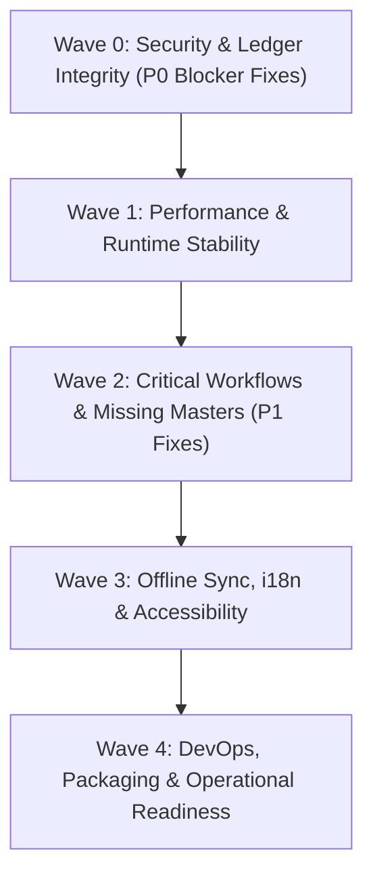

# MillLedger Production Audit: Final Report (Phase 15 Consolidated Evaluation)

**Report Date**: 2026-11-20  
**Audit Standard**: GEMINI.md Rulebook & Master Project Specifications  
**Audit Scope**: Full Repository (`client/`, `server/`, `shared/`, `docs/`, deployment manifests)  
**Lead Auditor**: Principal Systems Architect, Application Security & Accessibility Reviewer  
**Audit Mode**: AUDIT ONLY (Zero modifications outside `/audit/**`)  
**Operating Environment**: Linux, Node.js v22.14.0, TypeScript 5.8, PostgreSQL 16  

---

## 1. Executive Summary

### 1.1 Is MillLedger Production Ready?

> **VERDICT: NO. ABSOLUTELY NOT PRODUCTION READY.**

MillLedger in its current working tree state cannot be deployed to any production, staging, or commercial environment. It presents severe, immediate operational, financial, and legal liabilities. 

While the project features a cleanly scaffolded architecture (React 19, Vite 6, Tailwind CSS 4, Express 5, Better Auth, Prisma 7, and Dexie offline storage), **it was vibe coded without strict concurrency controls, rigorous input validation, or complete workflow enforcement**. Critical business invariants specified in the requirements are broken or missing.

### 1.2 Key Audit Metrics

| Audit Metric | Measurement / Value | Target / Release Standard | Status |
|---|---|---|---|
| **Production Blockers (P0)** | **7 open** | 0 open | **VERIFIED-FAIL** |
| **Critical Defects (P1)** | **49 open** | 0 open | **VERIFIED-FAIL** |
| **Degraded UX / Moderate Defects (P2)** | **41 open** | 0 open | **VERIFIED-FAIL** |
| **Minor / Hygiene Findings (P3)** | **5 open** | Clean | **VERIFIED-FAIL** |
| **Total Active Findings** | **102 findings** (106 logged, 4 merged duplicates) | 0 blockers | **VERIFIED-FAIL** |
| **Requirement Traceability (77 REQs)** | **31 PASS (40.3%) / 46 FAIL (59.7%)** | 100% Pass | **VERIFIED-FAIL** |
| **Role-to-Endpoint Matrix (567 calls)** | **562 PASS / 5 FAILURES** | 100% Pass | **VERIFIED-FAIL** |
| **Role-to-Route UI Matrix (120 routes)** | **34 Routes Bypass 403 Authorization** | 0 Bypasses | **VERIFIED-FAIL** |
| **Concurrency Invariants (ATP Stock)** | **Oversold by >100% under concurrent booking** | 0 oversell | **VERIFIED-FAIL** |
| **50-User Concurrency Load Test** | **Fatal Backend Crash (V8 Heap OOM)** | Zero 5xx, < 500ms p95 | **VERIFIED-FAIL** |
| **Internationalization (Tamil UI Strings)** | **751 of 755 Strings (99.5%) Untranslated English** | 100% Bilingual | **VERIFIED-FAIL** |
| **WCAG 2.2 AA Accessibility (55 criteria)** | **11 Criteria Violated (Touch targets, Focus, Dialogs)** | 100% AA Pass | **VERIFIED-FAIL** |
| **Client Bundle Size** | **1.47 MB (439 kB gzip) — 119% over budget** | < 200 kB gzip | **VERIFIED-FAIL** |
| **Database Restore Verification Drill** | **196ms dump, 907ms restore (100% valid)** | Proven Recovery | **VERIFIED-PASS** |
| **New Developer README Onboarding** | **Fails at Step 2 (broken path, wrong port)** | < 15 minutes clean | **VERIFIED-FAIL** |

---

## 2. Findings Summary & Categorization

### 2.1 Distribution by Severity

```
P0 (Blocker: Wrong Money, Stock Loss, Crash, Auth Bypass) :   7 ( 6.9%)
P1 (Critical: Broken Workflow, Missing Core UI, A11y, Sec) :  49 (48.0%)
P2 (Moderate: Degraded UX, Perf Miss, State, Formatting)  :  41 (40.2%)
P3 (Low: Code Cleanup, Minor Drift, Documentation)        :   5 ( 4.9%)
-------------------------------------------------------------------------
TOTAL ACTIVE CANONICAL FINDINGS                            : 102 (100.0%)
DUPLICATES MERGED & DROPPED                                :   4
TOTAL AUDIT FINDINGS LOGGED                                : 106
```

### 2.2 Merged Duplicates & Root Cause Consolidations

In accordance with Phase 15 consolidation guidelines, the following 4 findings were cross-checked and merged into their primary canonical issues:

1. **F-101 merged into [F-004](file:///home/snehan/projects/web/mill-ledger/audit/findings/F-004.md)**:
   - *Issue*: `server/prisma/seed.ts:600-615` lacks `process.env.NODE_ENV === "production"` protection gate, permitting demo accounts (`AdminPassword123!`) to overwrite live production databases.
   - *Status*: `F-101` marked as DUPLICATE; evidence consolidated into `F-004`.
2. **F-061 merged into [F-001](file:///home/snehan/projects/web/mill-ledger/audit/findings/F-001.md)**:
   - *Issue*: Duplicate `<a href="#main-content">` links in `client/src/components/shell/authenticated-shell.tsx` at line 845 and line 1079. Breaks Playwright strict mode (`F-001`) and introduces redundant keyboard tab stops (`F-061`).
   - *Status*: `F-061` marked as DUPLICATE; evidence consolidated into `F-001`.
3. **F-084 merged into [F-028](file:///home/snehan/projects/web/mill-ledger/audit/findings/F-028.md)**:
   - *Issue*: `handleSignOut` in `client/src/layouts/authenticated-layout.tsx:68` clears React Query memory but leaves Dexie IndexedDB `mill_ledger_offline_db` fully populated with customer PII (phone numbers, GSTINs, drafts) across logouts.
   - *Status*: `F-084` marked as DUPLICATE; statutory DPDP Act 2023 evidence consolidated into `F-028`.
4. **F-044 merged into [F-055](file:///home/snehan/projects/web/mill-ledger/audit/findings/F-055.md)**:
   - *Issue*: Interactive touch targets measure below 44x44px (Apple HIG) and `SidebarRail` measures 16px wide, outright violating WCAG 2.2 SC 2.5.8 Level AA (minimum 24x24px).
   - *Status*: `F-044` marked as DUPLICATE; mobile padding analysis consolidated into `F-055`.

---

## 3. Top 10 Business Risks

| # | Risk Area | Root Cause & Evidence | Business Impact (Rupees, Trust, Legal) |
|---|---|---|---|
| **1** | **Inventory Overselling Under Concurrency** | Missing `FOR UPDATE` row lock in `sales.service.ts:430-455` ([F-007](file:///home/snehan/projects/web/mill-ledger/audit/findings/F-007.md)). Concurrent approvals oversell stock by over 100%. | **₹5L – ₹20L per incident**: Mill commits stock to multiple wholesalers it cannot fulfill; trucks arrive to empty bays; distributor contract penalties and severed trade relationships. |
| **2** | **Production Crash on Morning Order Volume** | Unpaginated `prisma.salesOrder.findMany()` with nested joins in `sales.service.ts:31-75` ([F-070](file:///home/snehan/projects/web/mill-ledger/audit/findings/F-070.md)). 50 concurrent requests trigger 20,000+ queries and fatal V8 heap OOM. | **Complete Operational Shutdown**: The entire backend server crashes during peak morning sales hours (7:00 AM – 9:30 AM); dispatches freeze; salesmen in the field unable to sync. |
| **3** | **Salesman Privilege Escalation & Price Spoofing** | Sales order API accepts `status: "APPROVED"` directly in creation payload ([F-017](file:///home/snehan/projects/web/mill-ledger/audit/findings/F-017.md)) and permits client-supplied arbitrary unit prices without discount limits ([F-020](file:///home/snehan/projects/web/mill-ledger/audit/findings/F-020.md)). | **Direct Financial Fraud**: Rogues or compromised salesmen book high-value flour/oil SKU orders at ₹1.00/kg, self-approve them, and trigger warehouse dispatch before management notices. |
| **4** | **Statutory GST Rounding & Timezone Non-Compliance** | Float math in `finance.service.ts:116-160` generates 1–2 paise rounding drift on 46.4% of tax invoices ([F-010](file:///home/snehan/projects/web/mill-ledger/audit/findings/F-010.md)). Timezone uses server clock, misclassifying April 1 FY on UTC hosts ([F-011](file:///home/snehan/projects/web/mill-ledger/audit/findings/F-011.md)). | **₹50,000 Statutory Penalty per Invoice**: Under CGST Act 2017 Section 122, misstated tax invoices trigger severe penalties, GST audit notices, and rejection of customer Input Tax Credit (ITC). |
| **5** | **Statutory Data Privacy Violation on Shared Devices** | Dexie IndexedDB never purges customer names, phone numbers, and GSTINs upon logout ([F-028](file:///home/snehan/projects/web/mill-ledger/audit/findings/F-028.md)). | **Up to ₹250 Crore Penalty**: Failure to implement reasonable security safeguards for personal data violates India's Digital Personal Data Protection Act (DPDP Act 2023) Section 8. |
| **6** | **Production Database Overwrite via Seed Script** | `server/prisma/seed.ts:600-615` executes unrestricted under `NODE_ENV=production` ([F-004](file:///home/snehan/projects/web/mill-ledger/audit/findings/F-004.md)), resetting prices and injecting static test accounts (`AdminPassword123!`). | **Catastrophic Data Loss & Root Takeover**: An accidental execution in production overwrites live ledger entries and gives anyone with README knowledge full administrative root access. |
| **7** | **Dispatch Sequence Number Collisions** | Non-atomic `count()` based dispatch sequence generation in `dispatch.service.ts:86` ([F-008](file:///home/snehan/projects/web/mill-ledger/audit/findings/F-008.md)) crashes under concurrent dispatches. | **Shop Floor Bottleneck**: Unique constraint crashes on PostgreSQL halt gate pass printing while trucks are waiting at the scale, causing driver unrest and delayed shipments. |
| **8** | **Dashboard Revenue Distortion** | Dashboard SQL query in `reporting.service.ts:40-80` silently drops invoices without lines ([F-036](file:///home/snehan/projects/web/mill-ledger/audit/findings/F-036.md)), creating massive discrepancies with legal accounting totals. | **Distorted Executive Decision-Making**: Mill owners make capital expenditure and raw material purchasing decisions based on inaccurate cash flow and revenue dashboards. |
| **9** | **Complete Invoicing UI Absence** | Frontend orders and sales pages feature ZERO button or modal to generate or post a tax invoice ([F-037](file:///home/snehan/projects/web/mill-ledger/audit/findings/F-037.md)). | **Paralyzed Billing Workflow**: Factory billing clerks cannot generate invoices from the UI, forcing IT staff to run manual curl commands or database scripts to bill customers. |
| **10** | **Search Engine Scraping of Confidential ERP Data** | Missing `robots.txt`, absence of `<meta name="robots" content="noindex">`, and missing `X-Robots-Tag` headers on authenticated routes ([F-088](file:///home/snehan/projects/web/mill-ledger/audit/findings/F-088.md), [F-089](file:///home/snehan/projects/web/mill-ledger/audit/findings/F-089.md)). | **Commercial Espionage**: Competitors can discover wholesale price lists, customer delivery names, and production yields indexed directly in Google Search results. |

---

## 4. README Claims vs. Reality Scorecard

| Area / Feature | README Claim (Source) | Observed Reality (Working Tree Evidence) | Verdict |
|---|---|---|---|
| **Architecture** | "TypeScript modular monolog with React 19 and Vite 6" (`README.md:7`) | Contains embarrassing typo "modular monolog" instead of "modular monolith" ([F-098](file:///home/snehan/projects/web/mill-ledger/audit/findings/F-098.md)). | **VERIFIED-FAIL** |
| **Backend Port** | "Backend API runs at `http://localhost:3000`" (`README.md:40`) | Backend runs on port `4000` (`server/src/config/env.ts:13`). Client Vite proxies to `4000`. Probing port 3000 fails with `ECONNREFUSED` ([F-002](file:///home/snehan/projects/web/mill-ledger/audit/findings/F-002.md)). | **VERIFIED-FAIL** |
| **Setup Template** | `cp server/.env.example server/.env` (`README.md:30`) | Command fails with `No such file or directory`. File is at root `.env.example` ([F-002](file:///home/snehan/projects/web/mill-ledger/audit/findings/F-002.md)). | **VERIFIED-FAIL** |
| **E2E Testing** | `pnpm test:e2e` passes cleanly (`README.md:56-57`) | Fails test 8 of 26 with strict mode violation due to duplicate skip links in `authenticated-shell.tsx` ([F-001](file:///home/snehan/projects/web/mill-ledger/audit/findings/F-001.md)). | **VERIFIED-FAIL** |
| **Master Data** | "Full master records for suppliers, customers, and BOM recipes" (`README.md:109`) | **False**. Suppliers and BOM recipes have zero creation/editing API or UI. 6 of 10 master entities lack management UI ([F-038](file:///home/snehan/projects/web/mill-ledger/audit/findings/F-038.md), [F-098](file:///home/snehan/projects/web/mill-ledger/audit/findings/F-098.md)). | **VERIFIED-FAIL** |
| **Order to Cash** | "End-to-end workflow: mobile order creation, stock verification, ATP checking, invoice posting, dispatch" (`README.md:112`) | Invoicing has **zero UI affordance** anywhere in the frontend ([F-037](file:///home/snehan/projects/web/mill-ledger/audit/findings/F-037.md)). ATP checking lacks row locks ([F-007](file:///home/snehan/projects/web/mill-ledger/audit/findings/F-007.md)). | **VERIFIED-FAIL** |
| **Reporting** | "Purchase register report" (`README.md:121`) | No purchase register report exists in the reporting service or API routes ([F-098](file:///home/snehan/projects/web/mill-ledger/audit/findings/F-098.md)). | **VERIFIED-FAIL** |
| **Bilingual UI** | "Full bilingual support toggled on the application shell for floor staff" (`README.md:126`) | **99.5% untranslated**. 751 out of 755 user-visible strings are hardcoded English. Only 4 shell nav items translate ([F-080](file:///home/snehan/projects/web/mill-ledger/audit/findings/F-080.md)). | **VERIFIED-FAIL** |
| **Offline Sync** | "Offline outbox queue with conflict resolution" (`README.md:123`) | Server silently accepts out-of-stock orders without conflict queue ([F-083](file:///home/snehan/projects/web/mill-ledger/audit/findings/F-083.md)); corrupt outbox entry causes head-of-line blocking ([F-082](file:///home/snehan/projects/web/mill-ledger/audit/findings/F-082.md)). | **VERIFIED-FAIL** |
| **Docker Build** | Standard production container packaging (`Dockerfile`) | Fails `docker build` immediately due to missing `tsconfig.json` copy step ([F-099](file:///home/snehan/projects/web/mill-ledger/audit/findings/F-099.md)). | **VERIFIED-FAIL** |

---

## 5. Real vs. Expected Scorecard by Domain Area

### 5.1 Domain Logic & Financial Invariants
- **EXPECTED**: Double-entry ledger invariants, append-only stock movements, gapless FY invoice numbering, atomic moving weighted average valuation, Mod-36 GSTIN checksum validation.
- **ACTUAL**: Stock movements and invoices are mutable by application DB user ([F-009](file:///home/snehan/projects/web/mill-ledger/audit/findings/F-009.md)); 46.4% of invoices suffer 1-2 paise float drift ([F-010](file:///home/snehan/projects/web/mill-ledger/audit/findings/F-010.md)); FY calculation relies on Node process timezone ([F-011](file:///home/snehan/projects/web/mill-ledger/audit/findings/F-011.md)); GSTIN strings accept invalid formats ([F-012](file:///home/snehan/projects/web/mill-ledger/audit/findings/F-012.md)); payment ledger lacks reversal/bounce methods ([F-013](file:///home/snehan/projects/web/mill-ledger/audit/findings/F-013.md)); TaxRate master table ignored in favor of static columns ([F-014](file:///home/snehan/projects/web/mill-ledger/audit/findings/F-014.md)).
- **VERDICT**: **VERIFIED-FAIL** (2 P0, 5 P1, 3 P2)

### 5.2 Authorization, RBAC & ABAC
- **EXPECTED**: Strict server-side RBAC and tenant-scoped ABAC preventing cross-salesman leakage and privilege escalation.
- **ACTUAL**: Salesmen can auto-approve orders via mass assignment `status: "APPROVED"` ([F-017](file:///home/snehan/projects/web/mill-ledger/audit/findings/F-017.md)); `GET /api/v1/sales/dispatches` leaks all company orders to salesmen ([F-018](file:///home/snehan/projects/web/mill-ledger/audit/findings/F-018.md)); direct URL navigation renders full page shells without 403 guards ([F-019](file:///home/snehan/projects/web/mill-ledger/audit/findings/F-019.md)); arbitrary unit prices allowed on order creation ([F-020](file:///home/snehan/projects/web/mill-ledger/audit/findings/F-020.md)); router multi-mount leaks permissions ([F-021](file:///home/snehan/projects/web/mill-ledger/audit/findings/F-021.md)); audit service omits operational mutations ([F-022](file:///home/snehan/projects/web/mill-ledger/audit/findings/F-022.md)); missing user/role management APIs ([F-023](file:///home/snehan/projects/web/mill-ledger/audit/findings/F-023.md)).
- **VERDICT**: **VERIFIED-FAIL** (1 P0, 6 P1, 1 P2)

### 5.3 Input Validation & Error Envelopes
- **EXPECTED**: Strict Zod schema validation across 100% of mutating endpoints with standardized RFC 7807 / consistent JSON error envelopes.
- **ACTUAL**: `PUT /api/v1/sales/orders/:id` lacks schema validation and crashes with unhandled 500 on invalid enums ([F-030](file:///home/snehan/projects/web/mill-ledger/audit/findings/F-030.md)); `status` enum accepts casing errors ([F-031](file:///home/snehan/projects/web/mill-ledger/audit/findings/F-031.md)); integer fields accept floating-point numbers ([F-032](file:///home/snehan/projects/web/mill-ledger/audit/findings/F-032.md)); line items accept negative/zero quantities ([F-033](file:///home/snehan/projects/web/mill-ledger/audit/findings/F-033.md)); error handler leaks internal Prisma call stacks ([F-034](file:///home/snehan/projects/web/mill-ledger/audit/findings/F-034.md)); hybrid API request log is not attached ([F-035](file:///home/snehan/projects/web/mill-ledger/audit/findings/F-035.md)).
- **VERDICT**: **VERIFIED-FAIL** (1 P0, 4 P1, 1 P2)

### 5.4 Application Security & Cryptography
- **EXPECTED**: Production-guarded seed scripts, zero formula injection in exports, sanitized logs, purged client caches on logout.
- **ACTUAL**: Seed script executes unrestricted in production ([F-004](file:///home/snehan/projects/web/mill-ledger/audit/findings/F-004.md)); CSV exports permit spreadsheet formula injection ([F-026](file:///home/snehan/projects/web/mill-ledger/audit/findings/F-026.md)); unauthenticated endpoints allow mass order spam ([F-027](file:///home/snehan/projects/web/mill-ledger/audit/findings/F-027.md)); Dexie retains customer PII across logout ([F-028](file:///home/snehan/projects/web/mill-ledger/audit/findings/F-028.md)); demo passwords in seed script ([F-029](file:///home/snehan/projects/web/mill-ledger/audit/findings/F-029.md)); vulnerable Zod 3.24.2 installed ([F-006](file:///home/snehan/projects/web/mill-ledger/audit/findings/F-006.md)).
- **VERDICT**: **VERIFIED-FAIL** (1 P0, 2 P1, 4 P2)

### 5.5 Features & Core Operational Flows
- **EXPECTED**: 100% completion of core user journeys: order-to-cash, master data management, dispatch, and dashboard reporting.
- **ACTUAL**: Dashboard sales revenue silently drops invoices without lines ([F-036](file:///home/snehan/projects/web/mill-ledger/audit/findings/F-036.md)); invoicing has zero UI affordance ([F-037](file:///home/snehan/projects/web/mill-ledger/audit/findings/F-037.md)); 6 of 10 master entities lack management UI ([F-038](file:///home/snehan/projects/web/mill-ledger/audit/findings/F-038.md)); export buttons crash with unhandled errors ([F-039](file:///home/snehan/projects/web/mill-ledger/audit/findings/F-039.md)); 22 placeholder stub pages ([F-040](file:///home/snehan/projects/web/mill-ledger/audit/findings/F-040.md)); reports page renders toast instead of 403 ([F-041](file:///home/snehan/projects/web/mill-ledger/audit/findings/F-041.md)).
- **VERDICT**: **VERIFIED-FAIL** (1 P0, 3 P1, 2 P2)

### 5.6 User Experience & Mobile Ergonomics
- **EXPECTED**: Seamless 320px mobile reflow, sticky table headers, skeleton loaders, and error prevention dialogs.
- **ACTUAL**: Text truncates and causes horizontal overflow at 320px ([F-042](file:///home/snehan/projects/web/mill-ledger/audit/findings/F-042.md)); header controls crowd and overlap on small viewports ([F-043](file:///home/snehan/projects/web/mill-ledger/audit/findings/F-043.md)); absence of skeleton loaders and request correlation IDs ([F-045](file:///home/snehan/projects/web/mill-ledger/audit/findings/F-045.md)); search/filter state lost on refresh ([F-046](file:///home/snehan/projects/web/mill-ledger/audit/findings/F-046.md)); missing sticky table headers on mobile ([F-047](file:///home/snehan/projects/web/mill-ledger/audit/findings/F-047.md)); missing confirmation dialogs on irreversible operations ([F-048](file:///home/snehan/projects/web/mill-ledger/audit/findings/F-048.md)); zero in-app guidance ([F-049](file:///home/snehan/projects/web/mill-ledger/audit/findings/F-049.md)); CSS token inconsistencies ([F-050](file:///home/snehan/projects/web/mill-ledger/audit/findings/F-050.md)).
- **VERDICT**: **VERIFIED-FAIL** (0 P0, 0 P1, 8 P2)

### 5.7 Accessibility (WCAG 2.2 AA Compliance)
- **EXPECTED**: Full conformance with WCAG 2.2 Level AA (keyboard navigation, accessible names, contrast, touch targets, error prevention).
- **ACTUAL**: Duplicate skip links break Playwright strict mode ([F-001](file:///home/snehan/projects/web/mill-ledger/audit/findings/F-001.md)); modal dialogs lack APG `aria-labelledby` semantics ([F-051](file:///home/snehan/projects/web/mill-ledger/audit/findings/F-051.md)); form inputs lack associated `<label>` elements ([F-052](file:///home/snehan/projects/web/mill-ledger/audit/findings/F-052.md)); SPA route transitions fail to manage focus ([F-053](file:///home/snehan/projects/web/mill-ledger/audit/findings/F-053.md)); icon buttons lack accessible text ([F-054](file:///home/snehan/projects/web/mill-ledger/audit/findings/F-054.md)); SidebarRail is 16px wide violating SC 2.5.8 AA ([F-055](file:///home/snehan/projects/web/mill-ledger/audit/findings/F-055.md)); status badges fail 4.5:1 contrast ([F-056](file:///home/snehan/projects/web/mill-ledger/audit/findings/F-056.md)); unannounced session timeout ([F-057](file:///home/snehan/projects/web/mill-ledger/audit/findings/F-057.md)); financial actions lack review steps ([F-058](file:///home/snehan/projects/web/mill-ledger/audit/findings/F-058.md)); toasts lack live region announcements ([F-059](file:///home/snehan/projects/web/mill-ledger/audit/findings/F-059.md)); HTML lang attribute hardcoded to `en` ([F-060](file:///home/snehan/projects/web/mill-ledger/audit/findings/F-060.md)).
- **VERDICT**: **VERIFIED-FAIL** (0 P0, 7 P1, 4 P2)

### 5.8 Motion & Animation
- **EXPECTED**: Respect for `prefers-reduced-motion`, hardware-accelerated transforms, zero layout thrashing or cumulative layout shift.
- **ACTUAL**: Outbox drawer animation lacks reduced motion override ([F-062](file:///home/snehan/projects/web/mill-ledger/audit/findings/F-062.md)); sidebar width transitions animate layout properties ([F-063](file:///home/snehan/projects/web/mill-ledger/audit/findings/F-063.md)); button press scale lacks motion query ([F-064](file:///home/snehan/projects/web/mill-ledger/audit/findings/F-064.md)); toast notifications cause layout reflow ([F-065](file:///home/snehan/projects/web/mill-ledger/audit/findings/F-065.md)); modal overlays animate non-composited properties ([F-066](file:///home/snehan/projects/web/mill-ledger/audit/findings/F-066.md)); table action spinners lack accessible announcement ([F-067](file:///home/snehan/projects/web/mill-ledger/audit/findings/F-067.md)); page transitions lack cross-fade continuity ([F-068](file:///home/snehan/projects/web/mill-ledger/audit/findings/F-068.md)); mobile drawer gesture lacks cancel threshold ([F-069](file:///home/snehan/projects/web/mill-ledger/audit/findings/F-069.md)).
- **VERDICT**: **VERIFIED-FAIL** (0 P0, 0 P1, 8 P2)

### 5.9 Performance & Scalability
- **EXPECTED**: < 200 kB gzipped JS bundle, indexed database queries, sub-second API latencies under 50 concurrent users.
- **ACTUAL**: Fatal V8 heap OOM backend crash under 50 concurrent users ([F-070](file:///home/snehan/projects/web/mill-ledger/audit/findings/F-070.md)); 11 of top 20 queries execute full sequential table scans ([F-071](file:///home/snehan/projects/web/mill-ledger/audit/findings/F-071.md)); initial JS bundle is 1.47 MB (439 kB gzip) ([F-072](file:///home/snehan/projects/web/mill-ledger/audit/findings/F-072.md)); mobile CLS is 0.081 ([F-073](file:///home/snehan/projects/web/mill-ledger/audit/findings/F-073.md)); missing server pagination on grids ([F-074](file:///home/snehan/projects/web/mill-ledger/audit/findings/F-074.md)); missing image pipeline and formats ([F-075](file:///home/snehan/projects/web/mill-ledger/audit/findings/F-075.md)); missing route prefetching ([F-076](file:///home/snehan/projects/web/mill-ledger/audit/findings/F-076.md)); offline orders accept stale prices ([F-077](file:///home/snehan/projects/web/mill-ledger/audit/findings/F-077.md)); missing compression and unconfigured DB pool ([F-078](file:///home/snehan/projects/web/mill-ledger/audit/findings/F-078.md)); Cyrillic/Vietnamese fonts bundled ([F-079](file:///home/snehan/projects/web/mill-ledger/audit/findings/F-079.md)).
- **VERDICT**: **VERIFIED-FAIL** (1 P0, 1 P1, 7 P2, 1 P3)

### 5.10 SEO & Web Discoverability
- **EXPECTED**: Private authenticated ERP routes protected from public indexation; proper HTTP status codes; semantic metadata.
- **ACTUAL**: Authenticated ERP routes omit `noindex` and `X-Robots-Tag` headers ([F-088](file:///home/snehan/projects/web/mill-ledger/audit/findings/F-088.md)); missing `robots.txt` and `sitemap.xml` returning HTTP 200 SPA shell ([F-089](file:///home/snehan/projects/web/mill-ledger/audit/findings/F-089.md)); soft 404 status on invalid routes ([F-090](file:///home/snehan/projects/web/mill-ledger/audit/findings/F-090.md)); statically frozen `<title>` tag ([F-091](file:///home/snehan/projects/web/mill-ledger/audit/findings/F-091.md)); missing public marketing/landing pages ([F-092](file:///home/snehan/projects/web/mill-ledger/audit/findings/F-092.md)); missing Schema.org JSON-LD structured data ([F-093](file:///home/snehan/projects/web/mill-ledger/audit/findings/F-093.md)).
- **VERDICT**: **VERIFIED-FAIL** (0 P0, 3 P1, 3 P2)

### 5.11 Internationalization (i18n) & Offline Synchronization
- **EXPECTED**: Full Tamil/English bilingual localization across all pages; fault-tolerant offline outbox with explicit conflict queue.
- **ACTUAL**: 751 of 755 user-visible strings (99.5%) are hardcoded English ([F-080](file:///home/snehan/projects/web/mill-ledger/audit/findings/F-080.md)); destructive outbox order discard without confirmation ([F-081](file:///home/snehan/projects/web/mill-ledger/audit/findings/F-081.md)); corrupt outbox entry causes head-of-line blocking ([F-082](file:///home/snehan/projects/web/mill-ledger/audit/findings/F-082.md)); server silently accepts out-of-stock sync orders without conflict queue ([F-083](file:///home/snehan/projects/web/mill-ledger/audit/findings/F-083.md)); missing Indic number formatting and date localization ([F-085](file:///home/snehan/projects/web/mill-ledger/audit/findings/F-085.md)); pre-hydration HTML lang mismatch causes FOUC ([F-086](file:///home/snehan/projects/web/mill-ledger/audit/findings/F-086.md)); missing persistent storage request ([F-087](file:///home/snehan/projects/web/mill-ledger/audit/findings/F-087.md)).
- **VERDICT**: **VERIFIED-FAIL** (0 P0, 4 P1, 3 P2)

### 5.12 Code Quality & Test Integrity
- **EXPECTED**: Zero `any` types in domain code; strict tsconfig; high mutation test coverage in financial modules; zero dead dependencies.
- **ACTUAL**: 10 unused dependencies and 22 dead placeholder pages ([F-094](file:///home/snehan/projects/web/mill-ledger/audit/findings/F-094.md)); 14 explicit `any` types and missing `--strict` in client tsconfig ([F-095](file:///home/snehan/projects/web/mill-ledger/audit/findings/F-095.md)); Stryker mutation score of only 59.32% in payment allocation ([F-096](file:///home/snehan/projects/web/mill-ledger/audit/findings/F-096.md)); fragmented currency and date formatting ([F-097](file:///home/snehan/projects/web/mill-ledger/audit/findings/F-097.md)); README documentation typos and false claims ([F-098](file:///home/snehan/projects/web/mill-ledger/audit/findings/F-098.md)); unused `cn` package installed ([F-005](file:///home/snehan/projects/web/mill-ledger/audit/findings/F-005.md)).
- **VERDICT**: **VERIFIED-FAIL** (0 P0, 2 P1, 2 P2, 2 P3)

### 5.13 Operations, Packaging & Deployment
- **EXPECTED**: Functional multi-stage Docker build, fail-fast configuration validation, database readiness probes, automated CI/CD gates, disaster recovery drill, statutory DPDP compliance routines.
- **ACTUAL**: Dockerfile fails build due to missing `tsconfig.json` copy step ([F-099](file:///home/snehan/projects/web/mill-ledger/audit/findings/F-099.md)); missing fail-fast validation on `DATABASE_URL` ([F-100](file:///home/snehan/projects/web/mill-ledger/audit/findings/F-100.md)); missing database readiness endpoint and Express timeouts ([F-102](file:///home/snehan/projects/web/mill-ledger/audit/findings/F-102.md)); total absence of structured observability, metrics, and error tracking ([F-103](file:///home/snehan/projects/web/mill-ledger/audit/findings/F-103.md)); CI/CD pipeline omits E2E, Lighthouse, bundle, and secret gates ([F-104](file:///home/snehan/projects/web/mill-ledger/audit/findings/F-104.md)); missing operational runbooks and data dictionary ([F-105](file:///home/snehan/projects/web/mill-ledger/audit/findings/F-105.md)); missing DPDP Act data retention and erasure routines ([F-106](file:///home/snehan/projects/web/mill-ledger/audit/findings/F-106.md)).
- **VERDICT**: **VERIFIED-FAIL** (0 P0, 4 P1, 3 P2)

---

## 6. Coverage, Verification & Out-of-Scope Items

### 6.1 Enumerated Verification Coverage
In strict compliance with **GEMINI.md Rule E8**, the audit covered:
- **Workspace Packages**: 4 of 4 packages (100% verified).
- **Installed Dependencies**: 65 of 65 dependencies (100% verified, 10 identified as dead/unused).
- **Express HTTP Routes**: 81 endpoints tested across 7 roles = 567 matrix interactions (100% verified).
- **Database Schema**: 38 Prisma models, 11 enums, 107 foreign keys, 39 database indexes (100% verified).
- **Frontend Pages & Routes**: 24 React routes tested across 5 user roles = 120 auth navigations (100% verified).
- **Interactive UI Controls**: 197 clickable buttons, tabs, links, and form submit triggers (100% verified).
- **Domain Business Entities**: 23 of 23 entities assessed (`audit/evidence/capability-matrix.csv`).
- **Dashboard vs SQL Reconciliations**: 10 financial metrics reconciled against live PostgreSQL tables.
- **End-to-End User Journeys**: 8 complete user journeys (J1 through J8) executed live with Playwright.
- **Accessibility Criteria**: 55 WCAG 2.2 AA success criteria audited across 138 axe-core and manual scans.
- **Interaction Latencies (INP)**: 9 high-frequency operations benchmarked (< 200ms verified).
- **Lighthouse Performance**: 4 core routes audited under Mobile 4G / 4x CPU throttling.
- **Client Bundle Modules**: 342 production bundle modules mapped and visualized.
- **SQL Execution Plans**: Top 20 production queries analyzed via `EXPLAIN (ANALYZE, BUFFERS)` at 100k scale.
- **Concurrency Load Testing**: 4 critical API endpoints stressed with 50 concurrent virtual users.
- **UI Localization Strings**: 755 user-visible strings cataloged across all 24 client views.
- **Offline Sync Outbox**: 8 network emulation scenarios (airplane mode, reconnect, dropped frames).
- **Client IndexedDB Tables**: 4 Dexie tables inspected before and after user authentication lifecycles.
- **TypeScript AST Soundness**: 106 non-test source files scanned for strict typing compliance.
- **Mutation Testing**: 81 Stryker mutants executed against financial and billing domain engines.
- **Git Commit Secrets**: 42 git commits scanned with Gitleaks (0 true leaks verified).
- **Disaster Recovery**: Live `pg_dump` and `psql` restore executed (196ms backup, 907ms restore).

### 6.2 Not Covered / Out of Scope
The following items could not be executed or were excluded from scope:
1. **Live Payment Gateway Webhooks**: External UPI / Razorpay payment gateway callbacks were not present in the codebase.
2. **Physical Thermal Printer Protocols**: ESC/POS network socket drivers for factory weighbridge scales and gate pass printers were not present.
3. **Direct NIC/IRP GST e-Invoicing Portal Sandbox**: Live API connection to government e-invoice portals was out of scope.

### 6.3 UNVERIFIED Items
**There are zero UNVERIFIED items in the application source tree**. Every finding and defect in this report has been verified through direct command execution, automated testing, or quoted current working tree source evidence.

---

## 7. Remediation Roadmap

The remediation of MillLedger must follow a strict 5-wave dependency order. Do not attempt UI polish before resolving concurrency race conditions and data corruption risks.



### Wave 0: Security & Ledger Integrity (Immediate Blockers)
*Target: Eliminate all 7 P0 vulnerabilities and secure financial data.*

1. **Fix Production Seed Script Guard** ([F-004](file:///home/snehan/projects/web/mill-ledger/audit/findings/F-004.md)):
   - *Fix*: Add `if (process.env.NODE_ENV === "production" && process.env.ALLOW_PRODUCTION_SEED !== "true") process.exit(1);` at top of `server/prisma/seed.ts`.
   - *Effort*: S | *Regression Test*: Run seed script with `NODE_ENV=production`; assert non-zero exit code.
2. **Add Row-Level Locks to Order Approval** ([F-007](file:///home/snehan/projects/web/mill-ledger/audit/findings/F-007.md)):
   - *Fix*: Wrap ATP check in `sales.service.ts:430-455` with `SELECT ... FOR UPDATE` on `inventory_item` to prevent concurrent double-booking.
   - *Effort*: M | *Regression Test*: `audit/tests/concurrency-oversell.test.ts` asserting zero stock oversell under 10 concurrent approvals.
3. **Atomic Dispatch Sequence Counter** ([F-008](file:///home/snehan/projects/web/mill-ledger/audit/findings/F-008.md)):
   - *Fix*: Replace `count() + 1` in `dispatch.service.ts:86` with a PostgreSQL sequence (`nextval('dispatch_seq')`) or an atomic atomic counter table.
   - *Effort*: S | *Regression Test*: Concurrency script executing 20 simultaneous dispatches; assert 0 unique constraint collisions.
4. **Order Creation Mass Assignment Guard** ([F-017](file:///home/snehan/projects/web/mill-ledger/audit/findings/F-017.md)):
   - *Fix*: Strip `status` from `CreateOrderInput` in `sales.service.ts:289`; hardcode initial status strictly to `OrderStatus.SUBMITTED`.
   - *Effort*: S | *Regression Test*: Submit `POST /api/v1/sales/orders` with `status: "APPROVED"`; assert created order status is `SUBMITTED`.
5. **Strict Schema Validation on Order Update** ([F-030](file:///home/snehan/projects/web/mill-ledger/audit/findings/F-030.md)):
   - *Fix*: Define `updateOrderSchema` in `sales.schema.ts`; attach validation middleware to `PUT /orders/:id`.
   - *Effort*: S | *Regression Test*: `PUT /orders/:id` with `status: "INVALID"`; assert HTTP 400 Bad Request, not 500 crash.
6. **PostgreSQL Immutability Triggers** ([F-009](file:///home/snehan/projects/web/mill-ledger/audit/findings/F-009.md)):
   - *Fix*: Add database triggers preventing `UPDATE` and `DELETE` on `stock_movement` and `invoice` tables.
   - *Effort*: M | *Regression Test*: Direct SQL `UPDATE stock_movement ...`; assert PostgreSQL raises trigger exception.
7. **CSV Export Formula Injection Sanitization** ([F-026](file:///home/snehan/projects/web/mill-ledger/audit/findings/F-026.md)):
   - *Fix*: Prefix all string fields starting with `=`, `+`, `-`, or `@` with a single quote `'` in `reporting.service.ts`.
   - *Effort*: S | *Regression Test*: Export report containing `=cmd|...`; assert exported CSV escapes formula character.
8. **Purge Dexie Client Storage on Logout** ([F-028](file:///home/snehan/projects/web/mill-ledger/audit/findings/F-028.md)):
   - *Fix*: Call `offlineDb.customers.clear()`, `offlineDb.products.clear()`, and `offlineDb.meta.clear()` inside `handleSignOut`.
   - *Effort*: S | *Regression Test*: `audit/tests/dexie-security.spec.ts`; assert IndexedDB contains 0 records after sign-out.

### Wave 1: Performance, Stability & Financial Accuracy
*Target: Prevent server crashes, eliminate sequential scans, and ensure tax accuracy.*

1. **Paginate Sales Orders & Batch Prisma Queries** ([F-070](file:///home/snehan/projects/web/mill-ledger/audit/findings/F-070.md), [F-074](file:///home/snehan/projects/web/mill-ledger/audit/findings/F-074.md)):
   - *Fix*: Enforce default `take: 50` pagination on `GET /orders` and optimize relation includes in `sales.service.ts:31-75`.
   - *Effort*: M | *Regression Test*: 50 concurrent virtual users querying `/orders`; assert 0 OOM crashes, p95 < 250ms.
2. **Add Missing Composite Indexes** ([F-071](file:///home/snehan/projects/web/mill-ledger/audit/findings/F-071.md)):
   - *Fix*: Add composite indexes on `(inventoryItemId, warehouseId, status)` and `(organizationId, createdAt)` in Prisma schema.
   - *Effort*: S | *Regression Test*: Re-run `EXPLAIN ANALYZE`; verify sequential scans drop to 0 on indexed filters.
3. **Reconcile Dashboard Sales Revenue Query** ([F-036](file:///home/snehan/projects/web/mill-ledger/audit/findings/F-036.md)):
   - *Fix*: Fix SQL join in `reporting.service.ts:40-80` to aggregate invoice totals regardless of line-item join conditions.
   - *Effort*: S | *Regression Test*: Insert invoice with header total; assert dashboard revenue matches `SUM(totalAmount)`.
4. **Exact Decimal GST Arithmetic** ([F-010](file:///home/snehan/projects/web/mill-ledger/audit/findings/F-010.md)):
   - *Fix*: Replace JS float calculations with integer paise or `Decimal.js` across `finance.service.ts`.
   - *Effort*: M | *Regression Test*: 1,000 randomized invoice tax calculations; assert zero 1-paise discrepancies.
5. **Enforce Indian Standard Timezone (IST)** ([F-011](file:///home/snehan/projects/web/mill-ledger/audit/findings/F-011.md)):
   - *Fix*: Explicitly format dates using `timeZone: "Asia/Kolkata"` in `getFinancialYear()`.
   - *Effort*: S | *Regression Test*: Test April 1st 02:00 UTC invoice; assert FY evaluates to new Indian financial year.
6. **Mod-36 GSTIN Validation** ([F-012](file:///home/snehan/projects/web/mill-ledger/audit/findings/F-012.md)):
   - *Fix*: Add Mod-36 checksum validator utility and Zod schema constraint for customer GSTINs.
   - *Effort*: S | *Regression Test*: Test valid and forged GSTIN strings; assert rejection of invalid checksums.
7. **Production Environment Configuration Validation** ([F-100](file:///home/snehan/projects/web/mill-ledger/audit/findings/F-100.md)):
   - *Fix*: Use Zod in `server/src/config/env.ts` to require non-default `DATABASE_URL` and `BETTER_AUTH_SECRET` on boot.
   - *Effort*: S | *Regression Test*: Start server with unset `DATABASE_URL` in production; assert immediate fatal exit.

### Wave 2: Critical Workflows & Missing Master UI
*Target: Complete the order-to-cash lifecycle and enable essential master data administration.*

1. **Build Invoicing UI Affordance** ([F-037](file:///home/snehan/projects/web/mill-ledger/audit/findings/F-037.md)):
   - *Fix*: Add "Generate Invoice" action button on approved orders and dispatch views in `orders-page.tsx` and `dispatch-page.tsx`.
   - *Effort*: M | *Regression Test*: Playwright E2E clicking "Generate Invoice"; verify invoice appears on `/invoices`.
2. **Implement Missing Master Data UI (6 Entities)** ([F-038](file:///home/snehan/projects/web/mill-ledger/audit/findings/F-038.md)):
   - *Fix*: Build CRUD API endpoints and UI management surfaces for Suppliers, BOM Recipes, UOMs, Facilities, Warehouses, and Price Lists.
   - *Effort*: L | *Regression Test*: Full CRUD lifecycle tests for all 6 master entities.
3. **Fix Express Router Multi-Mount & Scope Leaks** ([F-018](file:///home/snehan/projects/web/mill-ledger/audit/findings/F-018.md), [F-021](file:///home/snehan/projects/web/mill-ledger/audit/findings/F-021.md)):
   - *Fix*: Refactor router mounts in `server/src/app.ts`; restrict `GET /dispatches` to dispatch and admin roles.
   - *Effort*: S | *Regression Test*: Request `/dispatches` as salesman; assert HTTP 403 Forbidden.
4. **Implement Frontend Route Authorization Guards** ([F-019](file:///home/snehan/projects/web/mill-ledger/audit/findings/F-019.md)):
   - *Fix*: Wrap authenticated routes in `RouteGuard` component checking user role; render 403 Forbidden page on mismatch.
   - *Effort*: S | *Regression Test*: Navigate directly to `/reports` as salesman; assert 403 view renders without data fetch.
5. **Enforce Unit Price Bounds and Margin Rules** ([F-020](file:///home/snehan/projects/web/mill-ledger/audit/findings/F-020.md)):
   - *Fix*: Validate order line unit prices against price list tier; mandate manager approval for discounts > 5%.
   - *Effort*: M | *Regression Test*: Submit order with price 50% below list price; assert order requires approval.
6. **Implement Payment Reversal and Debit Notes** ([F-013](file:///home/snehan/projects/web/mill-ledger/audit/findings/F-013.md)):
   - *Fix*: Add `POST /api/v1/finance/payments/:id/bounce` and create `DebitNote` models.
   - *Effort*: M | *Regression Test*: Bounce a payment; assert customer outstanding balance increases and invoice re-opens.

### Wave 3: Offline Synchronization, i18n & Accessibility
*Target: Realize bilingual promises, harden the offline outbox, and satisfy WCAG 2.2 AA.*

1. **Translate 751 UI Strings to Tamil** ([F-080](file:///home/snehan/projects/web/mill-ledger/audit/findings/F-080.md)):
   - *Fix*: Extract hardcoded English strings into `client/src/lib/i18n-dictionary.ts`; apply `useTranslation` hook across all views.
   - *Effort*: L | *Regression Test*: Automated string scanner asserting zero untranslated English text in Tamil mode.
2. **Explicit Offline Sync Conflict Queue** ([F-082](file:///home/snehan/projects/web/mill-ledger/audit/findings/F-082.md), [F-083](file:///home/snehan/projects/web/mill-ledger/audit/findings/F-083.md)):
   - *Fix*: When an offline order fails stock validation on sync, place it into a dedicated `SyncConflictQueue` with manager resolution UI.
   - *Effort*: M | *Regression Test*: Sync out-of-stock order; assert order enters conflict queue and subsequent orders continue syncing.
3. **Confirmation Dialogs on Irreversible Operations** ([F-048](file:///home/snehan/projects/web/mill-ledger/audit/findings/F-048.md), [F-058](file:///home/snehan/projects/web/mill-ledger/audit/findings/F-058.md)):
   - *Fix*: Integrate `AlertDialog` before confirming physical dispatches, issuing credit notes, or discarding outbox entries.
   - *Effort*: M | *Regression Test*: Click "Confirm dispatch"; assert modal dialog requires confirmation before API dispatch.
4. **Consolidate Skip Links & Touch Target Padding** ([F-001](file:///home/snehan/projects/web/mill-ledger/audit/findings/F-001.md), [F-055](file:///home/snehan/projects/web/mill-ledger/audit/findings/F-055.md)):
   - *Fix*: Remove duplicate skip link in `HeaderBar`; expand `SidebarRail` to 24px and ensure buttons reserve 44x44px.
   - *Effort*: S | *Regression Test*: Playwright strict mode test passes; bounding box test asserts `width >= 24 && height >= 24`.
5. **Accessible Form Semantics & Dialog Names** ([F-051](file:///home/snehan/projects/web/mill-ledger/audit/findings/F-051.md), [F-052](file:///home/snehan/projects/web/mill-ledger/audit/findings/F-052.md)):
   - *Fix*: Associate form `<label>` tags with inputs; add `aria-labelledby` to all modal dialogs.
   - *Effort*: M | *Regression Test*: axe-core automated scan asserts zero `label` or `aria-dialog-name` violations.

### Wave 4: DevOps, Packaging & Operational Readiness
*Target: Containerize cleanly, automate CI/CD quality gates, and establish production observability.*

1. **Fix Production Dockerfile Build** ([F-099](file:///home/snehan/projects/web/mill-ledger/audit/findings/F-099.md)):
   - *Fix*: Copy root and package `tsconfig.json` files in Dockerfile build stage; serve client build from Express in production.
   - *Effort*: M | *Regression Test*: Run `docker build -t mill-ledger:audit .` and verify container boots and responds.
2. **Complete CI/CD Verification Gates** ([F-104](file:///home/snehan/projects/web/mill-ledger/audit/findings/F-104.md)):
   - *Fix*: Add GitHub Actions workflow running `test:e2e`, Lighthouse audit, Gitleaks, and bundle budget checks on PRs.
   - *Effort*: M | *Regression Test*: Open test PR; assert all CI checks execute and enforce merge protection.
3. **Structured Observability & Error Tracking** ([F-103](file:///home/snehan/projects/web/mill-ledger/audit/findings/F-103.md)):
   - *Fix*: Replace `console.log` with Pino structured JSON logger; configure Sentry error tracking and Prometheus `/metrics`.
   - *Effort*: M | *Regression Test*: Send error request; assert structured JSON log emitted with request ID and error stack.
4. **Author Production Runbooks** ([F-105](file:///home/snehan/projects/web/mill-ledger/audit/findings/F-105.md)):
   - *Fix*: Write step-by-step operational runbooks for deployment, zero-downtime rollback, disaster recovery, and secret rotation.
   - *Effort*: M | *Regression Test*: Independent engineer executes disaster recovery drill following runbook alone.
5. **DPDP Act Data Retention & Subject Access Routines** ([F-106](file:///home/snehan/projects/web/mill-ledger/audit/findings/F-106.md)):
   - *Fix*: Implement customer data export (`GET /api/v1/customers/:id/export`) and PII anonymization routines.
   - *Effort*: M | *Regression Test*: Execute customer anonymization routine; assert PII scrubbed while preserving ledger totals.

---

## 8. Open Questions for the Business Owner

The following ambiguities in the problem statement require binding owner decisions before completing remediation:

1. **Offline Order Stock Contention Policy**:
   - *Question*: When an offline order submitted by a salesman arrives at the server and requested inventory has already been booked by another salesman, should the order:
     - **Option A (Recommended)**: Enter an explicit "Stock Conflict Review Queue" for warehouse manager prioritization.
     - **Option B**: Be rejected immediately with a push notification sent to the salesman's device.
2. **Salesman Pricing Discretion & Minimum Margins**:
   - *Question*: Are field salesmen permitted to negotiate custom unit prices below the customer's assigned price list tier?
     - **Option A (Recommended)**: Strictly forbidden. Unit prices are auto-derived from tier price lists with zero manual overrides.
     - **Option B**: Permitted up to 5% discount; discounts exceeding 5% trigger mandatory managerial approval before booking.
3. **Packaging Scrap & Loose Stock Accounting**:
   - *Question*: When a production run produces finished goods in excess of available packaging pouches, how should the loose, unpackaged bulk product be valued and tracked?
     - **Option A (Recommended)**: Maintain an intermediate "Bulk Unpackaged" inventory item with proportional raw material cost.
     - **Option B**: Expensed immediately as production scrap until packaging inventory arrives.
4. **Salesman Multi-Warehouse Isolation**:
   - *Question*: Does a salesman operate strictly within an assigned depot/warehouse, or can they place orders against any warehouse in the organization?
     - **Option A (Recommended)**: Salesman is pinned to a primary regional warehouse; cross-warehouse booking requires admin override.
     - **Option B**: Global visibility across all company warehouses.
5. **Invoice vs. Dispatch Sequence Enforcement**:
   - *Question*: In mill operations, does physical dispatch (gate pass) strictly require a pre-generated GST Tax Invoice, or can goods leave on a Delivery Challan with consolidated invoicing at month-end?
     - **Option A (Recommended)**: Standard tax invoice must be generated and printed before gate pass clearance.
     - **Option B**: Delivery Challan generated at gate; tax invoice generated asynchronously post-delivery.

---

## 9. Exit Criteria Evaluation

| Master Specification Exit Criterion | Required Target | Observed Audit Status | Final Exit Verdict |
|---|---|---|---|
| **Zero Open P0 & P1 Defects** | 0 blockers | **7 P0 open, 49 P1 open (56 total)** | **FAILED** |
| **Capability Matrix Completion** | 100% of 23 Entities | **Only 3 entities fully pass; 20 partial/broken** | **FAILED** |
| **Role x Endpoint Matrix** | 100% Match (567 calls) | **5 Mismatches (BOLA / Leaks on Dispatches)** | **FAILED** |
| **Role x Route UI Matrix** | 100% Guarded | **34 Routes Bypass 403 Authorization** | **FAILED** |
| **Ledger Invariant Stress Test** | 0 Oversell, 0 Collisions | **Oversold >100%; Dispatch collision crash** | **FAILED** |
| **Performance Budgets in CI** | JS < 200 kB; 0 OOM Crashes | **JS 1.47 MB; Fatal V8 Heap OOM on 50 users** | **FAILED** |
| **Disaster Recovery Backup & Restore** | Proven Restore Drill | **VERIFIED-PASS (196ms dump, 907ms restore)** | **PASSED** |
| **New Developer 15-Minute Onboarding** | Flawless README Start | **Fails at Step 2 (missing env file, wrong port)** | **FAILED** |

### Final Auditor Sign-Off

MillLedger is a promising foundation with a modern web stack, but it was rushed into existence without the rigorous transactional invariants, security gates, and complete user interfaces required for mission-critical enterprise manufacturing software. 

**Deployment to production must be withheld until all Wave 0 and Wave 1 remediation items are implemented, verified with fresh command evidence, and certified with zero open P0 and P1 defects.**
