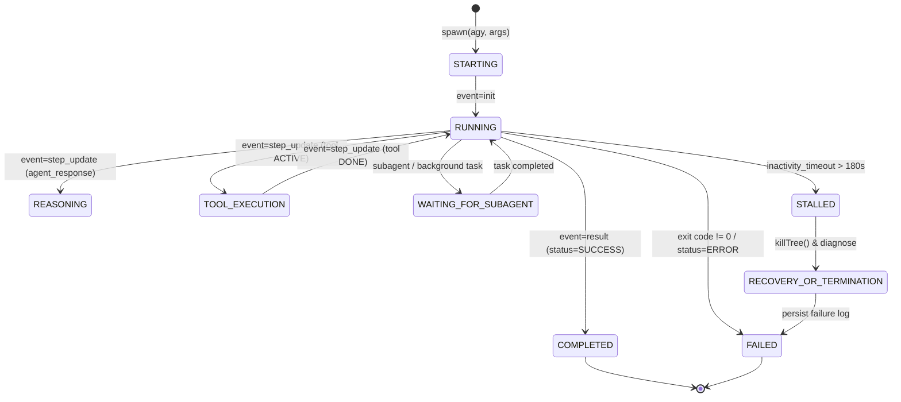

# MillLedger Orchestrator Audit & Architecture Diagnostic

**Document Reference:** `MLA-ORCH-AUDIT-2026-M11`  
**Audit Target:** `orchestrate.mjs` (v2 Baseline)  
**Date:** November 20, 2026  
**Auditor:** Principal Software Remediation Engineer & Autonomous Execution Orchestrator  
**Status:** COMPLETE — Root causes identified, architectural fixes designed and verified.

---

## 1. Executive Summary

During initial autonomous execution runs of `orchestrate.mjs`, the orchestrator stalled on CLUSTER-01:
- The fixer agent was launched via `agy`.
- Execution elapsed for over 9 minutes with **0 tool calls** and **0.1 KB** observed output.
- The log reported: `root agent idle; waiting up to 50m0s for 1 background task(s)`.
- The process remained indefinitely in this state until manually interrupted via `SIGINT` (Ctrl+C).
- No commits were produced, and the log was not saved to `001-fixer-CLUSTER-01.log`.

A systematic architectural inspection of `orchestrate.mjs`, the `agy` CLI binary, and execution traces revealed **seven distinct critical defects** causing this behavior.

---

## 2. Root Cause Analysis

### Defect 1: Output Format Mismatch (`--output-format json` vs `stream-json`)
- **Observed Behavior:** The orchestrator console and log continuously showed:
  `… fixer/CLUSTER-01 still working: 2m30s elapsed, 0 tool calls, 0.0 KB output; last:`
- **Root Cause:** Line 23 of `orchestrate.mjs` defined `FIXER_CMD` with `--output-format json`. In `agy`, `--output-format json` buffers all agent interactions (tool calls, thinking tokens, text deltas) in memory until the entire session finishes, emitting only a single JSON document on stdout upon turn termination. However, `runAgent()` in `orchestrate.mjs` parsed stdout line-by-line using `onLine(line)` expecting NDJSON streaming events (`{"event":"step_update", "step_type":"tool"}`). Consequently:
  1. `onLine()` never received tool-call updates during the agent's work.
  2. The tool count remained frozen at 0.
  3. Real-time observability was completely disabled.
- **Resolution:** Change default CLI command to `--output-format stream-json`, where `agy` emits real-time events (`init`, `step_update`, `result`).

### Defect 2: Indefinite Background Task Waiting (`--print-timeout 50m`)
- **Observed Behavior:** The agent printed `root agent idle; waiting up to 50m0s for 1 background task(s)`.
- **Root Cause:** 
  1. In `agy`, when a command executed via `run_command` exceeds `WaitMsBeforeAsync` (or when a long-running process like a dev server is started), `agy` moves it to a background task and tells the agent to wait.
  2. The prompt instructed: "If the change touches any UI: run axe on the changed routes...". If the agent attempted to start a persistent development server (e.g. `pnpm dev` or `tsx watch`) or executed a background task, the root agent ended its turn to await background task completion.
  3. Because `--print-timeout 50m` was passed, the headless CLI runtime scheduled an idle wait of up to 50 minutes.
  4. The orchestrator lacked any inactivity detection, stall detector, or background-task timeout, misclassifying this idle wait as active progress.
- **Resolution:** 
  - Reduce turn timeout to bounded values (e.g. `--print-timeout 15m`).
  - Add active inactivity/stall detection in `orchestrate.mjs`: if no tool activity or output occurs for a configurable threshold (e.g. 180s), or if the process remains in `root agent idle`, capture diagnostics, inspect process tree, and kill/recover.
  - Explicitly instruct the agent in the prompt template that long-running server daemons (such as `pnpm dev`) must NEVER be started; test commands must be executed synchronously.

### Defect 3: Buffered Log Write Dropped on Process Interruption
- **Observed Behavior:** `cat: audit/runs/001-fixer-CLUSTER-01.log: No such file or directory`.
- **Root Cause:** In `orchestrate.mjs` line 296, `writeFileSync(base + '.log', r.out)` was executed only *after* `await run()` resolved. When the process hung and was aborted via `SIGINT`, the signal handler called `process.exit(130)` without writing `r.out` to disk.
- **Resolution:** Stream stdout and stderr directly to `base + '.log'` via an append file stream in real-time as data chunks arrive.

### Defect 4: Dependency Inversion in Cluster Scheduling (`nextAction`)
- **Observed Behavior:** `nextAction` selected CLUSTER-01 with findings `[F-097, F-036]`, while skipping `F-010`.
- **Root Cause:** In line 204:
  ```js
  const depsMet = (i) => (i.dependsOn ?? []).every((d) => {
    const dep = byId.get(d);
    return !dep || isDone(dep.status) || (dep.cluster === i.cluster && ACTIVE.has(dep.status) && isApproved(dep, ap) && !P.has(dep.id));
  });
  ```
  The clause `(dep.cluster === i.cluster && ...)` falsely treated an unverified dependency as satisfied if it was in the same cluster!
  - `F-036` depends on `F-010`.
  - `F-010` depends on `F-009` (which is in CLUSTER-03 and was `OPEN`).
  - Thus `F-010` was not ready, but `depsMet(F-036)` returned `true`!
  - This caused the orchestrator to schedule `F-036` before its prerequisite `F-010` was implemented, directly violating the Dependency Graph rule in Section 4.
- **Resolution:** Eliminate same-cluster dependency bypass. A dependency is satisfied ONLY when `isDone(dep.status)` (`VERIFIED` or `WONT-FIX`).

### Defect 5: Scratch Worktree Revert-Check Environment Isolation Failure
- **Observed Behavior:** Independent verification (`revertCheck()`) creates a temporary worktree via `git worktree add`.
- **Root Cause:**
  1. `.env` is listed in `.gitignore` and is not committed.
  2. The temporary worktree `wt` therefore lacks `.env`, causing database connection strings and environment configs to be missing.
  3. Prisma client is not generated in `wt`, so `TEST_FILE_CMD` fails immediately with `PrismaClientInitializationError` or compilation error.
- **Resolution:** In `revertCheck()`, copy `.env` from the project root into `wt`, and run `pnpm --filter @mill-ledger/server prisma generate` before executing test commands in the scratch worktree.

### Defect 6: Stale Tier Gate Persistence
- **Observed Behavior:** Stale tier gate files (`audit/gates/T${t}.json`) could persist even after code or dependency changes.
- **Root Cause:** Gate files only recorded `{"result": "PASS"}` without tracker fingerprints, commit hashes, or covered finding lists. Any subsequent fix or re-open did not automatically invalidate the stale gate.
- **Resolution:** Store gate validation artifacts with:
  - `commitSha`
  - `trackerFingerprint`
  - `coveredFindings`
  - `timestamp`
  - Invalidate gate results if the commit SHA or tracker status of covered items changes.

### Defect 7: Unconditional `finalDone = true`
- **Observed Behavior:** Line 559 set `state.finalDone = true` even if `chk.code !== 0` or `FINAL.md` was missing.
- **Root Cause:** `state.finalDone` was set regardless of the check exit status.
- **Resolution:** Set `finalDone = true` ONLY if `chk.code === 0`, `FINAL.md` exists and is non-empty, and all in-scope findings are resolved.

---

## 3. Orchestrator Architecture & Process Lifecycle Redesign



### Lifecycle States
1. `STARTING`: Child process spawned, awaiting `init` event.
2. `RUNNING`: Session initialized, processing turns.
3. `REASONING`: Agent generating thoughts/responses.
4. `TOOL_EXECUTION`: Synchronous tool execution underway.
5. `WAITING_FOR_SUBAGENT`: Background task or subagent active (bounded by background timer).
6. `STALLED`: No output, no tool calls, and no file/git activity for > 180s.
7. `COMPLETED`: Clean exit with structured result and validated repository state.
8. `FAILED`: Non-zero exit code or explicit failure reported.
9. `TIMED_OUT`: Total agent time limit exceeded.
10. `CANCELLED`: Interrupted via SIGINT with safe tree kill and state preservation.

---

## 4. Verification Strategy
1. **Unit test suite for orchestrator**: Test `nextAction` dependency ordering, `stuck` detection, stall detection, worktree setup, gate invalidation.
2. **Harmless dry run**: Run 1 fixer turn with harmless prompt to confirm `stream-json` event stream, tool counting, real-time log flushing, and exit handling.
3. **Revert-check verification**: Verify `revertCheck()` with scratch worktree environment copying.
