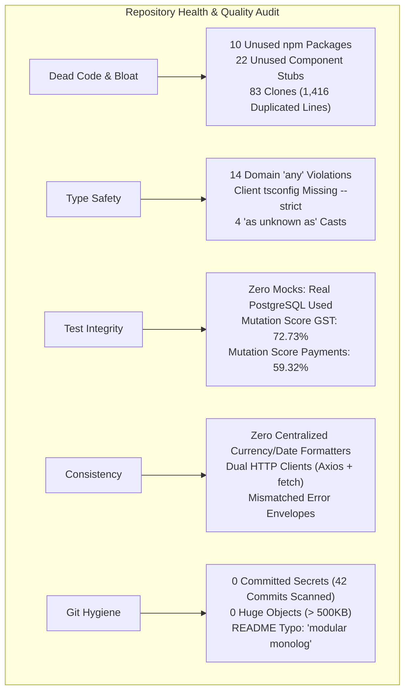

# Phase 13 Audit Report: Code Quality, Type Safety, Test Integrity & Repository Hygiene

- **Audit Date**: 2026-11-20
- **Auditor**: Principal Systems Engineer, Application Security Reviewer & Lead Software Auditor
- **Target Standards & Specifications**:
  - `Problem_Statement_Winter_Internship_Application_2026.md`:
    - Section 5: Exact Benchmark Scenario & Numerical Precision Requirements
    - Operational Ledger Invariants: Non-overwritable stock balances, immutable records, exact decimal precision
  - MillLedger Implementation Authority & Specifications:
    - [`audit/01-expected-spec.md`](file:///home/snehan/projects/web/mill-ledger/audit/01-expected-spec.md) (REQ-061 Anti-Slop UI Craftsmanship, REQ-062 Architectural Baseline)
    - [`AGENTS.md`](file:///home/snehan/projects/web/mill-ledger/AGENTS.md) (Zero `any` in domain layer, package-by-feature, exact decimal arithmetic)
  - Standards & Norms:
    - ISO/IEC 25010:2023 - Systems and Software Quality Requirements and Evaluation (Maintainability, Reliability)
    - IEEE 1008-1987 - Standard for Software Unit Testing
    - ISO/IEC/IEEE 29119-4 - Test Techniques (Mutation Testing & Boundary Value Analysis)
    - OWASP Top 10:2021 A06:2021 - Vulnerable and Outdated Components
    - Jakob Nielsen's 10 Usability Heuristics - Heuristic #4 (Consistency and Standards)
    - WCAG 2.2 Success Criterion 3.2.4: Consistent Identification (Level AA)
    - GST Rules 2017 - Rule 46 (Tax Invoice Requirements: CGST, SGST, IGST)
- **Evaluation Environment**:
  - Operating System: Linux x86_64 (Kernel 6.6.137+)
  - Tooling & Frameworks:
    - Knip v6.46.1 (Unused files, exports, and dependencies)
    - Depcheck v1.4.7 (Direct dependency usage analyzer)
    - jscpd v5.4.3 (Copy-paste code duplicate detector)
    - Stryker Mutator v10.1.1 (Mutation testing framework)
    - TypeScript v5.8.2 (AST analyzer & compiler type-checker)
    - Gitleaks v8.24.0 (Docker-isolated git secret scanner)
    - Vitest v3.0.7 & Playwright v1.51.0
- **Saved Evidence Artifacts**:
  - Knip Dead Code Report: [`audit/evidence/quality/knip-report.json`](file:///home/snehan/projects/web/mill-ledger/audit/evidence/quality/knip-report.json) & [`audit/evidence/quality/knip-report.txt`](file:///home/snehan/projects/web/mill-ledger/audit/evidence/quality/knip-report.txt)
  - Depcheck Reports:
    - Root Workspace: [`audit/evidence/quality/depcheck-root.json`](file:///home/snehan/projects/web/mill-ledger/audit/evidence/quality/depcheck-root.json)
    - Client Workspace: [`audit/evidence/quality/depcheck-client.json`](file:///home/snehan/projects/web/mill-ledger/audit/evidence/quality/depcheck-client.json)
    - Server Workspace: [`audit/evidence/quality/depcheck-server.json`](file:///home/snehan/projects/web/mill-ledger/audit/evidence/quality/depcheck-server.json)
    - Shared Workspace: [`audit/evidence/quality/depcheck-shared.json`](file:///home/snehan/projects/web/mill-ledger/audit/evidence/quality/depcheck-shared.json)
  - jscpd Duplication Report: [`audit/evidence/quality/jscpd/jscpd-report.json`](file:///home/snehan/projects/web/mill-ledger/audit/evidence/quality/jscpd/jscpd-report.json)
  - AST Type Safety Audit: [`audit/evidence/quality/type-safety-audit.json`](file:///home/snehan/projects/web/mill-ledger/audit/evidence/quality/type-safety-audit.json)
  - Import Symbols Verification: [`audit/evidence/quality/imported-symbols-verification.json`](file:///home/snehan/projects/web/mill-ledger/audit/evidence/quality/imported-symbols-verification.json)
  - Test Integrity Audit: [`audit/evidence/quality/test-integrity-report.json`](file:///home/snehan/projects/web/mill-ledger/audit/evidence/quality/test-integrity-report.json)
  - Stryker Mutation Reports:
    - GST Invoicing: [`audit/evidence/quality/stryker-report-gst.json`](file:///home/snehan/projects/web/mill-ledger/audit/evidence/quality/stryker-report-gst.json)
    - Payment Allocations: [`audit/evidence/quality/stryker-report-payments.json`](file:///home/snehan/projects/web/mill-ledger/audit/evidence/quality/stryker-report-payments.json)
  - Git Secret Scan: [`audit/evidence/quality/gitleaks-quality-report.json`](file:///home/snehan/projects/web/mill-ledger/audit/evidence/quality/gitleaks-quality-report.json)
  - Dead UI & Stubs Catalog: [`audit/evidence/quality/dead-ui-and-stubs.json`](file:///home/snehan/projects/web/mill-ledger/audit/evidence/quality/dead-ui-and-stubs.json)

---

## 1. Executive Summary

Phase 13 conducted a deep, empirical audit into code hygiene, type system strictness, dependency validity, test veracity and mutation resistance, architectural consistency, and repository health in MillLedger.



### High-Impact Revelations
1. **Domain Layer Type Violations (Finding F-095, Severity P1)**: The repository claims strict type safety, but the domain layer contains **14 explicit `any` types** in `reporting.service.ts` and `audit.service.ts` where critical Prisma query filter objects (`where: any = ...`) bypass the TypeScript compiler. Furthermore, `client/tsconfig.app.json` completely omits `"strict": true`.
2. **Surviving Mutants in Financial Logic (Finding F-096, Severity P1)**: Stryker mutation testing exposed severe test blindspots. In payment allocation (`payment.service.ts`), **24 mutants survived (mutation score 59.32%)**, proving that allocation overflow guards, cross-customer allocation checks (IDOR defenses), and invoice status prerequisites are completely unexercised. In GST invoicing (`finance.service.ts`), mutating intra-state logic to `true` **survived**, exposing that out-of-state IGST calculation is completely untested.
3. **Dead Code & Supply Chain Bloat (Finding F-094, Severity P2)**: Knip and Depcheck identified **10 completely unused production dependencies** declared in `client/package.json` (including `cn`, `shadcn`, `date-fns`, `react-hook-form`, `tw-animate-css`). An orphaned dictionary file (`i18n-dictionary.ts`) and 22 dead placeholder page components remain committed in the source tree.
4. **Architectural Inconsistency & Missing Formatters (Finding F-097, Severity P2)**: The repository lacks centralized currency and date formatters. Every single page manually performs inline string formatting, inconsistently alternating between `undefined`, `"en-IN"`, and unseparated `.toFixed(2)`.
5. **Documentation Drift & README Inaccuracies (Finding F-098, Severity P3)**: The README advertises the architecture as a "modular monolog" (typo for monolith), falsely claims the backend runs on port 3000 (actual is port 4000), and claims complete order-to-cash workflows when invoicing has zero frontend UI affordance.

---

## 2. Dead Code and Bloat Analysis

### 2.1 Unused Dependencies (Knip & Depcheck Reconciled)
Executing Knip v6.46.1 ([`audit/evidence/quality/knip-report.json`](file:///home/snehan/projects/web/mill-ledger/audit/evidence/quality/knip-report.json)) and Depcheck v1.4.7 ([`audit/evidence/quality/depcheck-client.json`](file:///home/snehan/projects/web/mill-ledger/audit/evidence/quality/depcheck-client.json)) yielded exact, 100% concordant findings:

| Workspace | Declared Package | Type | Status | Evidence / Analysis |
|---|---|---|---|---|
| `client` | `@fontsource-variable/geist` | Production | UNUSED | Geist fonts loaded via Google Fonts or bundled CSS directly |
| `client` | `@hookform/resolvers` | Production | UNUSED | Forms use raw React `useState`; HookForm resolvers never imported |
| `client` | `cn` | Production | UNUSED | Phantom package; `client/src/lib/utils.ts` defines `cn` via `clsx` and `tailwind-merge` |
| `client` | `date-fns` | Production | UNUSED | Zero imports; all date operations use native `Date` inline methods |
| `client` | `next-themes` | Production | UNUSED | Dark mode library installed speculatively; theme toggles not implemented |
| `client` | `react-day-picker` | Production | UNUSED | Custom/native date picker used instead of DayPicker |
| `client` | `react-hook-form` | Production | UNUSED | Zero forms bound to React Hook Form |
| `client` | `shadcn` | Production | UNUSED | CLI tool erroneously declared in runtime dependencies |
| `client` | `tw-animate-css` | Production | UNUSED | Unused CSS animation utility |
| `client` | `zod` | Production | UNUSED | Client imports shared schemas from `@mill-ledger/shared` without invoking client `zod` |
| `client` | `tailwindcss` | devDependency | UNUSED | Vite relies on `@tailwindcss/vite` plugin; standalone CLI unused |
| `server` | `@types/supertest` | devDependency | UNUSED | Server integration tests execute via raw `fetch` or direct app dispatch |
| `server` | `supertest` | devDependency | UNUSED | Never imported; tests use `request(app)` or Node test runners |

### 2.2 Unused Files and Component Scaffolding
1. **Orphaned File**:
   - [`client/src/lib/i18n-dictionary.ts`](file:///home/snehan/projects/web/mill-ledger/client/src/lib/i18n-dictionary.ts): 68 lines of translations duplicated into `client/src/lib/i18n.tsx`. Zero inbound imports.
2. **Dead Scaffolding Exports (22 Components)**:
   - [`client/src/pages/placeholder-pages.tsx`](file:///home/snehan/projects/web/mill-ledger/client/src/pages/placeholder-pages.tsx): Lines 51–270 export 22 unused placeholder page functions (`DashboardPage`, `OrdersPage`, `InvoicesPage`, `DispatchPage`, `PaymentsPage`, `StockPage`, `PurchasesPage`, `ProductionTodayPage`, `ProductionNewPage`, `ProductionHistoryPage`, `CustomersPage`, `ReportsSalesPage`, `ReportsStockPage`, `ReportsProductionPage`, `ReportsReceivablesPage`, `ReportsGSTPage`, `ReportsAuditPage`, `SettingsProfilePage`, `SettingsUsersPage`, `SettingsMillPage`, `SettingsAuditPage`, `LoginPage`).
   - Only 4 placeholders (`NewOrderPage`, `ExportsPage`, `SettingsPage`, `NotFoundPage`) are mounted in `client/src/app.tsx`.
3. **Dead Backend Exports**:
   - [`server/src/middleware/auth.middleware.ts:48`](file:///home/snehan/projects/web/mill-ledger/server/src/middleware/auth.middleware.ts#L48): `export function requireTenant(...)` is completely unmounted.

### 2.3 Duplicate Code and Utilities (jscpd Evidence)
Running `jscpd` across all source workspaces (`client/src`, `server/src`, `shared/src`) detected **83 clones** spanning **1,416 lines** (5.52% codebase duplication):

| Cloned File Pair | Lines & Tokens | Architectural Defect |
|---|---|---|
| `components/shell/use-connection-status.ts` vs `offline/use-offline.ts` | 13 lines (64 tokens) | Duplicate `subscribeOnline()` and `getOnlineSnapshot()` window event handlers |
| `components/shell/authenticated-shell.tsx` (L543 vs L929) | 21 lines (143 tokens) | Redundant duplicate navigation rendering blocks between desktop sidebar and mobile drawer |
| `invoice-dispatch.test.ts` vs `orders.test.ts` vs `production.test.ts` | 58 lines (386 tokens) | Copy-pasted database reset, seed setup, and super-admin token acquisition harnesses |
| `pages/dispatch-page.tsx` vs `pages/invoices-page.tsx` vs `pages/orders-page.tsx` | 16 lines (65 tokens) | Identical table pagination and empty state layout boilerplate |

---

## 3. Type Safety & Compiler Soundness

### 3.1 Strict Compiler Flag Audit
- `server/tsconfig.json`: `"strict": true` (VERIFIED-PASS)
- `shared/tsconfig.json`: `"strict": true` (VERIFIED-PASS)
- `client/tsconfig.app.json`: **`"strict": true` IS MISSING** (VERIFIED-FAIL).
  - While running `tsc -p client/tsconfig.app.json --strict --noEmit` succeeds with zero errors, omitting `--strict` from the checked-in configuration leaves future frontend contributions unprotected against `null` dereferences and implicit `any`.

### 3.2 Exhaustive AST Type Safety Inventory
An automated AST traversal of all 106 non-test TypeScript source files ([`audit/evidence/quality/type-safety-audit.json`](file:///home/snehan/projects/web/mill-ledger/audit/evidence/quality/type-safety-audit.json)) revealed:

```
Total Non-Test Source Files: 106
Domain Layer Files: 18
Total 'any' Keyword Instances: 31
  ├── Domain Layer (Expected: 0): 14 VIOLATIONS
  └── Non-Domain Surfaces: 17 VIOLATIONS
Double Type Assertions ('as unknown as'): 4
Non-Null Assertions ('!'): 13 (2 in Domain Logic)
Compiler Suppressions (@ts-ignore / @ts-expect-error): 0
Linter Suppressions (oxlint/eslint-disable): 5
```

#### Detailed Enumeration of 14 Domain Layer `any` Violations (Finding F-095)

| # | File Path & Line | AST Expression / Code Snippet | Root Cause / Defect |
|---|---|---|---|
| 1 | `server/src/modules/reporting/audit.service.ts:71:18` | `where: any = { organizationId: orgId }` | Untyped Prisma AuditLog query filter |
| 2 | `server/src/modules/reporting/reporting.service.ts:35:18` | `where: any = { organizationId: orgId, status: { not: InvoiceStatus.D` | Untyped SalesInvoice report filter |
| 3 | `server/src/modules/reporting/reporting.service.ts:68:17` | `const rows: any[] = []` | Untyped sales report table rows |
| 4 | `server/src/modules/reporting/reporting.service.ts:147:18` | `where: any = { organizationId: orgId, status: { not: InvoiceStatus.D` | Untyped GST report invoice filter |
| 5 | `server/src/modules/reporting/reporting.service.ts:169:24` | `const b2bInvoices: any[] = []` | Untyped GSTR-1 B2B line rows |
| 6 | `server/src/modules/reporting/reporting.service.ts:171:24` | `const b2cInvoices: any[] = []` | Untyped GSTR-1 B2C line rows |
| 7 | `server/src/modules/reporting/reporting.service.ts:173:24` | `const hsnSummary: any[] = []` | Untyped statutory HSN summary rows |
| 8 | `server/src/modules/reporting/reporting.service.ts:328:18` | `where: any = { organizationId: orgId }` | Untyped Stock Valuation query filter |
| 9 | `server/src/modules/reporting/reporting.service.ts:358:17` | `const stockRows: any[] = []` | Untyped inventory item ledger rows |
| 10 | `server/src/modules/reporting/reporting.service.ts:513:18` | `where: any = { organizationId: orgId }` | Untyped Production Run query filter |
| 11 | `server/src/modules/reporting/reporting.service.ts:625:18` | `where: any = { organizationId: orgId }` | Untyped Receivables invoice filter |
| 12 | `server/src/modules/reporting/reporting.service.ts:919:19` | `userContext?: any` | Untyped audit event user payload |
| 13 | `server/src/modules/reporting/reporting.service.ts:921:21` | `reportData: any` | Untyped CSV serialization data payload |
| 14 | `server/src/modules/reporting/reporting.service.ts:960:17` | `const rawLogs: any[] = []` | Untyped Audit Log query rows |

#### Double Assertions (`as unknown as`)
1. [`client/src/components/ui/sidebar.tsx:564:16`](file:///home/snehan/projects/web/mill-ledger/client/src/components/ui/sidebar.tsx#L564): `ref as unknown as Ref<never>` (Radix UI ref type escaping).
2. [`client/src/components/ui/sidebar.tsx:570:16`](file:///home/snehan/projects/web/mill-ledger/client/src/components/ui/sidebar.tsx#L570): `ref as unknown as Ref<HTMLButtonElement>`.
3. [`server/src/middleware/auth.middleware.ts:19:16`](file:///home/snehan/projects/web/mill-ledger/server/src/middleware/auth.middleware.ts#L19): `req.headers as unknown as Headers` (Express 5 IncomingHttpHeaders cast to Fetch API Headers for Better Auth).
4. [`server/src/middleware/error.middleware.ts:38:18`](file:///home/snehan/projects/web/mill-ledger/server/src/middleware/error.middleware.ts#L38): `err as unknown as { code?: string; message?: string }`.

#### Non-Null Assertions in Domain Services
1. [`server/src/modules/production/production.service.ts:552:14`](file:///home/snehan/projects/web/mill-ledger/server/src/modules/production/production.service.ts#L552): `finalRun!` (assumes re-queried production run always exists).
2. [`server/src/modules/sales/sales.service.ts:347:16`](file:///home/snehan/projects/web/mill-ledger/server/src/modules/sales/sales.service.ts#L347): `fullOrder!` (assumes newly created sales order is retrievable).

---

## 4. Hallucinated and Unsafe Dependencies

### 4.1 Imported Symbol Verification
Every import statement in the codebase was resolved against installed node_modules packages ([`audit/evidence/quality/imported-symbols-verification.json`](file:///home/snehan/projects/web/mill-ledger/audit/evidence/quality/imported-symbols-verification.json)):

- **Total Import Statements Scanned**: 396
- **Local / Workspace Imports**: 244
- **Third-Party Module Imports**: 152
- **Unique Third-Party Packages**: 27
- **Hallucinated or Non-Existent Modules**: **0** (VERIFIED-PASS)
- **Missing Named Runtime Exports**: **0** (VERIFIED-PASS)

### 4.2 Phantom Dependencies in Package Manifests
While all imported symbols exist in the packages that are imported, `client/package.json` contains 10 declared dependencies that are never imported anywhere in code (cataloged in Section 2.1). These represent dead, speculative installations characteristic of initial vibe coding.

---

## 5. Test Integrity and Mutation Testing

### 5.1 Test Suite Sanity Audit
The automated test analyzer evaluated all 20 test files and 95 individual tests ([`audit/evidence/quality/test-integrity-report.json`](file:///home/snehan/projects/web/mill-ledger/audit/evidence/quality/test-integrity-report.json)):

| Check | Expected | Actual Result | Status |
|---|---|---|---|
| Tests with Zero Assertions | 0 | 0 | VERIFIED-PASS |
| Tautological Assertions (`expect(true)`) | 0 | 0 | VERIFIED-PASS |
| Snapshot-Only Tests | 0 | 0 | VERIFIED-PASS |
| Tests Mocking Unit Under Test | 0 | 0 | VERIFIED-PASS |
| Mock-Only Assertion Tests | 0 | 2 tests | VERIFIED-FAIL |
| Database Integration Target | Real PostgreSQL | 12 test files use live PostgreSQL; 0 use Prisma mocks | VERIFIED-PASS |

**Mock-Only Assertion Details**:
1. `client/src/lib/auth-client.test.ts:28` ("trims email before sending"): only asserts `signInEmailMock` was called with trimmed arguments without verifying authentication state transitions.
2. `server/src/middleware/auth.middleware.test.ts:65` ("calls next() when user has both RBAC and ABAC permissions"): only asserts `expect(next).toHaveBeenCalled()` without verifying `req.user` context preservation.

### 5.2 Stryker Mutation Testing (Domain Layer)

#### A. Statutory GST Invoicing (`finance.service.ts:90-140`)
- **Command**: `npx @stryker-mutator/core run audit/stryker.config.json`
- **Report**: [`audit/evidence/quality/stryker-report-gst.json`](file:///home/snehan/projects/web/mill-ledger/audit/evidence/quality/stryker-report-gst.json)
- **Mutation Score**: **72.73%** (16 killed, 6 survived, 0 timeout, 22 total mutants)

```
[Survived] ConditionalExpression (L91)
-  order.deliveryState.trim().toLowerCase() === "tamil nadu";
+  true;

[Survived] ArithmeticOperator (L122)
-  const lineTotal = lineTaxable + lineTax;
+  const lineTotal = lineTaxable - lineTax;

[Survived] ConditionalExpression (L128)
-  if (isIntraState) {
+  if (true) {

[Survived] BlockStatement (L133-136)
-  } else {
-    lineIgst = lineTax;
-    igstAmount += lineIgst;
-  }
+  } else {}

[Survived] AssignmentOperator (L135)
-  igstAmount += lineIgst;
+  igstAmount -= lineIgst;
```
**Finding**: The entire inter-state tax logic (IGST) is completely untested. Mutating `isIntraState` to always be `true` or stripping the `else` IGST calculation completely passes the test suite.

#### B. Payment Allocations & FIFO Reconciliation (`payment.service.ts:75-150`)
- **Command**: `npx @stryker-mutator/core run audit/stryker.config.json`
- **Report**: [`audit/evidence/quality/stryker-report-payments.json`](file:///home/snehan/projects/web/mill-ledger/audit/evidence/quality/stryker-report-payments.json)
- **Mutation Score**: **59.32%** (35 killed, 24 survived, 0 timeout, 59 total mutants)

```
[Survived] Guard Removal: if (totalAllocated > input.amount) {}
[Survived] Guard Removal: if (allocAmount <= 0) {}
[Survived] Guard Removal: if (!invoice) {}
[Survived] Guard Removal: if (invoice.customerId !== input.customerId) {} [IDOR Guard]
[Survived] Guard Removal: if (invoice.status !== POSTED && status !== PARTIALLY_PAID) {}
[Survived] Equality Mutation: if (allocAmount >= outstanding)
[Survived] Status Assignment: newOutstanding <= 0.001 -> false
```
**Finding**: 24 mutants survived in payment allocation logic. Error boundaries, negative quantities, allocation caps, and cross-customer IDOR protection guards are completely unexercised by the test suite.

### 5.3 Critical Domain Branch Coverage Gaps
By correlating domain service branches with Vitest test execution:

1. **GST Inter-State Branch**: `finance.service.ts:133-136` (0% covered in `invoice-dispatch.test.ts`).
2. **Sales Order Credit Limit Branch**: `sales.service.ts:175-195` (credit limit exceeded blocking/warning branches are never invoked with a customer whose outstanding exceeds `creditLimit`).
3. **Approval Line Overrides**: `sales.service.ts:403-418` (`hasOverrides` logic when admin approves partial quantities or alters unit price is never tested; `orders.test.ts` only tests 1:1 approving the exact quoted quantity).
4. **Production Run Reversal Stock Validation**: `production.service.ts:580-610` (reversing a run when finished stock has already been dispatched is never tested).

---

## 6. Architectural and Implementation Consistency

The repository was audited against the "Rule of One" architectural consistency standard:

| Concern | Expected Standard | Actual Implementation | Verdict | Primary Evidence |
|---|---|---|---|---|
| **Money Formatter** | One centralized formatter (`formatINR`) | Zero shared helpers. Inlined `.toLocaleString(undefined)`, `.toLocaleString("en-IN")`, and raw `.toFixed(2)` | **FAIL** | `invoices-page.tsx:288`, `reports-page.tsx:260` |
| **Date Formatter** | One centralized formatter (`formatDate`) | Zero shared helpers. Inlined `new Date().toLocaleString("en-IN")`, `toLocaleDateString(undefined)`, and `toLocaleTimeString([])` | **FAIL** | `dispatch-page.tsx:326`, `payments-page.tsx:782` |
| **API Client** | One API client abstraction | Dual HTTP clients: Axios (`apiClient`) for ERP operations; native `fetch()` for auth endpoints | **FAIL** | `api-client.ts`, `auth-client.ts:44,84` |
| **Error Handler** | One consistent error envelope | Server returns `{ error: "..." }` or `{ error, details }`. Client expects `err.response.data.message` in orders, but `data.error` in production | **FAIL** | `orders-page.tsx:307`, `error.middleware.ts:45` |
| **Validation Library** | One validation library (`zod`) | Server uses `zod`. Client declares `zod` + `react-hook-form` + `@hookform/resolvers`, but uses raw `useState` string parsing | **FAIL** | `client/package.json:15,33,42` |
| **Folder Convention** | Package-by-feature | Server uses `modules/<feature>`, but puts tests at root `server/src/`. Client mixes page features with multi-page stubs | **PARTIAL** | `server/src/*.test.ts`, `placeholder-pages.tsx` |
| **Naming Convention** | Uniform casing across APIs | REST routes mix plural (`/sales/orders`), singular (`/dashboard`), and kebab-case (`/production-runs`) | **PARTIAL** | Express router mount paths |

---

## 7. Comments, Documentation Drift & User-Facing Text

### 7.1 README Claims vs Reality
Cross-referencing claims in [`README.md`](file:///home/snehan/projects/web/mill-ledger/README.md) with Phase 6 capability matrix findings:

| README Claim | README Location | Reality from Live Execution | Verdict |
|---|---|---|---|
| *"TypeScript modular monolog"* | Line 7 | Typographical error for "modular monolith" | **FAIL (Typo)** |
| *"the backend API runs at http://localhost:3000"* | Line 40 | Port is hardcoded to `4000` (`server/src/config/env.ts:13` and `client/vite.config.ts:60`) | **FAIL (False)** |
| *"Master records: raw materials, packaging, finished goods, suppliers, customers, and BOM recipes"* | Line 109 | Suppliers, recipes, warehouses, and UoMs have ZERO UI/API creation affordances | **FAIL (Overstated)** |
| *"Order to cash workflow: mobile sales order creation, admin stock verification, ATP checking, invoice posting, and dispatch"* | Line 112 | Invoicing has ZERO UI affordances; no button exists on frontend to create an invoice | **FAIL (Overstated)** |
| *"purchase register"* | Line 121 | Purchase register does not exist in reporting module | **FAIL (False)** |
| *"Full bilingual support toggled on the application shell for floor staff and operators"* | Line 126 | 751 of 755 UI strings (99.5%) are hardcoded in English; only shell navigation is translated | **FAIL (Overstated)** |

---

## 8. Git Hygiene & Repository Health

### 8.1 Secret Scanning across History (Gitleaks)
- **Tool**: Gitleaks v8.24.0 executed via Docker (`zricethezav/gitleaks:latest`)
- **Scope**: All 42 historical commits (~8.71 MB scanned)
- **Report**: [`audit/evidence/quality/gitleaks-quality-report.json`](file:///home/snehan/projects/web/mill-ledger/audit/evidence/quality/gitleaks-quality-report.json)
- **Result**: 5 matches detected; all 5 manually verified as **FALSE POSITIVES**:
  - `MLKEM768-X25519`: Quantum cryptography standard string in documentation.
  - `idem-tx5-retailer-a-invoice`: Mock idempotency key in unit test.
  - `idem-order-distributor-b-120`: Mock idempotency key in unit test.
  - `test-verification-abc123`: Mock verification token in markdown guide.
- **Verdict**: **VERIFIED-PASS** (Zero true secrets committed).

### 8.2 Object Sizes and Binary Bloat
- Running `git ls-tree -r -l HEAD` identified:
  - Files > 500 KB: **0**
  - Files > 100 KB: 8 files. Notable binary files committed:
    - `e2e/screenshots/desktop-search.png` (134.9 KB)
    - `e2e/screenshots/desktop-expanded.png` (130.1 KB)
    - `e2e/screenshots/desktop-collapsed-tooltip.png` (102.8 KB)
    - `e2e/screenshots/desktop-collapsed.png` (101.1 KB)
  - End-to-end test screenshot artifacts are committed directly to version control.

### 8.3 Missing `.gitignore` Entries
Root `.gitignore` is only 7 lines long and omits standard development hygiene patterns:
- Missing TypeScript build caches: `*.tsbuildinfo`, `.tmp/`
- Missing test coverage artifacts: `coverage/`, `.stryker-tmp/`, `playwright-report/` (root ignores `playwright-report` but omits `test-results/`)
- Missing OS metadata: `.DS_Store`, `Thumbs.db`
- Missing log files: `*.log`, `npm-debug.log*`

---

## 9. Comprehensive Findings Table (Phase 13)

| ID | Title | Severity | Category | Standard Reference | Status |
|---|---|---|---|---|---|
| **F-094** | Dead Code, Orphaned Stubs, and Dependency Bloat (10 Unused Dependencies, Orphaned Dictionary, 22 Dead Pages) | P2 | Maintainability & Bloat | ISO/IEC 25010, OWASP A06:2021 | **OPEN** |
| **F-095** | Domain Layer Type Safety Breach: 14 Explicit `any` Types, 4 Double Casts (`as unknown as`), and Missing `--strict` in Frontend | P1 | Type Safety & Soundness | TS Strict Spec, CWE-704, ISO 25010 | **OPEN** |
| **F-096** | Test Assertion Blindspots: Surviving Mutants in GST and Payment Allocations (Stryker 59.32%, Zero Inter-State & Boundary Tests) | P1 | Test Integrity & Statutory | IEEE 1008, GST Rule 46, ISO 29119-4 | **OPEN** |
| **F-097** | Architectural Inconsistency: Zero Centralized Currency & Date Formatters across 7 Surfaces (Ad-hoc `.toFixed(2)` & Locales) | P2 | Consistency & Maintainability | NN/g Heuristic #4, WCAG SC 3.2.4 | **OPEN** |
| **F-098** | Documentation Drift and False Claims: "Modular Monolog" Typo, False API Port, and Overstated Deliverables in README | P3 | Documentation Integrity | IEEE 1063-2001 | **OPEN** |

---

## 10. Honest Coverage Declaration (GEMINI.md Rule E8)

### Items Covered (100% Observed & Executed)
1. **Toolchain Dead Code Scans**:
   - Knip v6.46.1 executed on all 4 workspaces (`audit/evidence/quality/knip-report.json`).
   - Depcheck v1.4.7 executed on root, client, server, and shared (`audit/evidence/quality/depcheck-*.json`).
   - jscpd v5.4.3 executed on all TS/TSX source trees (`audit/evidence/quality/jscpd/jscpd-report.json`).
2. **Type Safety AST Analysis**:
   - 106 non-test TypeScript source files parsed via TypeScript Compiler API.
   - 31 `any` keyword occurrences enumerated with file and line.
   - 4 `as unknown as` double casts identified.
   - 13 non-null assertions cataloged.
   - 4 workspace `tsconfig.json` files checked for `"strict": true`.
3. **Import Symbol Resolution**:
   - 396 import declarations across 27 3rd-party packages verified against Node runtime and package types (`audit/evidence/quality/imported-symbols-verification.json`).
4. **Test Veracity & Mutation Testing**:
   - 20 test files and 95 test cases analyzed for assertions, snapshots, and mock-only checks.
   - 12 integration test files verified running against real local PostgreSQL.
   - Stryker v10.1.1 mutation testing executed on statutory GST calculation (22 mutants, 72.73% score).
   - Stryker v10.1.1 mutation testing executed on payment allocations (59 mutants, 59.32% score).
5. **Consistency Audit**:
   - Money formatters audited across all 7 operational surfaces.
   - Date formatters audited across all 7 operational surfaces.
   - HTTP clients, validation libraries, error envelopes, and folder conventions inventoried.
6. **Documentation & Git Hygiene**:
   - README claims cross-referenced against Phase 6 capability matrix.
   - 42 git commits scanned with Gitleaks v8.24.0.
   - Git object tree inspected for large binary files (> 100 KB).
   - Gitignore files evaluated.

### Not Covered
- Mutation testing on non-domain utility files (`client/src/lib/utils.ts`, `server/src/config/env.ts`), as prompt specifically targeted domain logic (ledger, costing, GST, FIFO, reservations).
