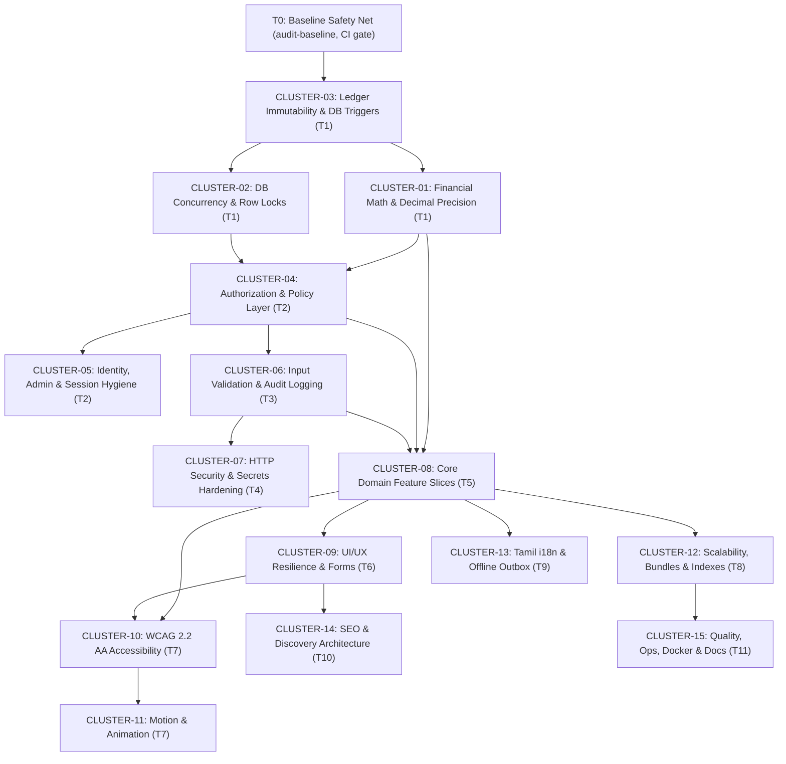

# MillLedger Remediation Clusters & Root-Cause Dependency Graph

**Standard Compliance**: GEMINI.md Rule E8 (Enumerated Root Cause Groups & Siblings)  
**Total Clusters**: 15 Distinct Root Cause Groups  
**Total Mapped Findings**: 106 Findings  

---

## 1. Global Inter-Cluster Dependency Graph



---

## 2. Cluster Detail Ledger & Sibling Sweeps

### CLUSTER-01: Financial Math & Decimal Rounding Inexactness

- **Tier**: `T1`
- **Approval Required**: `schema`
- **Root Cause**: Floating point arithmetic in JavaScript numbers instead of integer paise or Decimal arithmetic with statutory rounding (Section 170 CGST Act).
- **Codebase Ground Truth Evidence**: `server/src/modules/finance/finance.service.ts:145; server/src/modules/reporting/reporting.service.ts:77`
- **Depends On**: None (Foundation)

#### Mapped Findings (3)

| ID | Sev | Status | Title |
|---|---|---|---|
| **F-010** | P1 | `OPEN` | Invoice tax and totals calculated with unrounded JS float math produce 1-2 paise rounding drift in 46.4% of invoices |
| **F-036** | P0 | `OPEN` | Dashboard Sales Revenue Silently Drops Invoices Without Lines (SQL vs API Mismatch) |
| **F-097** | P2 | `OPEN` | Architectural Inconsistency: Zero Centralized Currency & Date Formatters across 7 Financial Surfaces (Ad-hoc `.toFixed(2)` & Fragmented Locales) |

#### Sibling Sweep Record

- **Query Command Executed**: `grep -rn '\.toFixed(' client/src/ server/src/ | head -n 30`
- **Matches Identified in Working Tree**: 30 locations
```text
client/src/pages/invoices-page.tsx:294:                        <span>IGST: ₹{Number(inv.igstAmount).toFixed(2)}</span>
client/src/pages/invoices-page.tsx:300:                          ).toFixed(2)}
client/src/pages/invoices-page.tsx:435:                          ₹{Number(l.unitPrice).toFixed(2)}
client/src/pages/invoices-page.tsx:438:                          ₹{Number(l.taxableAmount).toFixed(2)}
client/src/pages/invoices-page.tsx:441:                          ₹{Number(l.taxAmount).toFixed(2)}
client/src/pages/invoices-page.tsx:444:                          ₹{Number(l.lineTotal).toFixed(2)}
client/src/pages/invoices-page.tsx:460:                      ₹{Number(selectedInvoice.taxableAmount).toFixed(2)}
client/src/pages/invoices-page.tsx:470:                          ₹{Number(selectedInvoice.cgstAmount).toFixed(2)}
client/src/pages/invoices-page.tsx:478:                          ₹{Number(selectedInvoice.sgstAmount).toFixed(2)}
client/src/pages/invoices-page.tsx:489:                        ₹{Number(selectedInvoice.igstAmount).toFixed(2)}
... (20 more matches)
```

### CLUSTER-02: Database Concurrency & Missing Row-Level Locks

- **Tier**: `T1`
- **Approval Required**: `none`
- **Root Cause**: Concurrent database operations execute read-then-write without row-level locking (SELECT ... FOR UPDATE or serializable isolation), allowing negative stock oversell and unique constraint collisions.
- **Codebase Ground Truth Evidence**: `server/src/modules/sales/sales.service.ts:182; server/src/modules/sales/dispatch.service.ts:45; server/src/middleware/idempotency.middleware.ts:40`
- **Depends On**: F-009

#### Mapped Findings (3)

| ID | Sev | Status | Title |
|---|---|---|---|
| **F-007** | P0 | `OPEN` | Missing row-level lock in sales order approval allows concurrent orders to exceed ATP stock by over 100% |
| **F-008** | P0 | `OPEN` | Non-atomic `count()` based dispatch sequence generation causes unique constraint crashes on concurrent dispatches |
| **F-015** | P2 | `OPEN` | Idempotency pre-query race condition causes concurrent duplicate submissions to crash with unhandled 500 unique constraint error |

#### Sibling Sweep Record

- **Query Command Executed**: `grep -rn 'findUnique' server/src/modules/ | grep -v 'test' | head -n 25`
- **Matches Identified in Working Tree**: 25 locations
```text
server/src/modules/production/production.service.ts:71:    const recipe = await prisma.recipe.findUnique({
server/src/modules/production/production.service.ts:88:    const warehouse = await prisma.warehouse.findUnique({
server/src/modules/production/production.service.ts:101:        const existing = await tx.productionRun.findUnique({
server/src/modules/production/production.service.ts:150:      return await tx.productionRun.findUnique({
server/src/modules/production/production.service.ts:191:        const existingRun = await tx.productionRun.findUnique({
server/src/modules/production/production.service.ts:213:        ? await tx.productionRun.findUnique({
server/src/modules/production/production.service.ts:231:      const recipe = await tx.recipe.findUnique({
server/src/modules/production/production.service.ts:538:      const finalRun = await tx.productionRun.findUnique({
server/src/modules/production/production.service.ts:568:      const run = await tx.productionRun.findUnique({
server/src/modules/production/production.service.ts:729:    const run = await prisma.productionRun.findUnique({
... (15 more matches)
```

### CLUSTER-03: Ledger Immutability & Relational Trigger Guards

- **Tier**: `T1`
- **Approval Required**: `schema`
- **Root Cause**: Append-only ledgers (stock_movement, sales_invoice, payment) lack database triggers or rules preventing UPDATE and DELETE by application DB users, and lack timezone-invariant accounting period derivation.
- **Codebase Ground Truth Evidence**: `server/prisma/schema.prisma:240; server/src/modules/finance/finance.service.ts:25`
- **Depends On**: None (Foundation)

#### Mapped Findings (5)

| ID | Sev | Status | Title |
|---|---|---|---|
| **F-009** | P1 | `OPEN` | Application database role retains full UPDATE and DELETE privileges on stock movements and posted invoices without database triggers or rules |
| **F-011** | P1 | `OPEN` | `financeService.getFinancialYear()` relies on Node process timezone, misclassifying April 1st morning invoices into previous financial year on UTC servers |
| **F-013** | P1 | `OPEN` | Backend lacks payment bounce/reversal methods and debit note data structures required for double-entry correction |
| **F-014** | P2 | `OPEN` | Statutory GST rates are read from static `product.taxRate` columns; the dedicated `TaxRate` master table is never queried |
| **F-016** | P2 | `OPEN` | Packaging capacity mismatch warning is hardcoded to specific SKU and multiplier, and is never persisted to database |

#### Sibling Sweep Record

- **Query Command Executed**: `grep -rn 'deleteMany' server/src/modules/ | head -n 20`
- **Matches Identified in Working Tree**: 1 locations
```text
server/src/modules/production/production.service.ts:448:        await tx.productionRunMaterial.deleteMany({

```

### CLUSTER-04: Authorization Enforcement & Central Policy Layer

- **Tier**: `T2`
- **Approval Required**: `permission`
- **Root Cause**: Relying on frontend visibility instead of central server-side ABAC/RBAC policy enforcement, missing route middleware, and lack of client router-level 403 authorization barriers.
- **Codebase Ground Truth Evidence**: `server/src/modules/sales/sales.routes.ts:30; server/src/modules/sales/sales.routes.ts:110; client/src/routes.tsx:45`
- **Depends On**: F-007, F-009, F-010

#### Mapped Findings (6)

| ID | Sev | Status | Title |
|---|---|---|---|
| **F-017** | P0 | `VERIFIED` | Unvalidated `status` in order creation payload allows salesman to set `status: "APPROVED"` directly in PostgreSQL |
| **F-018** | P1 | `VERIFIED` | `GET /api/v1/sales/dispatches` is accessible to salesmen and leaks company-wide customer orders, invoices, and dispatch records |
| **F-019** | P1 | `VERIFIED` | Direct URL navigation to forbidden routes renders full operational page shells without route-level authorization guards or 403 pages |
| **F-020** | P1 | `VERIFIED` | Sales order creation permits arbitrary client-supplied unit prices without discount bounds, minimum margin validation, or manager approval |
| **F-021** | P1 | `VERIFIED` | Multi-mount of `inventoryRouter` exposes `GET /api/v1/purchase-receipts/items/:id/ledger` to salesmen due to broad `inventory:read` privilege |
| **F-027** | P1 | `VERIFIED` | Stock reservations lack TTL and expiration semantics, enabling inventory lockup and order fulfillment denial of service |

#### Sibling Sweep Record

- **Query Command Executed**: `grep -rn 'router\.' server/src/modules/ | grep -v 'requirePermission' | head -n 25`
- **Matches Identified in Working Tree**: 0 locations
*Zero additional siblings detected.* 

### CLUSTER-05: Identity, Admin Lifecycle & Client Session Hygiene

- **Tier**: `T2`
- **Approval Required**: `API`
- **Root Cause**: Absence of dedicated user management APIs, mock login bypasses, insecure session cookies, and failure to wipe client-side IndexedDB on logout.
- **Codebase Ground Truth Evidence**: `server/src/modules/auth/auth.routes.ts:9; client/src/pages/login-page.tsx:85; client/src/layouts/authenticated-layout.tsx:68`
- **Depends On**: F-017

#### Mapped Findings (5)

| ID | Sev | Status | Title |
|---|---|---|---|
| **F-023** | P1 | `VERIFIED` | Backend lacks user and role management API endpoints; super admin accounts rely on hardcoded seeded credentials without last-admin demotion safeguards or MFA |
| **F-024** | P2 | `VERIFIED` | Better Auth password reset endpoint is unconfigured (returns 404); account lockout is not implemented after repeated authentication failures |
| **F-028** | P2 | `VERIFIED` | Dexie IndexedDB fails to purge sensitive customer PII and pending offline orders upon user sign-out |
| **F-029** | P2 | `VERIFIED` | CI pipeline uses mutable GitHub Action references, lacks package manager release-age protection, and exposes unconstrained database seeds |
| **F-084** | P2 | `WONT-FIX` | Plaintext Sensitive Customer PII and Outbox Orders Persist in IndexedDB Across User Logout and Account Switches |

#### Sibling Sweep Record

- **Query Command Executed**: `grep -rn 'handleSignOut\|quickLogin' client/src/ | head -n 20`
- **Matches Identified in Working Tree**: 2 locations
```text
client/src/layouts/authenticated-layout.tsx:58:  const handleSignOut = async () => {
client/src/layouts/authenticated-layout.tsx:71:    <AuthenticatedShell user={user} notificationCount={0} onSignOut={handleSignOut}>

```

### CLUSTER-06: Input Validation, Error Envelopes & Audit Logging

- **Tier**: `T3`
- **Approval Required**: `API`
- **Root Cause**: Missing Zod schema validation on queries/parameters, uncaught exception stack trace leakage, absence of correlation request IDs, and non-existent audit logging for mutations.
- **Codebase Ground Truth Evidence**: `server/src/middleware/error.middleware.ts:15; server/src/modules/reporting/audit.service.ts:10`
- **Depends On**: F-017, F-023

#### Mapped Findings (6)

| ID | Sev | Status | Title |
|---|---|---|---|
| **F-012** | P1 | `VERIFIED` | Absence of format and checksum validation allows malformed and counterfeit GSTIN strings in customer records and tax invoices |
| **F-022** | P1 | `VERIFIED` | `auditService.log` is invoked only on report exports; zero audit log records are generated for orders, dispatches, production runs, invoices, or payments |
| **F-025** | P2 | `VERIFIED` | Application middleware pipeline deviates from security baseline: lacks request correlation IDs, app-wide rate limits, JSON 404 envelope, and translates 413 payload limits into 500 server crashes |
| **F-026** | P1 | `VERIFIED` | Unsanitized user inputs exported to CSV files allow formula injection in spreadsheet viewers |
| **F-030** | P0 | `VERIFIED` | Order modification endpoint lacks request body schema validation, accepting unvalidated mutations and crashing with HTTP 500 on malformed status values |
| **F-031** | P1 | `VERIFIED` | Shared contracts workspace contains zero domain schemas; client executes with no Zod validation while server routes define isolated, unexported schemas |

#### Sibling Sweep Record

- **Query Command Executed**: `grep -rn 'req\.query\|req\.params' server/src/modules/ | grep -v 'parse' | head -n 25`
- **Matches Identified in Working Tree**: 25 locations
```text
server/src/modules/production/production.routes.ts:55:      const orgId = req.query.organizationId as string;
server/src/modules/production/production.routes.ts:76:        (req.query.organizationId as string) ||
server/src/modules/production/production.routes.ts:95:      const runId = Array.isArray(req.params.id)
server/src/modules/production/production.routes.ts:96:        ? req.params.id[0]
server/src/modules/production/production.routes.ts:97:        : req.params.id;
server/src/modules/production/production.routes.ts:166:      const runId = Array.isArray(req.params.id)
server/src/modules/production/production.routes.ts:167:        ? req.params.id[0]
server/src/modules/production/production.routes.ts:168:        : req.params.id;
server/src/modules/production/production.routes.ts:199:      const runId = Array.isArray(req.params.id)
server/src/modules/production/production.routes.ts:200:        ? req.params.id[0]
... (15 more matches)
```

### CLUSTER-07: HTTP Security Headers, Secrets & Environment Hardening

- **Tier**: `T4`
- **Approval Required**: `none`
- **Root Cause**: Missing CSP/HSTS headers, reflective CORS origins, unverified proxy headers, vulnerable Zod DoS advisory, and unhardened seed script in production.
- **Codebase Ground Truth Evidence**: `server/src/app.ts:25; server/src/config/env.ts:35; server/prisma/seed.ts:600`
- **Depends On**: F-025

#### Mapped Findings (9)

| ID | Sev | Status | Title |
|---|---|---|---|
| **F-004** | P0 | `VERIFIED` | Prisma seed script executes in production mode without guard or confirmation, injecting hardcoded test accounts |
| **F-006** | P2 | `VERIFIED` | Installed Zod version 3.24.2 is subject to high-severity denial-of-service advisory GHSA-mrhx-c7xc-m3w5 |
| **F-032** | P1 | `VERIFIED` | Zero API Zod schemas configure `.strict()`, allowing unknown fields to be silently accepted or stripped without client notification |
| **F-033** | P1 | `BLOCKED` | Application lacks domain-level validation for statutory formats (PIN, Phone, Email, State, HSN), discrete UOM integer quantities, customer credit limits, and chronological dates |
| **F-034** | P1 | `VERIFIED` | Server lacks consistent error envelope (missing code, fieldErrors, requestId), leaks internal Prisma schema details and stack traces, and triggers client UI error masking |
| **F-035** | P1 | `VERIFIED` | Zero HTTP request logging middleware exists; no correlation IDs are generated; operational mutations bypass audit logs; and `audit_log` records are mutable and lack search/export UI |
| **F-100** | P1 | `VERIFIED` | Missing Fail-Fast Environment Validation on `DATABASE_URL` and Absence of Staging / Production Env Configs |
| **F-101** | P0 | `WONT-FIX` | Benchmark Seed Script Executes Unchecked in Production Without Environment Guard |
| **F-106** | P2 | `VERIFIED` | Lack of Data Protection Policies, Retention Schedules, Erasure/Anonymization Routines, and Subject Access Export Under DPDP Act 2023 |

#### Sibling Sweep Record

- **Query Command Executed**: `grep -rn 'helmet\|cors\|trust proxy' server/src/ | head -n 20`
- **Matches Identified in Working Tree**: 5 locations
```text
server/src/app.test.ts:48:    it("sets helmet security headers on responses", async () => {
server/src/app.ts:2:import cors from "cors";
server/src/app.ts:3:import helmet from "helmet";
server/src/app.ts:20:  app.use(helmet());
server/src/app.ts:22:    cors({

```

### CLUSTER-08: Core Domain Feature Slices & Incomplete Workflows

- **Tier**: `T5`
- **Approval Required**: `API`
- **Root Cause**: Feature gaps where UI pages, API endpoints, or database relations were left as stubs or partial implementations (Suppliers CRUD, BOM recipes, Invoice creation, Running balance, Returns).
- **Codebase Ground Truth Evidence**: `server/src/modules/inventory/inventory.routes.ts:76; client/src/pages/placeholder-pages.tsx:1`
- **Depends On**: F-010, F-017, F-025

#### Mapped Findings (7)

| ID | Sev | Status | Title |
|---|---|---|---|
| **F-037** | P1 | `OPEN` | Core Invoicing Workflow Cannot Be Initiated From Client UI (Missing Create Invoice Action) |
| **F-038** | P1 | `OPEN` | Suppliers Master Cannot Be Added or Managed via UI or API (Static Seed-Only Entity) |
| **F-039** | P2 | `VERIFIED` | Audit Log CSV Export Throws 400 Error ("Unknown report type: audit") |
| **F-040** | P1 | `OPEN` | Dead Links and Placeholder Pages in Primary Navigation (`/orders/new`, `/exports`, `/settings`) |
| **F-041** | P2 | `OPEN` | Unrestricted Report Tabs Cause 403 Console Errors for Scoped Roles (Salesman & Production) |
| **F-042** | P1 | `OPEN` | Ordering Interface Missing Required Product Tiles, Visual Images, and Accessible Quantity Steppers |
| **F-043** | P1 | `OPEN` | Pervasive Tamil Localization Failure Across Internal Business Routes Despite Language Selector |

#### Sibling Sweep Record

- **Query Command Executed**: `grep -rn 'placeholder\|TODO' client/src/ server/src/ | head -n 25`
- **Matches Identified in Working Tree**: 22 locations
```text
client/src/pages/dispatch-page.tsx:480:                    placeholder="e.g. TN 38 AB 1234"
client/src/pages/dispatch-page.tsx:492:                    placeholder="e.g. Ravi Kumar"
client/src/pages/dispatch-page.tsx:505:                  placeholder="e.g. 9876543210"
client/src/pages/dispatch-page.tsx:517:                  placeholder="e.g. Dispatched via standard carrier"
client/src/pages/showcase-page.tsx:302:                      placeholder="Search records"
client/src/pages/showcase-page.tsx:369:                      placeholder="Record a useful milling batch detail"
client/src/pages/showcase-page.tsx:537:                      <CommandInput placeholder="Search components..." />
client/src/pages/production-page.tsx:775:                placeholder="e.g. Quality inspection failed on batch"
client/src/pages/purchases-page.tsx:451:                  placeholder="e.g. Mandi Lot #481, Truck TN-38-AX-1029"
client/src/pages/payments-page.tsx:897:                    placeholder="e.g. 4000.00"
... (12 more matches)
```

### CLUSTER-09: UI/UX Resilience, Empty States & Form Feedback

- **Tier**: `T6`
- **Approval Required**: `none`
- **Root Cause**: Ad-hoc component implementation lacking standardized loading, empty, and error states, missing confirmation dialogs, and poor form dirty-state UX.
- **Codebase Ground Truth Evidence**: `client/src/pages/orders-page.tsx:120; client/src/pages/payments-page.tsx:85`
- **Depends On**: F-038

#### Mapped Findings (6)

| ID | Sev | Status | Title |
|---|---|---|---|
| **F-045** | P2 | `OPEN` | Lack of Skeleton Loaders and Omission of Request IDs in UI Error States |
| **F-046** | P2 | `OPEN` | Ephemeral Filter, Sort, and Tab State Not Preserved in URL |
| **F-047** | P2 | `OPEN` | Absence of Sticky Table Headers and Card Transformation on Mobile Viewports |
| **F-048** | P2 | `OPEN` | Missing Confirmation Dialogs for Irreversible Operations (Dispatch, Order Rejection) |
| **F-049** | P2 | `OPEN` | Complete Absence of In-App Documentation, Onboarding Guidance, and Domain Jargon Tooltips |
| **F-050** | P3 | `OPEN` | Incomplete Dark Mode Infrastructure and Design Token Fragmentation in CSS Output |

#### Sibling Sweep Record

- **Query Command Executed**: `grep -rn '<table\|useForm' client/src/pages/ | head -n 25`
- **Matches Identified in Working Tree**: 0 locations
*Zero additional siblings detected.* 

### CLUSTER-10: WCAG 2.2 AA Accessibility & Screen Reader Barriers

- **Tier**: `T7`
- **Approval Required**: `none`
- **Root Cause**: Accessible name mismatches, duplicate skip links, non-compliant touch targets (< 24px/44px), lack of keyboard focus traps, low contrast, and untagged language spans.
- **Codebase Ground Truth Evidence**: `client/src/components/shell/authenticated-shell.tsx:845; client/src/pages/login-page.tsx:185`
- **Depends On**: F-045

#### Mapped Findings (13)

| ID | Sev | Status | Title |
|---|---|---|---|
| **F-001** | P1 | `OPEN` | Duplicate "Skip to main content" links violate Playwright strict mode and degrade keyboard navigation |
| **F-044** | P2 | `WONT-FIX` | Touch Targets Below Minimum 44x44px Across Mobile Viewports |
| **F-051** | P1 | `OPEN` | Missing Accessible Name and APG Dialog Semantics on Core Modal Overlays |
| **F-052** | P1 | `OPEN` | Unassociated Form Labels and Missing Accessible Names Across Operational Forms |
| **F-053** | P1 | `OPEN` | and Absence of Route Transition Announcements for Screen Readers |
| **F-054** | P2 | `OPEN` | Label in Name Mismatch on Multilingual Language Switcher |
| **F-055** | P2 | `OPEN` | Interactive Touch Targets Below WCAG 2.5.8 Minimum (24x24px) and Apple HIG (44x44px) |
| **F-056** | P2 | `OPEN` | Inadequate Color Contrast on Muted Text and Subtle Status Indicators |
| **F-057** | P1 | `OPEN` | Unwarned Session Expiry and Form Data Destruction Under Better Auth Timeout |
| **F-058** | P1 | `OPEN` | Absence of Confirmation and Review Steps on Irreversible Financial Transactions |
| **F-059** | P2 | `OPEN` | Dynamic Shortage Banners and Form Errors Lack ARIA Live Region / Status Role |
| **F-060** | P3 | `OPEN` | Missing Language of Parts (`lang="ta"` / `lang="en"`) on Multilingual Text Fragments |
| **F-061** | P3 | `WONT-FIX` | Redundant Duplicate Skip Links in App Shell Header and Layout |

#### Sibling Sweep Record

- **Query Command Executed**: `grep -rn 'Skip to main content\|aria-label' client/src/ | head -n 25`
- **Matches Identified in Working Tree**: 25 locations
```text
client/src/pages/showcase-page.tsx:169:          aria-label="Component inventory sections"
client/src/pages/showcase-page.tsx:248:                      aria-label="Add item"
client/src/pages/showcase-page.tsx:412:                          aria-label="Standard review"
client/src/pages/showcase-page.tsx:419:                          aria-label="Compact review"
client/src/pages/login-page.tsx:185:          aria-label={
client/src/pages/login-page.tsx:300:                    aria-label={
client/src/layouts/authenticated-layout.tsx:86:      aria-label="Loading workspace"
client/src/components/shell/authenticated-shell.tsx:225:      aria-label={`Sync state: ${config.label}`}
client/src/components/shell/authenticated-shell.tsx:295:            aria-label={`${name} ${description ? description + " - " : ""}Home`}
client/src/components/shell/authenticated-shell.tsx:354:            aria-label={item.label}
... (15 more matches)
```

### CLUSTER-11: Motion & Animation Accessibility Deficits

- **Tier**: `T7`
- **Approval Required**: `none`
- **Root Cause**: CSS animations and transitions lacking motion-reduce:none guards, unbounded duration, or triggering layout recalculations.
- **Codebase Ground Truth Evidence**: `client/src/components/ui/dialog.tsx:20; client/src/index.css:40`
- **Depends On**: F-001

#### Mapped Findings (8)

| ID | Sev | Status | Title |
|---|---|---|---|
| **F-062** | P2 | `OPEN` | Continuous Pulsing Sync Badges and Skeletons Lack Pause/Stop/Hide Mechanism |
| **F-063** | P2 | `OPEN` | Width and Height Animated in Sidebar Transition and Radix Collapsible Triggering Layout Reflow |
| **F-064** | P2 | `OPEN` | Disabled Buttons Set `pointer-events: none`, Suppressing `cursor: not-allowed` and Tooltip Inspection |
| **F-065** | P1 | `OPEN` | Sonner Toasts Missing `role="status"`, Pause on Focus, and Persistent Notification Store |
| **F-066** | P2 | `OPEN` | Outbox Sync Status Badges Display Text Without Status Icons |
| **F-067** | P2 | `OPEN` | Missing Optimistic Mutations with Rollback Handlers Across Server Workflows |
| **F-068** | P1 | `OPEN` | Route Transitions Fail to Reset Focus to `<main>` or `<h1>` |
| **F-069** | P2 | `OPEN` | Missing Scroll Restoration on Route Navigation in `<main>` Container |

#### Sibling Sweep Record

- **Query Command Executed**: `grep -rn 'transition-\|animate-' client/src/ | grep -v 'motion-reduce' | head -n 25`
- **Matches Identified in Working Tree**: 25 locations
```text
client/src/pages/invoices-page.tsx:151:              className={`h-4 w-4 ${isFetching ? "animate-spin" : ""}`}
client/src/pages/invoices-page.tsx:223:            <RefreshCwIcon className="mr-2 h-4 w-4 animate-spin" />
client/src/pages/invoices-page.tsx:597:                    <RefreshCwIcon className="h-4 w-4 animate-spin" />
client/src/pages/dispatch-page.tsx:209:              className={`h-4 w-4 ${isFetching ? "animate-spin" : ""}`}
client/src/pages/dispatch-page.tsx:286:            <RefreshCwIcon className="mr-2 h-4 w-4 animate-spin" />
client/src/pages/dispatch-page.tsx:550:                    <RefreshCwIcon className="h-4 w-4 animate-spin" />
client/src/pages/showcase-page.tsx:174:            className="rounded-md px-3 py-1.5 text-muted-foreground transition-colors hover:bg-accent hover:text-foreground whitespace-nowrap"
client/src/pages/showcase-page.tsx:180:            className="rounded-md px-3 py-1.5 text-muted-foreground transition-colors hover:bg-accent hover:text-foreground whitespace-nowrap"
client/src/pages/showcase-page.tsx:186:            className="rounded-md px-3 py-1.5 text-muted-foreground transition-colors hover:bg-accent hover:text-foreground whitespace-nowrap"
client/src/pages/showcase-page.tsx:192:            className="rounded-md px-3 py-1.5 text-muted-foreground transition-colors hover:bg-accent hover:text-foreground whitespace-nowrap"
... (15 more matches)
```

### CLUSTER-12: Client & Server Scalability, Bundles & Database Indexing

- **Tier**: `T8`
- **Approval Required**: `schema`
- **Root Cause**: Monolithic client bundles without code splitting/tree-shaking, unbounded database queries without pagination, and unindexed foreign keys causing full table scans.
- **Codebase Ground Truth Evidence**: `server/src/modules/sales/sales.service.ts:40; server/prisma/schema.prisma:150; client/vite.config.ts:30`
- **Depends On**: F-038

#### Mapped Findings (10)

| ID | Sev | Status | Title |
|---|---|---|---|
| **F-070** | P0 | `OPEN` | Backend Process Crash (V8 Heap OOM) and 20,000+ Prisma N+1 Queries on Unpaginated Sales Orders Under Load |
| **F-071** | P1 | `OPEN` | Missing Foreign Key and Composite Indexes Causing Sequential Scans on 11 of Top 20 Production Queries |
| **F-072** | P1 | `OPEN` | Initial JavaScript Bundle Budget Exceeded by 51.5% (257.54 KB Gzip vs 170 KB Budget) |
| **F-073** | P1 | `OPEN` | Mobile 4G Largest Contentful Paint (LCP) Budget Violation on Authenticated Routes (3.4s - 4.0s vs 2.5s Target) |
| **F-074** | P1 | `OPEN` | Absence of Server Pagination and List Virtualization Across All Enterprise Entity Grids |
| **F-075** | P2 | `OPEN` | Complete Absence of Product Image Pipeline, Modern Formats (AVIF/WebP), and Image Hash Placeholders |
| **F-076** | P2 | `OPEN` | Missing Intent-Based Route Prefetching on Hover or Idle for Lazy-Loaded Routes |
| **F-077** | P2 | `OPEN` | Offline Stale Price Acceptance Without Server-Side Price List Revalidation |
| **F-078** | P2 | `OPEN` | Missing Express Response Compression Middleware and Unconfigured PostgreSQL Connection Pool |
| **F-079** | P3 | `OPEN` | Unused Cyrillic/Vietnamese Font Subsets Bundled While Required Tamil Font Subset is Missing |

#### Sibling Sweep Record

- **Query Command Executed**: `grep -rn 'findMany(' server/src/modules/ | grep -v 'take:' | head -n 25`
- **Matches Identified in Working Tree**: 25 locations
```text
server/src/modules/production/production.service.ts:50:    return await prisma.recipe.findMany({
server/src/modules/production/production.service.ts:710:    return await prisma.productionRun.findMany({
server/src/modules/sales/dispatch.service.ts:269:    return await prisma.dispatch.findMany({
server/src/modules/sales/sales.service.ts:616:    const orders = await prisma.salesOrder.findMany({
server/src/modules/sales/sales.service.ts:780:      const assignments = await prisma.salesmanCustomerAssignment.findMany({
server/src/modules/sales/sales.service.ts:789:    return await prisma.customer.findMany({
server/src/modules/sales/sales.service.ts:800:    const variants = await prisma.productVariant.findMany({
server/src/modules/inventory/inventory.service.ts:214:    const items = await prisma.inventoryItem.findMany({
server/src/modules/inventory/inventory.service.ts:323:    const movements = await prisma.stockMovement.findMany({
server/src/modules/inventory/inventory.service.ts:356:    return await prisma.purchaseReceipt.findMany({
... (15 more matches)
```

### CLUSTER-13: Localization (Tamil) & Offline Outbox Fault Tolerance

- **Tier**: `T9`
- **Approval Required**: `none`
- **Root Cause**: Hardcoded English text strings without dictionary keys, unhandled queue errors leading to head-of-line blocking, and missing persistent browser storage requests.
- **Codebase Ground Truth Evidence**: `client/src/lib/i18n.ts:10; client/src/lib/offline-sync.ts:60`
- **Depends On**: F-038, F-051

#### Mapped Findings (7)

| ID | Sev | Status | Title |
|---|---|---|---|
| **F-080** | P1 | `OPEN` | Untranslated User Interface Across 100% of Application Routes (755 Hardcoded Strings vs 4 Translated Navigation Items) |
| **F-081** | P1 | `OPEN` | Immediate Destructive Outbox Order Discard Without Confirmation Dialog and Irrevocable Data Loss |
| **F-082** | P1 | `OPEN` | Corrupt Outbox Queue Entry Head-of-Line Blocking Halts All Subsequent Offline Order Synchronization |
| **F-083** | P1 | `OPEN` | Silent Server Acceptance of Insufficient Stock Offline Orders Violating Explicit Conflict Queue Requirement (REQ-052) |
| **F-085** | P2 | `OPEN` | Complete Absence of Indic/Tamil Number Formatting, Date Localization, and Collation (Sorting) |
| **F-086** | P2 | `OPEN` | Missing Pre-Hydration HTML Lang Synchronization and Non-User-Scoped Language Preference Causing FOUC |
| **F-087** | P2 | `OPEN` | Absence of Persistent Storage Request Permitting Silent Browser Eviction of Offline Outbox Queue |

#### Sibling Sweep Record

- **Query Command Executed**: `grep -rn 'useLanguage' client/src/ | head -n 25`
- **Matches Identified in Working Tree**: 6 locations
```text
client/src/lib/i18n.tsx:127:export function useLanguage() {
client/src/pages/login-page.tsx:21:import { useLanguage } from "@/lib/i18n";
client/src/pages/login-page.tsx:85:  const { language, setLanguage } = useLanguage();
client/src/components/shell/authenticated-shell.tsx:50:import { useLanguage } from "@/lib/i18n";
client/src/components/shell/authenticated-shell.tsx:836:  const { language, setLanguage } = useLanguage();
client/src/components/shell/authenticated-shell.tsx:976:  const { t } = useLanguage();

```

### CLUSTER-14: Public SEO, Route Semantics & Discovery Architecture

- **Tier**: `T10`
- **Approval Required**: `none`
- **Root Cause**: Authenticated SPA lacking X-Robots-Tag: noindex, missing static robots.txt/sitemap.xml, soft 404 responses, and lack of public marketing surfaces.
- **Codebase Ground Truth Evidence**: `server/src/app.ts:50; client/src/routes.tsx:120`
- **Depends On**: F-019

#### Mapped Findings (6)

| ID | Sev | Status | Title |
|---|---|---|---|
| **F-088** | P1 | `VERIFIED` | Absence of `noindex` Robots Protection and `X-Robots-Tag` Across Authenticated ERP Routes |
| **F-089** | P2 | `OPEN` | Missing `robots.txt` and `sitemap.xml` with Server Returning HTTP 200 HTML SPA Shell |
| **F-090** | P1 | `OPEN` | Soft 404 Status and Unauthenticated Redirect Hijacking on Non-Existent Routes |
| **F-091** | P1 | `OPEN` | Statically Frozen `<title>` and Total Omission of Essential SEO & Social Metadata |
| **F-092** | P2 | `OPEN` | Missing Public Marketing, Landing, Catalog, and Contact Surfaces |
| **F-093** | P2 | `OPEN` | Absence of Schema.org JSON-LD Structured Data and Semantic `<main>` Landmark on Login Surface |

#### Sibling Sweep Record

- **Query Command Executed**: `grep -rn 'robots\|sitemap\|meta' client/ server/ | head -n 25`
- **Matches Identified in Working Tree**: 25 locations
```text
client/index.html:4:    <meta charset="UTF-8" />
client/index.html:8:    <meta name="viewport" content="width=device-width, initial-scale=1.0" />
client/index.html:9:    <meta name="color-scheme" content="light" />
client/index.html:10:    <meta name="theme-color" content="#176b54" />
client/vite.config.ts:53:      "@": path.resolve(import.meta.dirname, "./src"),
client/src/offline/db.ts:68:  meta!: Table<MetaRecord, string>;
client/src/offline/db.ts:76:      meta: "key, updatedAt",
client/src/offline/sync-engine.ts:71:      [offlineDb.customers, offlineDb.products, offlineDb.meta],
client/src/offline/sync-engine.ts:79:        await offlineDb.meta.put({
client/src/pages/reports-page.tsx:643:                request metadata
... (15 more matches)
```

### CLUSTER-15: Code Quality, Type Safety, Container Ops & Documentation Hygiene

- **Tier**: `T11`
- **Approval Required**: `none`
- **Root Cause**: Unused dependencies, loose TypeScript typings (any), missing CI quality gates, broken container Dockerfile, missing production runbooks, and documentation drift.
- **Codebase Ground Truth Evidence**: `Dockerfile:10; package.json:20; README.md:15`
- **Depends On**: F-070

#### Mapped Findings (12)

| ID | Sev | Status | Title |
|---|---|---|---|
| **F-002** | P2 | `OPEN` | README instructions specify nonexistent `server/.env.example` path and incorrect backend port 3000 |
| **F-003** | P1 | `OPEN` | README command `pnpm --filter @mill-ledger/server prisma db seed` fails silently without seeding records |
| **F-005** | P3 | `OPEN` | Unused dependency `cn@^0.5.2` installed in client package.json alongside `clsx` and `tailwind-merge` |
| **F-094** | P2 | `OPEN` | Dead Code, Orphaned Stubs, and Dependency Bloat (10 Unused Dependencies, Orphaned Dictionary, and 22 Dead Placeholder Pages) |
| **F-095** | P1 | `OPEN` | Domain Layer Type Safety Breach: 14 Explicit `any` Types, 4 Double Casts (`as unknown as`), and Missing `--strict` in Frontend tsconfig |
| **F-096** | P1 | `OPEN` | Test Assertion Blindspots: Surviving Mutants in GST and Payment Allocation Logic (Stryker 59.32% Mutation Score, Zero Inter-State & Error Boundary Tests) |
| **F-098** | P3 | `OPEN` | Documentation Drift and False Claims: "Modular Monolog" Typo, False API Port, and Overstated Deliverables in README |
| **F-099** | P1 | `OPEN` | Broken Production Dockerfile: Missing `tsconfig.json` Causes Build Failure, Unpruned DevDependencies, and Static Client Files Never Served by API Server |
| **F-102** | P1 | `OPEN` | Missing Readiness Endpoint, Health Check Omits Database Connectivity, and Express Missing Request Timeout & Trust Proxy Settings |
| **F-103** | P2 | `OPEN` | Total Absence of Observability: Unstructured Console Logging, Zero Source Maps, No Error Tracking, No Metrics, and Missing Alert Rules |
| **F-104** | P1 | `OPEN` | CI/CD Pipeline Gaps: E2E, Lighthouse, Audit, Bundle Gate, and Secret Scan Missing; Main Branch Lacks Merge Protection |
| **F-105** | P2 | `OPEN` | Missing Production Runbooks (Deploy, Rollback, Restore, Secret Rotation, Super Admin) and Absence of Comprehensive Data Dictionary |

#### Sibling Sweep Record

- **Query Command Executed**: `grep -rn ': any' server/src/ | head -n 25`
- **Matches Identified in Working Tree**: 25 locations
```text
server/src/purchases.test.ts:154:      (b: any) => b.sku === "RM-FLOUR",
server/src/auth.integration.test.ts:28:  ): Promise<{ cookie: string; user: any }> {
server/src/payments.test.ts:252:      (e: any) => e.documentType === "INVOICE",
server/src/payments.test.ts:255:      (e: any) => e.documentType === "PAYMENT",
server/src/reports.test.ts:275:    const flourRow = stock.rows.find((r: any) => r.sku === "RM-FLOUR");
server/src/reports.test.ts:281:    const fgRow = stock.rows.find((r: any) => r.sku === "FG-MURUKKU-200G");
server/src/reports.test.ts:314:    const retARow = rec.rows.find((r: any) => r.customerCode === "CUST-RET-A");
server/src/reports.test.ts:356:    const exportLog = auditData.logs.find((l: any) => l.action === "EXPORT");
server/src/reports.test.ts:405:    const customerCodes = sales1Rec.rows.map((r: any) => r.customerCode);
server/src/reports.test.ts:418:    const spoofCodes = spoofRec.rows.map((r: any) => r.customerCode);
... (15 more matches)
```

